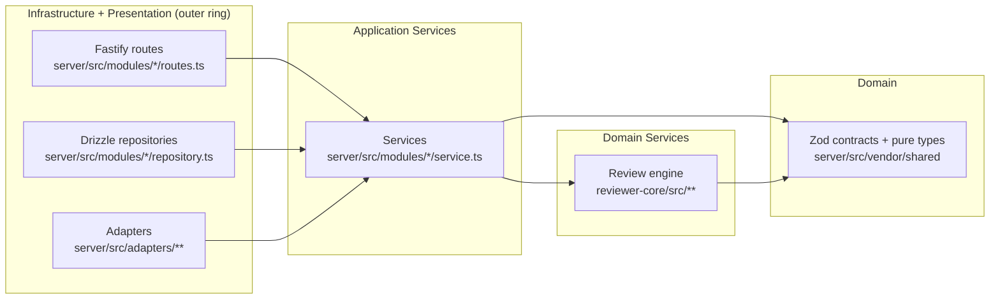

## When to use

Trigger this skill when:

- Adding a new module under `server/src/modules/`.
- Deciding where a piece of code belongs — route vs service vs repository vs adapter.
- Designing a new port (interface) or adapter (external integration).
- Reviewing a module for layering violations.
- Answering "service vs repository?", "where should this code live?", "why can't services import Drizzle?".

## The Dependency Rule

> **Source code dependencies only point inward.** Outer rings may depend on inner rings; inner rings must not know about outer rings.

This is the single invariant that holds the architecture together. Every other rule in this skill is a corollary.

Sources: Palermo (2008), Uncle Bob (2012), Microsoft Learn — see [rules/references.md](rules/references.md).

## The four rings

Arrows point **inward**: outer rings depend on inner rings, never the reverse. `Domain` has zero framework imports; `Infrastructure + Presentation` is the only place real SDKs, Fastify, Drizzle, and `node:*` modules appear.

## Mapping to DevDigest

| Onion ring | DevDigest location | Rule |
|---|---|---|
| Domain (entities, Zod contracts, pure types) | `server/src/vendor/shared`, local `types.ts` next to a module | No Drizzle imports. No Fastify imports. No `node:fs`, no `fetch`. |
| Domain Services | `reviewer-core/src/**` | Pure. Receives an `LLMProvider` port by argument. Emits no JS. |
| Application Services | `server/src/modules/<name>/service.ts` | Depends only on port interfaces via `app.container`. Unit-testable with plain object mocks. |
| Ports (interfaces) | Declared inward — co-located with the service that needs them, or in `server/src/platform/container.ts` for cross-cutting ones | Interface lives inward; implementation lives outward. |
| Infrastructure adapters | `server/src/adapters/{llm,github,git,astgrep,tokenizer,secrets,codeindex,embedder,depgraph,auth}` | May import SDKs, `node:*`, network libs. Must implement a port. Mocks live in `server/src/adapters/mocks.ts`. |
| Persistence adapter | `server/src/modules/<name>/repository.ts` (+ optional `repository/*.ts` sub-repos) | **Only** place Drizzle is imported inside a module. |
| Presentation | `server/src/modules/<name>/routes.ts` | Thin. Zod schemas + handler that calls `app.container` → service. |
| Composition root | `server/src/platform/container.ts` + `server/src/modules/index.ts` | Only place concrete adapters are instantiated. Tests pass `ContainerOverrides` here. |

## Rule files

Read these in order for a new module; skim selectively for review/debugging.

- [rules/dependency-rule.md](rules/dependency-rule.md) — the inward-only rule, with good/bad import examples.
- [rules/module-layout.md](rules/module-layout.md) — idealised layout for `server/src/modules/<feature>/`.
- [rules/ports-and-adapters.md](rules/ports-and-adapters.md) — ports inward, adapters outward; the DI container.
- [rules/testing.md](rules/testing.md) — hermetic unit tests vs `*.it.test.ts` integration tests.
- [rules/anti-patterns.md](rules/anti-patterns.md) — 12 violations with one-line fixes.
- [rules/pragmatism.md](rules/pragmatism.md) — when NOT to apply full onion (CRUD escape hatch).
- [rules/references.md](rules/references.md) — the six authoritative sources behind this skill.

## Core principles

- **Dependencies point inward.** Always.
- **Ports inward, adapters outward.** Services depend on interfaces; the container wires concrete adapters.
- **Databases and frameworks are details.** Not the centre. Swapping ORM or HTTP framework must not force domain changes.
- **Testability is a consequence.** If the service needs Docker, keys, or network to run a unit test, something is in the wrong ring.
