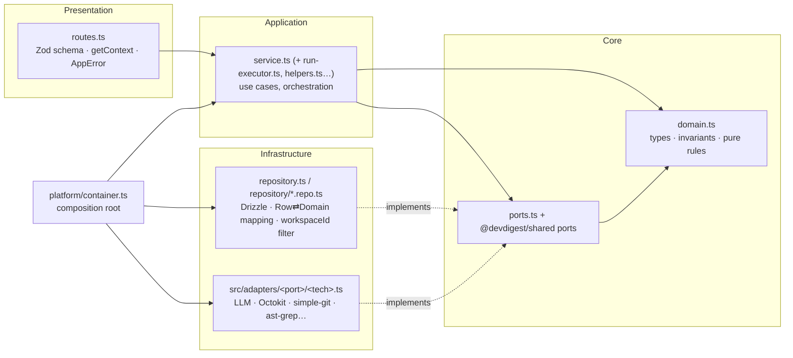

# Onion Architecture — DevDigest backend

**One rule:** source code dependencies point **inward only**. The core knows nothing about Fastify,
Drizzle, Postgres, SDKs, the container or `process.env`. Outer rings implement interfaces that inner
rings define, and the composition root (`platform/container.ts`) wires them together.

This skill *adds* layering to the conventions in `server/CLAUDE.md` — it never contradicts them. Read
that file first; existing naming (`routes.ts → service.ts → repository.ts`, `<Domain>Service`,
`adapters/<port>/<tech>.ts`, `AppError`, `*.it.test.ts`) stays.

## The rings of one module (`server/src/modules/<name>/`)



| Ring | Files | May import | Must NOT import |
|---|---|---|---|
| **Domain** (core) | `domain.ts` or `domain/` | other domain files, `import type` from `@devdigest/shared` | fastify, drizzle-orm, postgres, zod runtime, `db/*`, `adapters/*`, `platform/*`, `container`, `node:fs`, `process.env` |
| **Ports** (core) | `ports.ts`; external ports in `@devdigest/shared` (`LLMProvider`, `GitHubClient`, `GitClient`, `CodeIndex`, `SecretsProvider`…) | domain, `import type` from shared | anything infrastructural |
| **Application** | `service.ts`, `run-executor.ts`, `helpers.ts`, `constants.ts`, kebab role files | domain, ports, `@devdigest/shared` (DTOs + Zod), `platform/errors.ts`, `import type { Container }` | `drizzle-orm`, `db/schema`, `db/client`, `db/rows` (warn), `adapters/*`, another module's folder |
| **Infrastructure** | `repository.ts`, `repository/*.repo.ts`, `src/adapters/**` | Drizzle, `db/*`, SDKs, domain, ports | routes, services; adapters must not import `modules/*` or the container |
| **Presentation** | `routes.ts` | its own service, `_shared/{context,schemas}`, `@devdigest/shared` Zod, `platform/errors.ts` | `drizzle-orm`, `db/*`, repositories, `adapters/*` |
| **Composition root** | `platform/container.ts`, `modules/index.ts`, `app.ts` | everything | — |

`modules/_shared/` is shared presentation/application glue (context, route schemas) — not a dumping
ground for domain logic of several modules.

## Hard rules (apply to all new and changed code)

1. **Routes are thin.** Parse with Zod (`schema: { params, body, querystring }`), call `getContext`,
   call one service method, return its DTO. No `container.db`, no `t.*` tables, no business `if`s.
2. **Only repositories touch Drizzle.** `drizzle-orm`, `db/schema`, `db/client` are imported only in
   `repository.ts` / `repository/*.repo.ts`. Repositories return **domain types or DTO-ready shapes**,
   never leak `$inferSelect` rows upward. The `workspaceId` filter lives here (see `server/INSIGHTS.md`).
3. **Services depend on ports, receive narrow deps.** New services take
   `deps: Pick<Container, 'agentsRepo' | 'llm' | …>` (or an explicit interface), never the whole
   `Container`, and never `new XRepository(container.db)` — get repos from container getters.
4. **Adapters are behind ports.** A service never imports `src/adapters/**`. Need a new capability →
   define the port (in `ports.ts`, or `@devdigest/shared` if cross-package — ask first, vendor is
   do-not-touch), implement `adapters/<port>/<tech>.ts`, add a lazy getter + override in `container.ts`,
   add `Mock<Port>` to `adapters/mocks.ts`.
5. **Domain is pure.** Invariants and decisions (status derivation, severity rollups, version-bump
   rules, cost math) live in `domain.ts` as plain functions over plain types — unit-testable without
   Docker. Use `import type` only from `@devdigest/shared`.
6. **Validate at the edges, trust inside.** Zod parses HTTP input (route schema), LLM output, env/config,
   and JSON columns read from DB. Inner rings receive already-typed values and don't re-parse.
7. **Errors flow outward as `AppError`.** Domain/application throw `AppError` subclasses (or return
   results); routes never call `reply.status` ad hoc; the global handler builds the envelope.
8. **No cross-module imports.** Cross-module data goes through container getters (`agentsRepo`,
   `reviewRepo`, `repoIntel`). Shared constants needed by several modules → move to the owning
   module's facade or `@devdigest/shared` (coordinate).
9. **Side effects are ports too.** `JobRunner`, `RunBus`, clock/IDs, filesystem reads used by use cases
   are injected; job handlers are application code that call services, not Drizzle.
10. **Don't over-engineer.** Simple read-only CRUD may skip `domain.ts`, but never skip the
    routes → service → repository chain.

## Workflows

### New module
1. Create `modules/<name>/` with `domain.ts` (if there are rules), `ports.ts` (repository interface the
   service needs), `repository.ts` (`<Domain>Repository implements <Port>`), `service.ts`, `routes.ts`.
2. Register the repository as a lazy getter in `platform/container.ts` (+ `ContainerOverrides` entry
   if tests must swap it); register the plugin in `modules/index.ts`.
3. Tests: `test/<name>-domain.test.ts` (pure), `test/<name>-service.test.ts` (fake ports),
   `test/<name>-routes.it.test.ts` via `app.inject` (see `references/testing.md`).
4. Run the layer check (below) — zero new violations.

### New query / table
Repository method first (named after intent: `listOpenByRepo`, not `selectPulls`), mapping inside the
repository, then expose via the port. Migration only via `pnpm db:generate` (never hand-edit).

### New external service (SDK, CLI, API)
Port → adapter `adapters/<port>/<tech>.ts` (`<Tech><Port>`) → container getter (secrets via
`container.secrets`) → `Mock<Port>`. Service sees only the port.

### Reviewing a backend PR
Walk the diff ring by ring with the table above; run the layer check; flag each violation with the
rule number and the "good" shape from `examples.md`.

## Layer check (dependency-cruiser, already a dependency)

Rules: `server/.dependency-cruiser.cjs`. Baseline: `server/architecture-baseline.json`.
CI: `.github/workflows/server-unit.yml` → job `architecture`. From `server/` (Windows-safe, no
package.json scripts):

```bash
node scripts/check-architecture.mjs            # fails only on NEW error-level violations
node scripts/check-architecture.mjs --update   # after FIXING violations: shrink the baseline
node node_modules/dependency-cruiser/bin/dependency-cruise.mjs src --output-type err   # full raw report
```

- The codebase has known legacy violations (27 at creation: 24 errors, 3 warnings), listed in
  `architecture-baseline.json` and explained in `examples.md` § Known violations. **Don't add new ones.**
- When you touch a file with a legacy violation, fix it if it's in scope. Then run `--update` and
  commit the smaller baseline. If it's out of scope, leave it and mention it.
- **The baseline may only shrink.** On PRs CI fails if `architecture-baseline.json` contains a key the
  base branch's baseline doesn't have. Never run `--update` to absorb a new violation.
- Baseline keys are `rule|from|to`, and an npm target is reduced to `node_modules/<package>`. So
  dependency upgrades (pnpm paths carry versions and entry files) don't invalidate the baseline. That's
  why we don't use depcruise's own `--ignore-known`.

## Read when

| Situation | File |
|---|---|
| Writing routes, plugins, hooks, decorators | `references/fastify.md` |
| Writing repositories, queries, transactions, mapping | `references/drizzle.md` |
| Deciding where Zod parsing / types live | `references/zod.md` |
| Adding an SDK/CLI integration or a port | `references/adapters.md` |
| Background jobs, SSE, fire-and-forget runs | `references/jobs-and-sse.md` |
| Testing per ring | `references/testing.md` |
| Good/bad code from this repo, known violations | `examples.md` |
| Background reading, rationale | `references/sources.md` |

Related skills: `fastify-best-practices`, `drizzle-orm-patterns`, `zod`, `postgresql-table-design`,
`typescript-expert` (tool-level detail); this skill decides **where** code goes.
