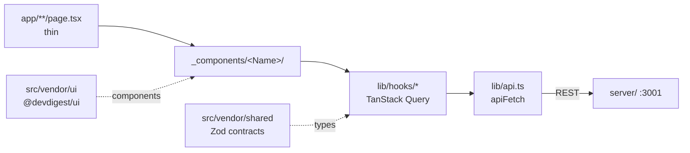

# client — architecture

The route map is in the [package README](../README.md); the system overview is
in the [main README](../../README.md#architecture) and the cross-package rules in the
[repo architecture](../../docs/architecture.md). This document covers the
data layer and the boundary with the API.

## Data flow

- `lib/api.ts` is the only module that calls `fetch`. `apiFetch` sets
  `content-type: application/json` only when a body is sent, because Fastify
  rejects a body-less request that declares JSON.
- Every failure is normalised to `ApiError` (`status`, `code`, `details`). An
  unreachable API becomes status `0` with code `network_error`; UI error
  handling branches on these, so keep new calls on `apiFetch`.
- Hooks live in `lib/hooks/`, grouped by domain (`core`, `agents`, `reviews`,
  `repo-intel`, `trace`). The query client defaults are set once in
  `lib/providers.tsx` (30 s stale time, one retry).
- Types for API data come from the client copy of `@devdigest/shared`.

## Boundary with the server

- The client never imports server code; the only contact is HTTP.
- `src/vendor/shared` is a separate copy of the server's contracts. The server
  copy is what the API validates against; mirror contract changes here.
- `NEXT_PUBLIC_API_BASE` is inlined at build time (default
  `http://localhost:3001`).

## What tests do and do not cover

Component tests mock `fetch`, so they prove rendering and interaction but not
the real API contract. Whole journeys run in [`../../e2e`](../../e2e/README.md),
whose flows assert on visible text and URLs.

## Adding a milestone screen

Add the route under `src/app/`, put logic in `_components/<Name>/` with a test
beside it, add hooks to `lib/hooks/`, and add strings to `messages/en/`. Write
the spec in [`../specs/`](../specs/README.md) first.
