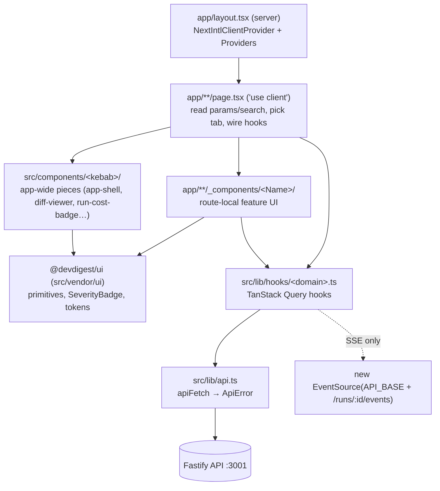
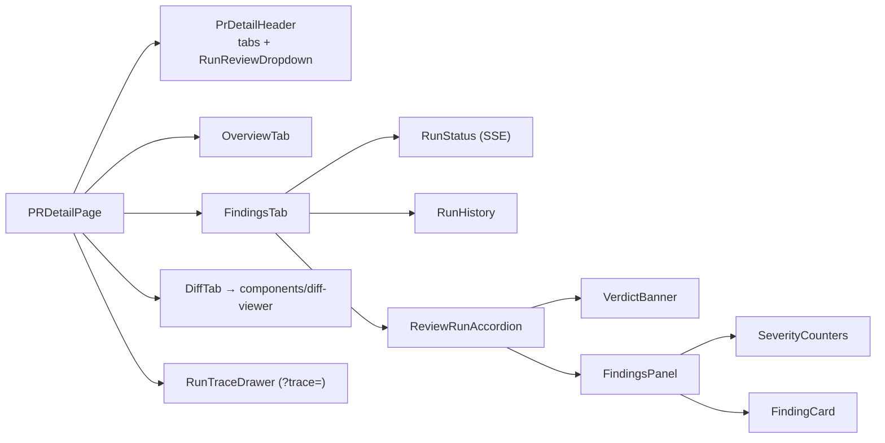

# Client architecture — routes → pages → `_components` → hooks → api

How a screen is put together and where each kind of code goes. The route map and the list of API calls per route are
in the package [README](../README.md). Folder and file naming rules are in [`../CLAUDE.md`](../CLAUDE.md) § Naming
conventions.

## Layers

| Layer | Location | Rule |
|---|---|---|
| Root layout | `src/app/layout.tsx:14 → RootLayout` | A server component. Loads next-intl messages, wraps the app in `NextIntlClientProvider` → `Suspense` → `Providers`. Sets `data-theme` before paint (`themeNoFlashScript`). |
| Providers | `src/lib/providers.tsx:21 → Providers` | One `QueryClient` (retry 1, `staleTime` 30s, no refetch on focus) → `ThemeProvider` → `ToastProvider` → `RepoProvider`. |
| Pages | `src/app/**/page.tsx` | `"use client"`, thin. They resolve route params, keep tab state in the query string, and pass data and callbacks down. Example: `src/app/repos/[repoId]/pulls/[number]/page.tsx:26 → PRDetailPage`. |
| Route-local components | `src/app/**/_components/<Name>/` | Feature UI for one route. Subcomponents nest in `<Name>/_components/`. |
| Shared components | `src/components/<kebab>/` | Used by several routes: `app-shell` (nav, breadcrumbs, `g`-key shortcuts), `diff-viewer`, `page-shell`, `run-cost-badge`, `severity-tally` (non-zero severity icon+count chips: PR-list FINDINGS, Timeline tiles), `showcase`. |
| Hooks | `src/lib/hooks/*.ts` | The only code that calls `api.*`. Barrel at `src/lib/hooks/index.ts`. |
| API client | `src/lib/api.ts:21 → apiFetch`, `:65 → api` | Adds `content-type: application/json` only when a body is sent. Network failure → `ApiError(status 0, 'network_error')`. Non-2xx → reads the server envelope `{error:{code,message,details}}`. 204 → `undefined`. |
| Contracts | `@devdigest/shared` (`src/vendor/shared`), re-exported by `src/lib/types.ts` | Wire types are snake_case (`start_line`, `run_id`). |

## Worked example — the PR detail page

`/repos/:repoId/pulls/:number` → `src/app/repos/[repoId]/pulls/[number]/page.tsx`

1. The URL has the PR **number**, but every PR endpoint takes the row **uuid**. The page loads `usePulls(repoId)`
   and maps number → `prId` (`page.tsx:35-36`). Then `usePullDetail(prId)`, `usePrReviews(prId)`,
   `usePrActiveRuns(prId)`, `usePrRuns(prId)`.
2. The tab lives in `?tab=` (`overview` | `findings` | `diff`, default `overview`). The trace drawer lives in
   `?trace=<runId>`. Both are written with `router.replace` (`page.tsx:60-68`).
3. Tabs come from `PrDetailHeader` (`_components/PrDetailHeader/PrDetailHeader.tsx:115-119`). The labels "Overview",
   "Agent runs", "Files changed" are hard-coded English strings. The keys are `overview`/`findings`/`diff`.
4. `FindingsTab` → `RunHistory` (Timeline; severity icons per run from `severityByRun`) and `ReviewRunAccordion` (one per review run) → `FindingsPanel` → `SeverityCounters` + `FindingCard`s.
   Live runs show `RunStatus` (SSE) and call `onRunDone` (`page.tsx:156-160`). That callback invalidates active runs and
   run history and refetches reviews.
5. `RunTraceDrawer` (default export) shows the live log over SSE while the run is going. After that it shows the stored
   trace (`useRunTrace(runId, !stillRunning)`, `RunTraceDrawer.tsx:49`).

## Cross-cutting rules
- **i18n**: `src/i18n/request.ts:16 → loadMessages` reads **every** `messages/<locale>/*.json`. The file name becomes
  the namespace. There is one locale (`en`) and no locale routing. Components call `useTranslations("<ns>")`.
  Components shown in `/showcase` must not call it (the smoke test has no intl provider). They take strings as props.
- **Errors**: the global `QueryCache.onError` toasts only on network errors or 5xx. 4xx query errors stay inline.
  Every mutation error toasts (`providers.tsx:35-43`). SSE `error` events are toasted separately inside
  `useRunEvents`.
- **Root redirect**: `src/app/page.tsx:15-19 → HomePage` sends you to the **first** repo's `/pulls` when any repo exists.
  Otherwise it shows an empty state with a link to `/onboarding`. e2e flows rely on this.
- **Design system**: import from the `@devdigest/ui` barrel only. See [`../src/vendor/ui/README.md`](../src/vendor/ui/README.md).

## Related
- How hooks fetch, poll, and stream → [data-fetching.md](data-fetching.md)
- UI feature specs → [`../specs/`](../specs/README.md)
