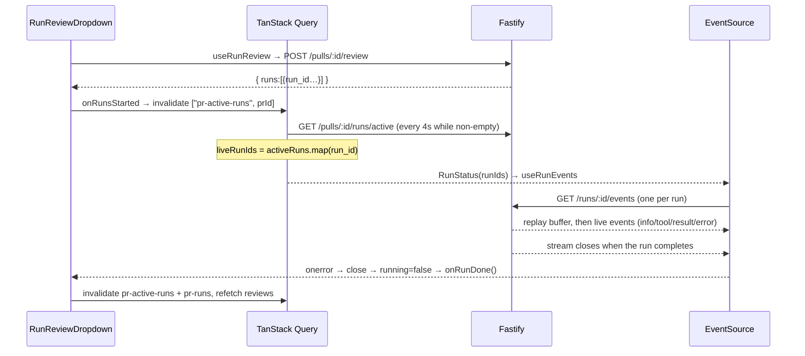

# Data fetching — TanStack Query hooks, polling, SSE

Every server call goes through a hook in `src/lib/hooks/*` → `api.*` (`src/lib/api.ts`). The one exception is the SSE
stream. This doc lists the hooks, their query keys, and how live review progress is tracked. Layering is in
[architecture.md](architecture.md).

## QueryClient defaults
`src/lib/providers.tsx:21-45`: `retry: 1`, `staleTime: 30_000`, `refetchOnWindowFocus: false` (some hooks turn it back
on). Error toasts: queries toast on network errors or 5xx only, mutations always.

## Hook catalogue

| File | Query hooks (key) | Mutation hooks → keys invalidated |
|---|---|---|
| `core.ts` | `useSettings` (`["settings"]`), `useSecretsStatus` (`["secrets-status"]`), `useRepos` (`["repos"]`), `usePulls` (`["pulls", repoId]`, **60s refetch + on focus**, `core.ts:102`), `usePullDetail` (`["pull", prId]`), `useContextFiles` (`["context", repoId]`) | `useUpdateSettings`, `useTestConnection` → `provider-models`, `secrets-status`; `useAddRepo`/`useDeleteRepo` → `repos`; `useRefreshRepo` → `repos`, `["pulls", repoId]`; `useReindexContext` → `["context", repoId]` |
| `agents.ts` | `useAgents` (`["agents"]`), `useAgent` (`["agent", id]`), `useProviderModels` (`["provider-models", provider]`) | `useCreateAgent`/`useUpdateAgent` → `agents`; `useDeleteAgent` → `agents` + removes `["agent", id]` |
| `reviews.ts` | `usePrActiveRuns` (`["pr-active-runs", prId]`), `usePrRuns` (`["pr-runs", prId]`), `usePrReviews` (`["reviews", prId]`), `usePrComments` (`["pr-comments", prId]`) | `useRunReview` → `["reviews", prId]`; `useFindingAction` → `["reviews", prId]` (only if `prId` passed); `useDeleteRun` → `pr-runs` + `reviews`; `useDeleteReview` → `reviews`; `useCreatePrComment` → `pr-comments`; `useCancelRun` → nothing |
| `trace.ts` | `useRunTrace(runId, enabled)` (`["run-trace", runId]`, `trace.ts:12`) | — |
| `repo-intel.ts` | `useRepoIntelStatus(repoId, poll)` (`["repo-intel-state", repoId]`, 1.5s refetch when `poll`, `repo-intel.ts:31`) | `useResyncRepoIntel` → `repo-intel-state` |

Notes:
- Most hooks use `enabled: !!id`, so they wait for the id. `usePullDetail` uses `prId != null`.
- Invalidation must use the exact key string. `"pull"` (detail) and `"pulls"` (list) are different keys.
- In the starter, `useRepoIntelStatus` and `useResyncRepoIntel` are defined but no component calls them (grep `src/app`,
  `src/components`).

## Live review progress — three mechanisms working together

1. **Server-side source of truth, polled**: `usePrActiveRuns` (`src/lib/hooks/reviews.ts:28`) polls every 4s
   **only while** the list is non-empty. `usePrRuns` (`reviews.ts:40`) polls every 4s while any run has
   `status === "running"`. Both read DB-backed endpoints, so live tracking survives reloads and navigation
   (`page.tsx:42-49`).
2. **SSE for the live log**: `useRunEvents(runIds)` (`reviews.ts:168`) opens one `EventSource` per run id at
   `${API_BASE}/runs/${runId}/events`. It listens to `onmessage` **and** the named events `info|tool|result|error`,
   because the server sets the SSE `event:` name to the kind. Events go into one array. `error`-kind events also call
   `notify.error`. The server buffers and replays, so a late subscriber still gets the full log.
3. **End of run**: the server ends the stream after `runBus.complete`. The browser reports that as `onerror`. The hook
   closes that source (so `EventSource` doesn't auto-reconnect) and sets `running=false` when all sources are closed
   (`reviews.ts:200-204`). `RunStatus` (`_components/RunStatus/RunStatus.tsx:23-26`) fires `onDone` on the
   running→stopped edge, and the page refreshes its queries (`page.tsx:156-160`).

Because `onerror` means "finished", a dropped connection in the middle of a run looks like completion too. Polling
(mechanism 1) corrects the UI on its next tick. Don't add a fourth mechanism. Extend these.

## Adding a call
1. Add the endpoint's contract type to `@devdigest/shared` usage. Never redefine it locally unless the type is
   missing from the vendored copy. If so, document it like `RepoIntelState` in `repo-intel.ts`.
2. Add `useX` / `use<Verb>X` to the matching `src/lib/hooks/<domain>.ts`. Use `[kebab-key, id]` and `enabled: !!id`.
3. In mutations, invalidate every key whose data the server changes (see `useDeleteRun`: deleting a run also deletes
   its review).
4. In component tests, mock the hook module with `vi.mock` on its relative path (example:
   `FindingsPanel/FindingsPanel.test.tsx:7` mocks `lib/hooks/reviews`). `src/test/setup.ts` only installs jest-dom and
   a `ResizeObserver` stub. It does **not** mock `fetch` globally, so an unmocked hook would make a real request.
