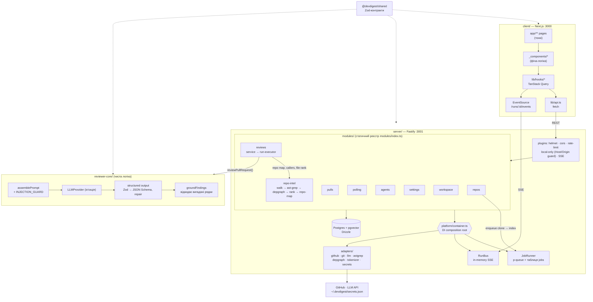
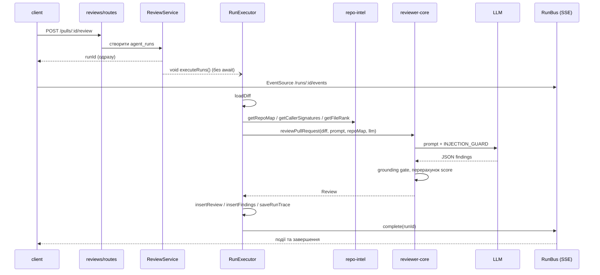

# Онбордінг: DevDigest (starter)

## 1. Що це і навіщо

**DevDigest** — інструмент для AI-рев'ю pull request'ів, який працює локально. Цей репозиторій — **стартовий шаблон**. Він робить одну річ від початку до кінця: імпортує PR з GitHub і проганяє на ньому рев'ю LLM-агентом. Результат — структуровані findings із severity та score.

Схоже, що проєкт навчальний або курсовий. У README є роадмап M1–M8, і кожен milestone повертає одну фічу: skills, blast radius, MCP-сервер, eval, multi-agent тощо. Тому в коді багато "заготовок під майбутнє". Детальніше про це в розділі 5.

Основний сценарій: **додати репо → сервер клонує та індексує його → імпортувати PR → натиснути Review → отримати findings у UI**. Назовні йдуть лише запити до GitHub і до LLM.

## 2. Технологічний стек

| Шар | Технології |
|---|---|
| **client/** (`:3000`) | Next.js 15 (App Router), React 19, TanStack Query, next-intl, recharts, mermaid, react-markdown |
| **server/** (`:3001`) | Fastify 5, Drizzle ORM, Postgres 16 + pgvector, Zod (`fastify-type-provider-zod`), SSE (`fastify-sse-v2`), p-queue |
| **reviewer-core/** | Чистий TypeScript, без БД і файлової системи. LLM підключається через ін'єкцію |
| **Аналіз коду** | `@ast-grep/napi` (символи), `dependency-cruiser` (граф імпортів), `graphology` (PageRank), `@vscode/ripgrep`, `js-tiktoken` |
| **Зовнішні сервіси** | Octokit (GitHub), `simple-git`, OpenAI / Anthropic SDK, OpenRouter |
| **Тести** | vitest, testcontainers (справжній Postgres), agent-browser для e2e |
| **Інфраструктура** | Docker піднімає тільки Postgres. Решта запускається на хості через `./scripts/dev.sh`. CI — 5 workflow'ів GitHub Actions із path-фільтрами |

## 3. Як модулі пов'язані між собою

### Покроково, як проходить рев'ю

## 4. Ключові особливості (спроєктовані свідомо)

- **Три пакети без монорепо-workspace.** У кожного свій `package.json` і свій lockfile. Код між ними ділиться через **tsconfig path aliases**. `server` імпортує вихідний код `reviewer-core` напряму: `@devdigest/reviewer-core → ../reviewer-core/src`. Тому `build` у reviewer-core — це лише typecheck.
- **Composition root і DI.** Усі адаптери проходять через [container.ts](../server/src/platform/container.ts) і створюються ліниво. Для тестів туди передають overrides — моки з `adapters/mocks.ts`. Модулі не лізуть у чужі папки: спільні репозиторії беруться з контейнера (`container.agentsRepo`, `container.reviewRepo`).
- **Zod як єдине джерело правди.** Ті самі схеми валідують запити (невалідний запит отримує 422 ще до хендлера), серіалізують відповіді й описують структурований вихід LLM.
- **Grounding gate.** Finding без реального рядка в diff відкидається. Score, який повертає модель, ігнорується і рахується наново з тих findings, що лишилися.
- **Захист від prompt-injection** — одне довірене правило `INJECTION_GUARD` у системному промпті. Свідомо немає keyword-сканування, бо такий denylist ловить лише одне формулювання.
- **repo-intel індексує заздалегідь, на clone/fetch.** Під час рев'ю він тільки читає готові дані. Якщо репо не проіндексоване, рев'ю просто йде по самому diff, без помилки.
- **Безпека для localhost.** API без автентифікації слухає тільки `127.0.0.1`. Від DNS rebinding захищає перевірка `Host`/`Origin` у [local-only.ts](../server/src/platform/local-only.ts). Секрети лежать у `~/.devdigest/secrets.json` з правами `0600` — не в БД і не в git.
- **Фонові задачі двох видів.** Clone і index йдуть через `JobRunner` (p-queue, дублюються в таблицю `jobs`, з retry). А рев'ю — це просто `void executor.executeRuns()` в тому самому процесі. Під час старту сервер прибирає «осиротілі» run'и в статусі `running`.
- **Тести розділені за назвою файлу.** `*.it.test.ts` працюють із справжнім Postgres через testcontainers. Усе інше герметичне. e2e детерміновані й без LLM.

## 5. Дивні частини (на що звернути увагу)

1. **Контракти `@devdigest/shared` скопійовані двічі й уже розійшлися.** Є [server/src/vendor/shared](../server/src/vendor/shared) і [client/src/vendor/shared](../client/src/vendor/shared). `diff` показує близько 150 рядків різниці. Наприклад, у клієнта `LLMProvider.id` має тип `'openai' | 'anthropic'`, без `openrouter`. Також у клієнтській копії немає `commitFiles`, `sync`, `diffNameOnly`, `sessionId`. Це «спільна» схема, яка насправді не спільна.
2. **reviewer-core бере shared із папки сервера:** `../server/src/vendor/shared`. Формально engine «чистий», але фізично залежить від дерева `server/`.
3. **Схема БД містить таблиці всіх milestone'ів наперед** — 40+ таблиць у `db/schema/*`: eval, ci, skills, knowledge… Більшість із них порожні. Так задумано, але новачка це плутає.
4. **Залишки «майбутнього» коду.** Shim'и [platform/grounding.ts](../server/src/platform/grounding.ts) і [platform/prompt.ts](../server/src/platform/prompt.ts) — це re-export'и, які «зберігають сумісність» для імпортерів, а імпортерів у них фактично немає. Коментарі згадують «CI agent-runner», а його в стартері немає. `@fastify/autoload` стоїть у залежностях, хоча модулі реєструються статично. Executor уміє map-reduce і cancel між файлами.
5. **Три LLM-провайдери в двох місцях.** OpenAI та Anthropic реалізовані як адаптери сервера. OpenRouter живе в `reviewer-core`, і контейнер імпортує його звідти. При цьому кореневий README каже, що LLM викликається «via OpenRouter».
6. **Документація трохи відстає від коду.** README reviewer-core каже, що в стартері передаються тільки diff, system prompt і repo map. Насправді executor також передає callers digest і rank note («high blast-radius»).
7. **RunBus живе в пам'яті.** Якщо сервер рестартне посеред рев'ю, live-лог пропаде, а run прибере reaper. Для локального інструменту це нормально, але про це варто знати.
8. **У `.claude/skills` лежить багато вендорних skills** для AI-асистентів: zod, fastify, drizzle, next… Це не код продукту.

## 6. Що тут цілком стандартне (і зроблено добре)

- Структура модуля: `routes.ts → service.ts → repository.ts`, плюс `constants/helpers`. Fastify-плагін на кожну фічу.
- Клієнт: тонкі сторінки, логіка в колокованих `_components/<Name>/` з тестами поруч, усі дані йдуть через `lib/hooks`.
- Drizzle-міграції не запускаються автоматично на старті (`pnpm db:migrate`). Seed ідемпотентний.
- Конфіг запускається без жодного ключа: усі секрети опціональні.
- Rate-limit глобальний, а для дорогих ендпоінтів (`POST /pulls/:id/review`) ліміт жорсткіший.

## 7. З чого почати читати

1. [README.md](../README.md) і [TESTING.md](../TESTING.md)
2. [server/src/app.ts](../server/src/app.ts) → [modules/index.ts](../server/src/modules/index.ts) → [platform/container.ts](../server/src/platform/container.ts)
3. Головний flow: [reviews/service.ts](../server/src/modules/reviews/service.ts) → [reviews/run-executor.ts](../server/src/modules/reviews/run-executor.ts) → [reviewer-core/src/review/run.ts](../reviewer-core/src/review/run.ts) → [prompt.ts](../reviewer-core/src/prompt.ts) і [grounding.ts](../reviewer-core/src/grounding.ts)
4. [repo-intel/README.md](../server/src/modules/repo-intel/README.md) і папка `pipeline/`
5. Клієнт: [lib/api.ts](../client/src/lib/api.ts), [lib/hooks/reviews.ts](../client/src/lib/hooks/reviews.ts) (там SSE), сторінка `app/repos/[repoId]/pulls/[number]`
6. Запуск: `./scripts/dev.sh`, потім http://localhost:3000
