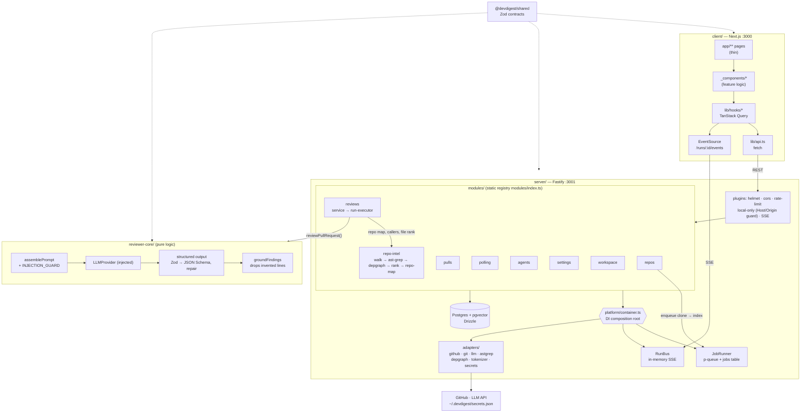
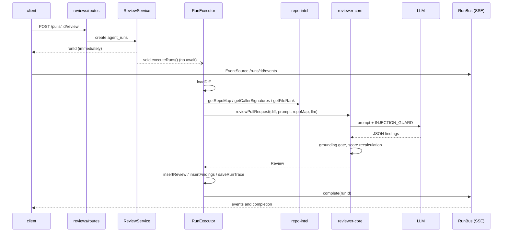

# Onboarding: DevDigest (starter)

## 1. What it is and why

**DevDigest** is a tool for AI review of pull requests that runs locally. This repository is a **starter template**. It does one thing end to end: it imports a PR from GitHub and runs a review on it with an LLM agent. The result is structured findings with a severity and a score.

The project looks like a learning or course project. The README has an M1–M8 roadmap, and each milestone brings back one feature: skills, blast radius, an MCP server, eval, multi-agent and so on. That is why the code contains many "placeholders for the future". See section 5 for details.

The main scenario: **add a repo → the server clones and indexes it → import a PR → click Review → get findings in the UI**. The only outbound requests go to GitHub and to the LLM.

## 2. Tech stack

| Layer | Technologies |
|---|---|
| **client/** (`:3000`) | Next.js 15 (App Router), React 19, TanStack Query, next-intl, recharts, mermaid, react-markdown |
| **server/** (`:3001`) | Fastify 5, Drizzle ORM, Postgres 16 + pgvector, Zod (`fastify-type-provider-zod`), SSE (`fastify-sse-v2`), p-queue |
| **reviewer-core/** | Pure TypeScript, no DB and no file system. The LLM is plugged in by injection |
| **Code analysis** | `@ast-grep/napi` (symbols), `dependency-cruiser` (import graph), `graphology` (PageRank), `@vscode/ripgrep`, `js-tiktoken` |
| **External services** | Octokit (GitHub), `simple-git`, OpenAI / Anthropic SDK, OpenRouter |
| **Tests** | vitest, testcontainers (real Postgres), agent-browser for e2e |
| **Infrastructure** | Docker runs only Postgres. Everything else runs on the host via `./scripts/dev.sh`. CI — 5 GitHub Actions workflows with path filters |

## 3. How the modules connect

### Step by step: how a review runs

## 4. Key features (designed on purpose)

- **Three packages without a monorepo workspace.** Each has its own `package.json` and its own lockfile. Code is shared between them via **tsconfig path aliases**. `server` imports the `reviewer-core` source code directly: `@devdigest/reviewer-core → ../reviewer-core/src`. That is why `build` in reviewer-core is only a typecheck.
- **Composition root and DI.** All adapters go through [container.ts](../server/src/platform/container.ts) and are created lazily. Tests pass overrides into it — mocks from `adapters/mocks.ts`. Modules don't reach into each other's folders: shared repositories come from the container (`container.agentsRepo`, `container.reviewRepo`).
- **Zod as the single source of truth.** The same schemas validate requests (an invalid request gets a 422 before reaching the handler), serialize responses and describe the LLM's structured output.
- **Grounding gate.** A finding without a real line in the diff is dropped. The score the model returns is ignored and recalculated from the findings that remain.
- **Prompt-injection protection** is a single trusted rule, `INJECTION_GUARD`, in the system prompt. There is deliberately no keyword scanning, because such a denylist only catches one phrasing.
- **repo-intel indexes ahead of time, on clone/fetch.** During a review it only reads prepared data. If the repo isn't indexed, the review simply runs on the diff alone, without an error.
- **Localhost security.** The API has no authentication and listens only on `127.0.0.1`. DNS rebinding is blocked by the `Host`/`Origin` check in [local-only.ts](../server/src/platform/local-only.ts). Secrets live in `~/.devdigest/secrets.json` with `0600` permissions — not in the DB and not in git.
- **Two kinds of background tasks.** Clone and index go through `JobRunner` (p-queue, mirrored to the `jobs` table, with retries). A review, however, is just `void executor.executeRuns()` in the same process. On startup the server cleans up "orphaned" runs left in the `running` status.
- **Tests are split by file name.** `*.it.test.ts` run against a real Postgres via testcontainers. Everything else is hermetic. e2e tests are deterministic and use no LLM.

## 5. Odd parts (what to watch out for)

1. **The `@devdigest/shared` contracts are copied twice and have already diverged.** There is [server/src/vendor/shared](../server/src/vendor/shared) and [client/src/vendor/shared](../client/src/vendor/shared). `diff` shows about 150 lines of difference. For example, on the client `LLMProvider.id` has the type `'openai' | 'anthropic'`, without `openrouter`. The client copy also lacks `commitFiles`, `sync`, `diffNameOnly`, `sessionId`. It is a "shared" schema that isn't actually shared.
2. **reviewer-core takes shared from the server folder:** `../server/src/vendor/shared`. Formally the engine is "pure", but physically it depends on the `server/` tree.
3. **The DB schema contains the tables of all milestones up front** — 40+ tables in `db/schema/*`: eval, ci, skills, knowledge… Most of them are empty. This is by design, but it confuses newcomers.
4. **Leftovers of "future" code.** The shims [platform/grounding.ts](../server/src/platform/grounding.ts) and [platform/prompt.ts](../server/src/platform/prompt.ts) are re-exports that "preserve compatibility" for importers, yet they effectively have no importers. Comments mention a "CI agent-runner" that doesn't exist in the starter. `@fastify/autoload` is in the dependencies, although modules are registered statically. The executor can do map-reduce and cancel between files.
5. **Three LLM providers in two places.** OpenAI and Anthropic are implemented as server adapters. OpenRouter lives in `reviewer-core`, and the container imports it from there. Meanwhile the root README says the LLM is called "via OpenRouter".
6. **The documentation lags slightly behind the code.** The reviewer-core README says the starter passes only the diff, the system prompt and the repo map. In reality the executor also passes a callers digest and a rank note ("high blast-radius").
7. **RunBus lives in memory.** If the server restarts mid-review, the live log is lost and the run is cleaned up by the reaper. That's fine for a local tool, but worth knowing.
8. **`.claude/skills` holds many vendored skills** for AI assistants: zod, fastify, drizzle, next… They are not product code. The exception is our own `engineering-insights` skill, which maintains the per-module INSIGHTS.md files.

## 6. What is entirely standard here (and done well)

- Module structure: `routes.ts → service.ts → repository.ts`, plus `constants/helpers`. One Fastify plugin per feature.
- Client: thin pages, logic in colocated `_components/<Name>/` with tests alongside, all data goes through `lib/hooks`.
- Drizzle migrations don't run automatically on startup (`pnpm db:migrate`). The seed is idempotent.
- The config starts without a single key: all secrets are optional.
- Rate limiting is global, with a stricter limit for expensive endpoints (`POST /pulls/:id/review`).

## 7. Where to start reading

1. [README.md](../README.md) and [TESTING.md](../TESTING.md)
2. [server/src/app.ts](../server/src/app.ts) → [modules/index.ts](../server/src/modules/index.ts) → [platform/container.ts](../server/src/platform/container.ts)
3. The main flow: [reviews/service.ts](../server/src/modules/reviews/service.ts) → [reviews/run-executor.ts](../server/src/modules/reviews/run-executor.ts) → [reviewer-core/src/review/run.ts](../reviewer-core/src/review/run.ts) → [prompt.ts](../reviewer-core/src/prompt.ts) and [grounding.ts](../reviewer-core/src/grounding.ts)
4. [repo-intel/README.md](../server/src/modules/repo-intel/README.md) and the `pipeline/` folder
5. Client: [lib/api.ts](../client/src/lib/api.ts), [lib/hooks/reviews.ts](../client/src/lib/hooks/reviews.ts) (SSE is there), the page `app/repos/[repoId]/pulls/[number]`
6. Running it: `./scripts/dev.sh`, then http://localhost:3000
