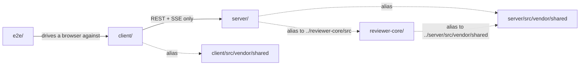
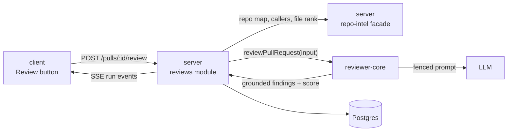

# Architecture — how the packages fit together

The system overview diagram and the day-1 feature list are in the
[main README](../README.md#architecture). This document covers what spans
packages: who may depend on whom, how one review crosses them, who owns what,
and how the documentation is organised. Internals are in each package's own
architecture doc:

[server](../server/docs/architecture.md) ·
[client](../client/docs/architecture.md) ·
[reviewer-core](../reviewer-core/docs/architecture.md) ·
[e2e](../e2e/docs/architecture.md)

## Package dependencies

Four independent packages, no workspace. They share TypeScript source through
tsconfig path aliases; nothing is published or built in between.



Rules that follow from this:

- `client` talks to `server` over HTTP only and never imports server code.
- `reviewer-core` imports nothing from `server` except the shared contracts.
- `e2e` imports no code from any package; it depends on the server's seed data
  and on the client's visible text and routes.
- `@devdigest/shared` has two physical copies. The server copy is the one the
  API validates against; the client copy is kept in step by hand, and the two
  have already drifted (see [`server/INSIGHTS.md`](../server/INSIGHTS.md)).
- Because the server runs `reviewer-core` from source, that package's
  dependencies must be installed for the API to boot.
- A new alias dependency must be added to the `paths:` filter of the affected
  workflow in `.github/workflows/`, or CI will not run for it.

## One review across the packages



The server gathers context and persists results; `reviewer-core` assembles the
prompt, calls the model, grounds the findings and recomputes the score; the
client triggers the run and renders its events. The step-by-step sequence,
failure handling and run reaping are in
[`server/docs/architecture.md`](../server/docs/architecture.md#one-review-run).

## Where each concern is owned

| Concern | Owner | Details |
|---------|-------|---------|
| HTTP, persistence, GitHub, git, secrets | `server/` | [server architecture](../server/docs/architecture.md) |
| Indexing and repo facts | `server/src/modules/repo-intel` | [repo-intel README](../server/src/modules/repo-intel/README.md) |
| Prompt assembly, injection guard, structured output, grounding, scoring | `reviewer-core/` | [reviewer-core architecture](../reviewer-core/docs/architecture.md) |
| Request and response shapes | `@devdigest/shared` | both vendored copies |
| Rendering, data hooks, error states | `client/` | [client architecture](../client/docs/architecture.md) |
| Whole-journey regression checks | `e2e/` | [e2e architecture](../e2e/docs/architecture.md) |

## How a milestone feature lands

A typical feature touches several packages in this order:

1. Contracts in `@devdigest/shared` (both copies).
2. A `server/src/modules/<name>/` plugin using tables that already exist.
3. Optionally a new prompt slot or gate in `reviewer-core`.
4. A screen, hooks and message keys in `client`.
5. An `e2e` flow, if a main journey changes.

Each touched package gets its own spec, with the same file name, in its
`specs/` folder, and the specs link to each other.

## Documentation layout

```
dev-digest/
├── CLAUDE.md            agent map: rules and "read when" pointers
├── README.md            project overview, quick start, roadmap
├── TESTING.md           test and CI strategy
├── docs/
│   ├── README.md        index of every doc in the repo
│   ├── architecture.md  this file: what spans packages
│   └── agent-prompts/   reviewer system prompts
└── <package>/           server, client, reviewer-core, e2e
    ├── CLAUDE.md        package rules, loaded when work happens there
    ├── README.md        what the package is and how to run it
    ├── INSIGHTS.md      lasting facts and session lessons (engineering-insights skill)
    ├── docs/            README.md (index) + architecture.md
    └── specs/           README.md (index) + _template.md + feature specs
```

Each fact has one home. `CLAUDE.md` files hold only short rules and pointers;
READMEs and `docs/` hold the explanations, and are linked rather than copied.
