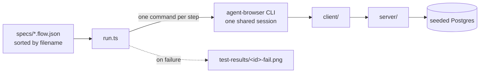

# e2e — architecture

The flow format and how to run the suite are in the
[package README](../README.md); the system overview is in the
[main README](../../README.md#architecture) and the cross-package rules in the
[repo architecture](../../docs/architecture.md). This document covers how the
runner and the hermetic stack work.

## Runner

- `run.ts` loads every flow in `specs/`, sorted by filename, and runs the steps
  in order against one shared browser session, which it closes at the end
  whatever the outcome.
- A step fails when its command exits non-zero or its optional
  `stdoutIncludes` assertion does not match. A failed step takes a screenshot.
- The runner starts nothing itself. It expects a running, seeded stack at
  `E2E_BASE_URL`.

## Hermetic stack (`../../scripts/e2e.sh`)

- Starts an ephemeral Postgres container with no volume, on `:5433`, so the
  seeded demo repo is the only repo.
- Exports `DATABASE_URL`, `API_PORT`, `WEB_PORT` and `NEXT_PUBLIC_API_BASE`
  before spawning anything; already-set env wins over `server/.env`, so the dev
  config is not touched.
- Refuses to migrate or seed unless `DATABASE_URL` points at the isolated port.
- Runs the API with plain `tsx` (no watcher) on `:3101` and the web app on
  `:3100`, then tears everything down on exit, failure or Ctrl-C.
- This script is a local convenience. CI (`e2e-web.yml`) brings up its own
  stack and calls `npm test` directly.

## Dependencies on other packages

- Flows depend on the seed in `server/src/db/seed.ts` and on visible text and
  routes in `client/`. A change to either can break a flow without touching
  this package.
- Nothing here imports code from the other packages.
