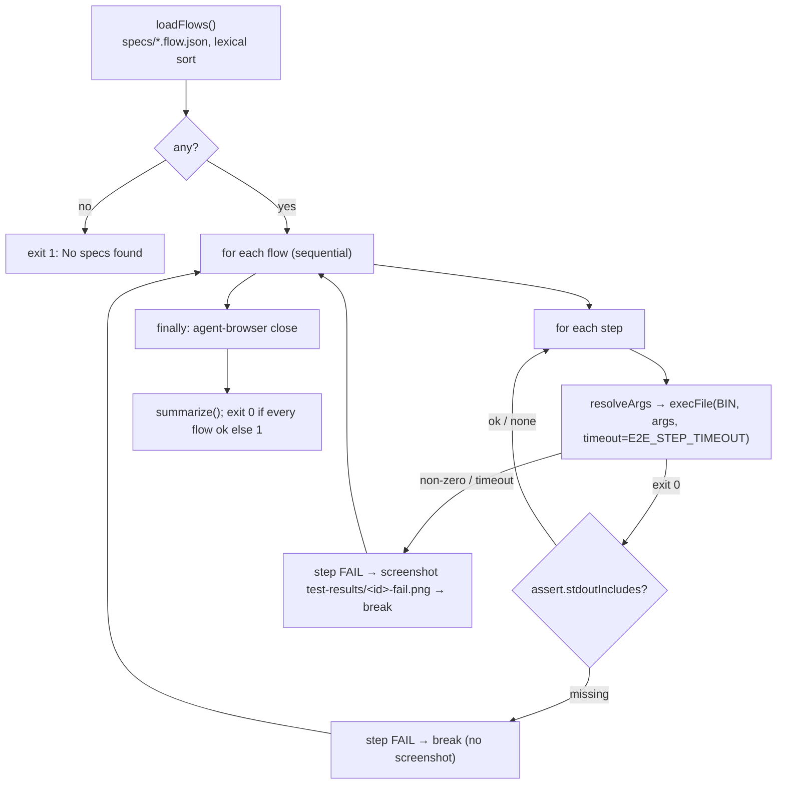
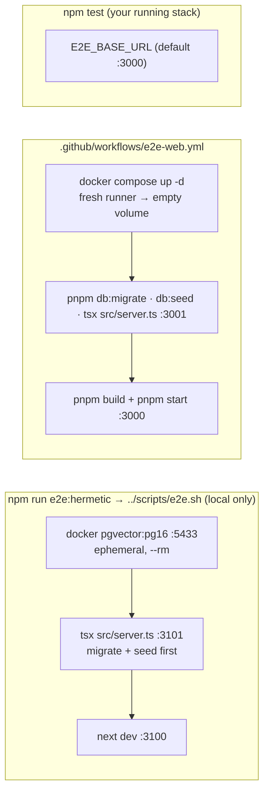

# How flows work — format, runner, agent-browser, stacks

What happens when you run `npm test` in `e2e/`. The package [README](../README.md) covers install, env variables, and
the coverage table. The flow index is in [`../specs/README.md`](../specs/README.md). To write a new flow, see
[writing-a-flow.md](writing-a-flow.md).

## Flow file format
Types: `lib/assert.ts:9 → Step`, `lib/assert.ts:18 → Flow`.

```jsonc
{
  "name": "…",                 // required: printed and used in the summary
  "description": "…",          // optional: documentation only, the runner ignores it
  "steps": [
    {
      "cmd": ["wait", "--text", "#482"],      // required: argv passed verbatim to agent-browser
      "label": "seeded PR row visible",        // optional: defaults to cmd.join(" ")
      "assert": { "stdoutIncludes": "…" }      // optional: substring check on stdout
    }
  ]
}
```

`{BASE}` in any argument is replaced with `E2E_BASE_URL`, after trailing slashes are trimmed
(`lib/assert.ts:37 → resolveArgs`). That is the only substitution.

## Runner — `run.ts`



| Behavior | Location |
|---|---|
| Flow discovery: files ending `.flow.json` in `specs/`, sorted lexically (that is why there is an `NN-` prefix) | `run.ts:53 → loadFlows` |
| Each step = one `execFile(BIN, args, { cwd: e2e/, timeout: STEP_TIMEOUT, maxBuffer: 32MB })`. Non-zero exit or timeout throws | `run.ts:44 → ab` |
| First failing step stops **that flow**. The remaining flows still run | `run.ts:68-89 → runFlow` |
| Screenshot only on a thrown step (best-effort), not on a failed `stdoutIncludes` | `run.ts:80-87` |
| Browser session closed once, at the end, even after errors | `run.ts:108-111` |
| Summary `PASS/FAIL <name>` + failed step labels + `k/n flows passed` | `lib/assert.ts:46 → summarize` |

### One browser session for all flows
agent-browser is a CLI backed by a daemon that keeps the page open between calls. `run.ts` never opens a new session
per flow, so **flow N starts on whatever page flow N-1 left**. A failed flow can leave the page anywhere. That is why
every flow's first step is `open {BASE}/…`.

### Assertions = waits
There is no assertion library. `wait --url <substr>`, `wait --text <text>`, and `wait --load networkidle` exit non-zero
when the condition doesn't hold within agent-browser's timeout, and that fails the step. `find role|text|label …
click` fails when nothing matches. `assert.stdoutIncludes` exists, but no current flow uses it.

## agent-browser config
`agent-browser.json`: `headed: false`, `ignoreHttpsErrors: false`. Override `BIN` with `AGENT_BROWSER_BIN`. The AI
`chat` command is never used, so no LLM key is needed.

## Which stack the flows hit



- `scripts/e2e.sh` exports `DATABASE_URL` (127.0.0.1:5433), `API_PORT`, `WEB_PORT`, `NEXT_PUBLIC_API_BASE`, and
  `E2E_BASE_URL` before starting anything (`scripts/e2e.sh:40-43`). It refuses to migrate unless the URL points at the
  isolated port (`e2e.sh:121-124`). It installs missing `node_modules` (reviewer-core with `npm ci`, `e2e.sh:117`).
  It waits for `/health` and the web root (60 × 1s each). It tears everything down from an `EXIT/INT/TERM` trap
  (`e2e.sh:67-82`).
- CI runs the plain runner (`npm ci && npm test`) against a production build of the client. Locally the hermetic
  script uses `next dev`, so the first load of each route includes on-demand compile time. If steps time out
  locally, raise `E2E_STEP_TIMEOUT` (default 60000 ms).
- Flows are read-only over seeded rows. Flows 02/04/05 assume the seeded repo is the **only** repo (root redirects to
  the first repo, `client/src/app/page.tsx:15-19`).
