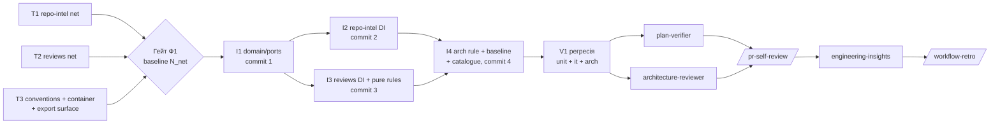

# Порти — всередину, контейнер — на край — Implementation Plan

> Пара до [`specs/16-server-ports-inward.md`](../specs/16-server-ports-inward.md) (SPEC-16).
> Усі `file:line` нижче звірені з HEAD `fc35f3f`. Якщо HEAD зсунувся, спершу
> перевір цитати (`git log --oneline -1`), а вже потім виконуй план.

---

## 0. Що робить окрема сесія (handoff, читати першим)

План виконують у **новій сесії**, тож тут є все потрібне, без опори на пам'ять
попередньої розмови. Оркестратор (team lead / головна сесія) робить кроки по
порядку. Кожен агент отримує шлях до цього файлу, свій task-id і не виходить за
свої **owned paths**.

```bash
# 0.1 Підготовка (оркестратор)
cd /Users/ilapa/projects/dev-digest
git status                              # чисто, окрім specs/16 + plans/16
git switch -c refactor/16-server-ports-inward
git add specs/16-server-ports-inward.md plans/16-server-ports-inward.md
git commit -m "docs: SPEC-16 + plan 16 (ports inward, container to the edge)"
docker info >/dev/null && echo "docker OK"   # обов'язково: *.it.test.ts без Docker тихо skip-аються
(cd server && pnpm install --frozen-lockfile)

# 0.2 Baseline кількості тестів ДО Фази 1
SCR=${TMPDIR:-/tmp}/plan16; mkdir -p "$SCR"
(cd server && pnpm test 2>&1 | tee "$SCR/tests-0-pre.txt" | tail -n 8)
(cd server && pnpm arch 2>&1 | tail -n 3)
#  → занотуй рядки "Test Files … passed | … skipped" і "Tests … passed | … skipped".
#     skipped має бути таким самим у всіх наступних замірах (той самий стан Docker).
```

| # | Крок | Як запустити | Гейт після кроку |
|---|---|---|---|
| 1 | **Фаза 1**: T1, T2, T3 **паралельно** | 3 × `Agent(subagent_type: "test-writer")`, у кожен prompt: «Виконай task T1 (T2/T3) з `plans/16-server-ports-inward.md`, §Фаза 1. Owned paths — лише перелічені там. Код продукту (`server/src/**/*.ts` без `.test.ts`) не змінюй.» | `cd server && pnpm typecheck && pnpm test && pnpm arch` → зелено; `pnpm test \| tee "$SCR/tests-1-net.txt"`; **це новий baseline** (N_net passed, S skipped). Коміт `test(server): characterization net for SPEC-16` |
| 2 | **I1** (один) | `Agent(subagent_type: "implementer")`: «Виконай task I1 з plans/16…, після гейтів зроби commit 1.» | гейти I1 (§Фаза 2 → I1) |
| 3 | **I2 ‖ I3** паралельно, кожен у **своєму worktree** | `git worktree add .worktrees/16-i2 -b refactor/16-i2` і `git worktree add .worktrees/16-i3 -b refactor/16-i3` (обидва від commit 1); у кожному worktree `pnpm install` в `server/`, `reviewer-core/`; потім 2 × `Agent(subagent_type: "implementer")` з cwd = свій worktree: «Виконай task I2 (I3)…» | у кожному worktree: гейти свого таска. Потім в основному дереві `git cherry-pick <I2-commit>` → гейти AC-23 → `git cherry-pick <I3-commit(s)>` → гейти AC-23 + `pnpm typecheck` (root CLAUDE.md, Gotchas: чистий merge ≠ резолвляться крос-файлові посилання). `git worktree remove` обидва |
| 4 | **I4** (один) | `Agent(subagent_type: "implementer")`: «Виконай task I4…» | гейти I4 + `cd evals && pnpm eval:quality` |
| 5 | **Фаза 3, V1**: регресія | оркестратор сам: команди з §Фаза 3 → V1; `pnpm test \| tee "$SCR/tests-3-final.txt"` | passed ≥ N_net + нові юніт-тести I3; skipped = S |
| 6 | **V2 ‖ V3** | `Agent(subagent_type: "plan-verifier")` (plan path + `git diff <docs-commit>..HEAD`) і `Agent(subagent_type: "architecture-reviewer")` (той самий діапазон) паралельно | `plan-verifier` = PASS; `architecture-reviewer` без нових CONFIRMED HIGH+ |
| 7 | `/pr-self-review` | Skill `pr-self-review` | не BLOCKED |
| 8 | `engineering-insights` → `server/LEARNINGS.md` | Skill `engineering-insights` | запис додано/розширено |
| 9 | `/workflow-retro` | Skill `workflow-retro` | ретро в чаті |

**Пушити або відкривати PR план не вимагає.** Це робить користувач окремо
(пам'ять: push іде в `ai-agentic-engineering-neo/dev-digest`, без AI-attribution
у комітах).

---

## Source requirements

Реалізує [`specs/16-server-ports-inward.md`](../specs/16-server-ports-inward.md)
(SPEC-16, status: draft, рішення в ньому остаточні) **повністю: AC-1 … AC-23**.
Відкритих clarifications немає: CL-1…CL-4 закриті в самій spec (рядки 418-431).

Мапінг AC → коміт (відповідає оркестрації, яку обрав користувач; див.
*Clarifications*, п. A1):

| Коміт | Таск | AC |
|---|---|---|
| T (тести-сітка) | T1–T3 | готує доказ для AC-3, AC-12, AC-13, AC-14 |
| 1 `refactor(server): move ports to domain/ports` | I1 | AC-1…AC-6 |
| 2 `refactor(repo-intel): inject deps instead of Container` | I2 | AC-7, AC-8, AC-12 (частина repo-intel), AC-13, AC-15 (repo-intel тести) |
| 3 `refactor(reviews): inject deps + extract pure trace/digest rules` (можна 3a/3b, див. R3) | I3 | AC-9, AC-10, AC-11, AC-12 (частина reviews), AC-14, AC-15 (conventions + нові юніт-тести) |
| 4 `chore(arch): widen no-container rule, shrink baseline, update catalogue` | I4 | AC-16…AC-19 |
| кожен із 1–4 | — | AC-20…AC-23 (гейти) |

## Clarifications & recommendations

### Ухвалено користувачем (не переобговорюється)

- Multi-agent з точною оркестрацією з §0 і §Execution mode.
- Клієнтську копію `client/src/vendor/shared` не чіпаємо (spec Non-goals).
- Shim у `server/src/vendor/shared/adapters.ts` лишається (spec AC-3, E2).

### Припущення, які довелося зробити (spec цього не покриває або каже інакше)

- **A1 — коміти 2/3 розрізані по модулях, а не по «ін'єкція / винос функцій».**
  Spec, «Порядок комітів» (рядки 402-416), кладе всю ін'єкцію в коміт 2, а винос
  чистих функцій — у коміт 3. Оркестрація користувача ділить інакше: I2 =
  repo-intel, I3 = reviews/conventions (ін'єкція + винос). План іде за
  оркестрацією. Інваріант spec «кожен коміт окремо проходить гейти» (AC-23)
  зберігається.
- **A2 — `blast/service.ts:3` правимо в I1, а не в I3.** Бриф оркестратора
  відносив цей фікс до I3, але spec ставить AC-6 у Крок 1 / коміт 1. Коли I1
  переносить `RepoIntel` у `domain/ports/repo-intel.ts`, фікс зводиться до
  заміни одного рядка імпорту, і I3 тоді взагалі не мусить торкатися `blast/`.
  Перенесення фіксу не створює спільних файлів між I2 і I3.
- **A3 — друга точка складання `RepoIntelService`, якої немає в spec.**
  `modules/repo-intel/routes.ts:29` робить `new RepoIntelService(container)` і на
  цьому окремому екземплярі викликає `registerIndexJobHandlers()` (:30).
  AC-12 називає точками складання тільки `container.ts` і `reviews/routes.ts`.
  Рішення (I2): додати в контейнер кешований getter `repoIntelService`
  (конкретний клас, **без** урахування `overrides.repoIntel`), на який спирається
  getter `repoIntel` (`overrides.repoIntel ?? this.repoIntelService`), а
  `repo-intel/routes.ts` викликає `container.repoIntelService.registerIndexJobHandlers()`.
  Поведінка збережена:
  (а) сьогодні handlers завжди реєструються на **реальному** сервісі, навіть
  коли `overrides.repoIntel` задано: `new RepoIntelService(container)` ігнорує
  overrides. Новий getter теж їх ігнорує;
  (б) у `RepoIntelService` немає стану екземпляра, крім `repo`
  (`modules/repo-intel/service.ts:104`), тож злиття двох екземплярів в один
  нічого не змінює.
  Запасний варіант, якщо verifier заперечить: лишити в `repo-intel/routes.ts`
  явне `new RepoIntelService(new RepoIntelRepository(container.db), {...})`.
  Routes і так є дозволеною точкою складання (AC-16 виключає `routes.ts`).
- **A4 — `ReviewRunExecutor` потребує ще й `git`.** У списку залежностей AC-9 його
  немає, але executor викликає `loadDiff(this.container, …)`
  (`run-executor.ts:101`), а після AC-10 `loadDiff` бере `GitClient`. Тому до
  deps executor'а додається `git: Pick<GitClient, 'diff'>`. Це не нова
  залежність, а явний запис наявної.
- **A5 — новий тест експортної поверхні `@devdigest/shared`.** Порти — це
  type-only експорти, і `contracts.test.ts` їх не бачить (він імпортує лише
  zod-значення, `test/contracts.test.ts:2-22`). Для перевірки AC-3 («diff множини
  експортованих імен — порожній») T3 додає `server/test/shared-export-surface.test.ts`.
  Тест через TypeScript compiler API (`typescript` ^5.7.2 уже є в devDeps
  сервера) збирає відсортований список **усіх** імен, які експортує
  `src/vendor/shared/index.ts`, включно з type-only, і порівнює його з inline-літералом.
  Файла не було в брифі T3, тому він доданий до owned paths T3.

### Рекомендації планувальника (judgment calls, не вимоги spec)

- **R1 — `RepoIntelDeps`/`PipelineDeps` винести в окремий leaf-файл
  `modules/repo-intel/deps.ts`.** Якщо `PipelineDeps` оголосити в `service.ts`, а
  `pipeline/full.ts` імпортує його як тип, з'явиться **новий** цикл
  `service.ts → pipeline/full.ts → service.ts`. `no-circular` ловить і
  type-only ребра (`tsPreCompilationDeps: true`, `server/.dependency-cruiser.cjs:84-86`),
  а baseline не дозволяє нових записів (AC-17). Тому `deps.ts` імпортує лише
  `domain/ports/*`, а від нього залежать `service.ts` і `pipeline/*`.
- **R2 — `jobs` у `RepoIntelDeps` як локальний структурний тип**
  `{ register(kind: string, handler: (payload: unknown) => Promise<void>): void }`,
  а не `JobRunner` з `platform/jobs.ts`. Справжній `JobRunner.register(kind, handler: JobHandler)`
  (`platform/jobs.ts:16,45`) задовольняє цей тип структурно. Так модуль не тягне
  ребро в `platform/`. Варіант `Pick<JobRunner, 'register'>` теж прийнятний: він
  не порушує жодного правила.
- **R3 — I3 може зробити два коміти**: 3a (ін'єкція, AC-9…AC-11) і 3b (винос
  чистих функцій, AC-14). Так зберігається дух spec «винос — окремим комітом».
  Обидва коміти мусять пройти гейти. `plan-verifier` приймає і 1, і 2 коміти.
- **R4 — вузькі локальні порти замість `as unknown as` у тестах.** Деякі тести
  мусять кастити фейк репозиторію (`as unknown as ReviewRepository`), бо
  executor бере весь клас. Якщо executor оголосить
  `type RunRepo = Pick<ReviewRepository, 'completeAgentRun' | 'saveRunTrace' | 'recordRunSkills' | 'insertReview' | 'insertFindings' | 'markReviewed' | 'getPrFiles'>`,
  фейки в тестах стають типізованими без касту. Це опційно: AC-15 вимагає
  прибрати лише `as unknown as Container`.
- **R5 — ціль ширша за AC-15:** після I2+I3 `grep -rn "as unknown as Container" server/test server/src`
  дає **0** збігів. Сьогодні таких файлів 11 (див. *Approach §2/§3*), і кожен із
  них I2/I3 однаково мусять змінити, бо міняється сигнатура конструктора.

## Execution mode

**Рекомендація планувальника:** multi-agent. Зміна торкається шарів `server/src`
(порти, composition root, 6 файлів модулів), крос-пакетного аліасу
`@devdigest/shared` (reviewer-core, agent-runner) і правил `pnpm arch`. Тут
потрібні і страхувальна сітка до рефакторингу, і незалежна перевірка після.

**Вибір користувача (ухвалено до планування, не питалося повторно):** саме
multi-agent, з такою оркестрацією:

- **Фаза 0** — цей план (`implementation-planner`).
- **Фаза 1** — 3 × `test-writer` паралельно (T1, T2, T3), код продукту не
  змінюється.
- **Фаза 2** — `implementer`: I1 (блокуючий) → I2 ‖ I3 (паралельно, непересічні
  шляхи) → I4.
- **Фаза 3** — регресія (оркестратор) → `plan-verifier` ‖ `architecture-reviewer`
  → `/pr-self-review` → `engineering-insights` → `/workflow-retro`.

### Паралельність по фазах

| Фаза | Агенти одночасно | Хто | Спільні файли |
|---|---|---|---|
| 0 | 1 | implementation-planner | — |
| 1 | **3** (пік) | test-writer × 3 (T1, T2, T3) | немає — owned paths не перетинаються |
| 2a | 1 | implementer (I1) | — |
| 2b | 2 | implementer × 2 (I2, I3), кожен у своєму worktree | лише `platform/container.ts`, і його змінює **тільки I2** (див. I3) |
| 2c | 1 | implementer (I4) | — |
| 3a | 0 (оркестратор) | регресійні команди | — |
| 3b | 2 | plan-verifier, architecture-reviewer (обидва read-only) | — |
| 3c | 1 | skills: pr-self-review → engineering-insights → workflow-retro | — |

### DAG залежностей



## Modules affected

| Модуль | Що змінюється | Чому |
|---|---|---|
| **server** | новий `src/domain/ports/*`; `vendor/shared/adapters.ts` (DTO + shim); ~30 файлів з імпортами портів; `repo-intel/{service,deps,routes}.ts`, `pipeline/{full,incremental}.ts`; `reviews/{run-executor,diff-loader,routes,run-trace-rules}.ts`; `conventions/{samples,routes}.ts`; `blast/service.ts`; `platform/container.ts`; `adapters/{tokenizer,depgraph}/index.ts`; `.dependency-cruiser.cjs`; `.dependency-cruiser-known-violations.json`; тести | уся суть SPEC-16 |
| **reviewer-core** | **жодних змін коду** — лише гейт `pnpm typecheck && pnpm test` | аліас `@devdigest/shared` → `../server/src/vendor/shared/index.ts` (`reviewer-core/tsconfig.json:22`), тож shim потягне `domain/ports/*` у його `tsc` (spec E1) |
| **agent-runner** | **жодних змін коду** — лише `pnpm typecheck` | той самий аліас (`agent-runner/tsconfig.json:22`) |
| **client** | **жодних змін** — лише `pnpm typecheck` | має власну копію `vendor/shared` (`client/tsconfig.json:24`), AC-22 |
| `.claude/skills/onion-architecture/README.md` | каталог порушень | AC-19 |
| e2e, mcp-server | нічого | поведінка HTTP не змінюється; `mcp-server` не імпортує `server/src` (лише коментар у `mcp-server/src/http/sse.ts:10`) |

## Architectural constraints

Усе процитовано з прочитаних файлів, а не з пам'яті.

1. **Порти живуть зі споживачем, не з реалізацією; не у `vendor/shared`.**
   `.claude/skills/onion-architecture/SKILL.md` §3 (рядки 83-96).
2. **Конструкторна ін'єкція, ніколи контейнер. Знати конкретні класи можуть лише
   `platform/container.ts` / `app.ts`.** SKILL.md §4 (рядки 98-127). Routes
   теж є дозволеними точками складання (`server/src/modules/reviews/routes.ts:61-63`
   прямо так і каже в коментарі).
3. **Крос-модульний імпорт заборонений навіть для одного типу. Рішення —
   локальна структурна форма.** SKILL.md §13 (рядки 270-300);
   `server/LEARNINGS.md` → «2026-08-03 — a new module needing another module's
   repo/service must use the `AgentLookup`-style local port» + addenda
   2026-08-06 і 2026-08-11 (локальний `AgentRecord` замість `AgentRow`,
   рядки 222-307).
4. **Baseline матчиться по точних from→to; звуження типу параметра може
   створити НОВЕ ребро.** `server/LEARNINGS.md` → «2026-08-03 —
   `.dependency-cruiser-known-violations.json` baselines exact from→to edges»
   (рядки 920-934). Spec E10. Тому після кожного кроку I2/I3 запускається
   `pnpm arch`, а `pnpm arch:baseline` до I4 **не** запускається.
5. **`import type` теж є ребром.** `server/.dependency-cruiser.cjs:84-86`
   (`tsPreCompilationDeps: true`); LEARNINGS addendum 2026-08-06.
6. **Тести з `as unknown as Container` ламаються в рантаймі від будь-якого нового
   `container.X`.** `server/LEARNINGS.md` → «2026-08-04 — a debug log gated on
   `container.config.X`…» + addendum 2026-08-12 (рядки 936-970). Саме цю
   проблему SPEC-16 і прибирає.
7. **Адаптери підміняються через `ContainerOverrides` / `adapters/mocks.ts`, а не
   module-level mock.** `server/CLAUDE.md` → Non-default conventions; SKILL.md §14.
8. **`src/vendor/shared` — do-not-touch, крім свідомих змін; reviewer-core бачить
   правку одразу.** `server/CLAUDE.md` → Do-not-touch; root `CLAUDE.md` →
   Do-not-touch. SPEC-16 свідомо змінює `adapters.ts`, але **тільки** серверну
   копію.
9. **`isolatedModules: true`, `verbatimModuleSyntax: false`** у
   `server/`, `reviewer-core/`, `agent-runner/` `tsconfig.json` (рядки 11, 14).
   Re-export інтерфейсу мусить бути `export type { … } from …`, інакше TS1205.
   Заодно це робить shim type-only, як вимагає spec E2.
10. **`*.it.test.ts` тихо skip-аються без Docker.** `server/CLAUDE.md` → Testing;
    `TESTING.md` → Suite map. Порівнювати лічильники тестів можна лише за
    однакового стану Docker.
11. **`.claude/skills/**` змінено → `cd evals && pnpm eval:quality`.** Root
    `CLAUDE.md` → Eval Self-Check. Окремого skill-eval для `onion-architecture`
    немає (`evals/skills/` має лише `dependency-checker`, `pr-self-review`).
12. **Спільний Postgres між worktree.** Root `CLAUDE.md` → Conventions. Міграцій
    у цьому плані немає, тож колізії `db:generate` не буде; I2 і I3 у паралельних
    worktree можуть одночасно ганяти `*.it.test.ts`, бо кожен тест піднімає свій
    testcontainer.

## Approach

### §1 — I1: `domain/ports` + shim (AC-1…AC-6)

**Нові файли** `server/src/domain/ports/`, по одному на порт. Кожен імпортує
**лише** `zod` (тип `z` для `StructuredRequest`) і DTO-типи **відносним шляхом
у конкретний leaf-файл** `../../vendor/shared/adapters.js` /
`../../vendor/shared/contracts/platform.js`, а не барель і не аліас
`@devdigest/shared`. Причина — spec E1: файли компілюються ще й у
reviewer-core/agent-runner, тож жодних серверних path-аліасів.

| Файл | Що оголошує (переноситься дослівно з) |
|---|---|
| `llm.ts` | `ChatMessage`, `CompletionRequest`, `CompletionResult`, `StructuredRequest`, `StructuredResult`, `LLMProvider` (`vendor/shared/adapters.ts:30-88`); `ModelInfo` лишається DTO в adapters.ts |
| `embedder.ts` | `Embedder` (`adapters.ts:91-95`) |
| `github.ts` | `GitHubClient` (`adapters.ts:166-212`). Власних параметрних типів у нього немає: `PrMeta`/`PrDetail`/`IssueMeta`/`PrReviewComment` — з `contracts/platform.ts`, решта — DTO з AC-2 |
| `git.ts` | `CloneOptions`, `BlameLine`, `GitCommit`, `GitClient` (`adapters.ts:215-273`, крім DTO `DiffHunk`/`UnifiedDiff`) |
| `code-index.ts` | `CodeIndex` (`adapters.ts:295-299`) |
| `auth.ts` | `AuthProvider` (`adapters.ts:313-316`) |
| `secrets.ts` | `SecretKey`, `SecretsProvider` (`adapters.ts:319-333`) |
| `tokenizer.ts` | `Tokenizer` (з `adapters/tokenizer/index.ts:16-18`) |
| `depgraph.ts` | `FileEdge`, `DepGraph` (з `adapters/depgraph/index.ts:22-33`) |
| `repo-intel.ts` | **увесь** вміст `modules/repo-intel/types.ts` (рядки 25-216: `IndexStatus`, `DegradedReason`, `IndexResult`, `IndexState`, `Blast*`, `SymbolRow`, `SignatureRow`, `RefRow`, `FileRankRow`, `WeightedFileRow`, `RepoMapResult`, `RepoIntel`), разом із doc-коментарем. Зовнішніх імпортів у types.ts немає |

**`vendor/shared/adapters.ts`:** лишаються DTO з AC-2 без зміни форми
(`ModelInfo`, `RepoRef`, `GitHubReviewPayload`, `CreateReviewCommentInput`,
`OpenPrPayload`, `CommitFile`, `CommitFilesPayload`, `WorkflowRun`, `RunArtifact`,
`DiffHunk`, `UnifiedDiff`, `CodeMatch`, `CodeSymbol`, `CodeReference`, `AuthUser`,
`AuthWorkspace`). Перенесені імена повертаються одним блоком
`export type { … } from '../../domain/ports/<file>.js'` на кожен файл, з
JSDoc-коментарем `@deprecated`: «compat-shim для reviewer-core/agent-runner;
джерело правди — `server/src/domain/ports`; видалення shim — follow-up SPEC-16».
Увага до `*/` усередині JSDoc: `server/LEARNINGS.md` → «2026-08-03 — a `*/`
inside a JSDoc comment's own text silently truncates the comment».
`vendor/shared/index.ts` **не змінюється**.

**Адаптери-реалізації портів, що лежали поруч:** `adapters/tokenizer/index.ts`
і `adapters/depgraph/index.ts` імпортують тип із `domain/ports` і роблять
`export type { Tokenizer }` / `export type { DepGraph, FileEdge }` для
зворотної сумісності тестів (`test/repo-intel-rank-map.test.ts:10`,
`test/skills-import-url.test.ts:6`). Re-export не є оголошенням, тож AC-5
виконується. `modules/repo-intel/types.ts` стає `export type { … } from
'../../domain/ports/repo-intel.js'` (spec AC-5 це дозволяє);
`modules/repo-intel/index.ts:8` (`export * from './types.js'`) без змін.

**Міграція імпортів у `server/src` поза `vendor/`.** Повний список на HEAD (29
файлів) — тих, що тягнуть порт з `@devdigest/shared`:
`adapters/{auth/local,codeindex/ripgrep,embedder/openai,git/simple-git,github/octokit,llm/anthropic,llm/openai,mocks,secrets/local}.ts`,
`modules/_shared/linked-issue.ts`, `modules/agents/service.ts`,
`modules/brief/{ports,prompts}.ts`, `modules/ci/{service,service.test}.ts`,
`modules/conventions/{prompts,service}.ts`, `modules/eval/{executor,ports,service}.ts`,
`modules/intent/{prompts,service}.ts`, `modules/onboarding/{ports,prompts}.ts`,
`modules/pulls/routes.ts`, `modules/repos/service.ts`, `modules/reviews/adhoc.ts`,
`modules/reviews/run-executor.concurrency.test.ts`, `modules/settings/constants.ts`,
`platform/container.ts` (рядки 1-11). DTO в тих самих import-рядках лишаються на
`@devdigest/shared`, переїжджають лише імена портів. Плюс `Tokenizer`-імпортери з
`adapters/tokenizer`: `modules/{skills/service,brief/ports,eval/service,onboarding/ports}.ts`,
`platform/container.ts:46-47` (класи `DepCruiseGraph`/`TiktokenTokenizer` і далі
з adapters, типи — з domain), а також `platform/container.ts:43` (`RepoIntel`).
`server/test/**` **не мігрує**: shim покриває (AC-5 скоупить `server/src`).

**AC-6:** `modules/blast/service.ts:3` → імпорт тих самих 5 типів з
`../../domain/ports/repo-intel.js` (modules → domain дозволено).
`modules/blast/service.test.ts:4` можна лишити, бо тести виключені з depcruise.

### §2 — I2: repo-intel через конструктор (AC-7, AC-8, AC-12, AC-13, AC-15)

- **Новий `modules/repo-intel/deps.ts`** (R1):
  `RepoIntelDeps = { git: GitClient; codeIndex: CodeIndex; jobs: JobRegistry (R2); depgraph: DepGraph; tokenizer: Tokenizer; repoIntelEnabled: boolean }`,
  `PipelineDeps = Pick<RepoIntelDeps, 'git' | 'depgraph' | 'tokenizer'>`, де типи
  беруться з `domain/ports/*`.
- **`service.ts`:** конструктор `(private repo: RepoIntelRepository, private deps: RepoIntelDeps)`
  замість `(private container: Container)` + `new RepoIntelRepository(container.db)`
  (`service.ts:104-108`). Механічні заміни: `this.container.git` → `this.deps.git`
  (:153), `this.container.jobs.register` → `this.deps.jobs.register` (:175,178,181),
  `this.container.config.repoIntelEnabled` → `this.deps.repoIntelEnabled` (10 входжень — spec E9 каже «×9», але на HEAD `grep -c` дає 10:
  :225,472,485,492,524,645,710,738,766,805; звір `grep -n repoIntelEnabled`),
  `this.container.codeIndex` → `this.deps.codeIndex` (:246,269,565),
  `runFullIndex(this.container, …)` / `runIncremental(this.container, …)` →
  `(this.deps, …)` (:125,134,163). Doc-коментар у шапці (`service.ts:17-18`,
  «The constructor takes ONLY a Container») оновити.
  Імпорт `platform/container.js` (:21) видалити.
- **`pipeline/full.ts`:** `runFullIndex(deps: PipelineDeps, repository, payload)`
  (:74-75), `safeCurrentHead(deps: Pick<PipelineDeps,'git'>, ref)` (:316-318),
  `container.depgraph`/`container.tokenizer` → `deps.*` (:220, :247). Імпорт
  контейнера (:29) видалити.
- **`pipeline/incremental.ts`:** `runIncremental(deps: PipelineDeps, …)` (:55-56),
  виклики `runFullIndex(deps, …)` (:82,119,138), `deps.git.*` (:88,114),
  `deps.depgraph` (:226), `deps.tokenizer` (:245). Імпорт контейнера (:22)
  видалити. Імпорт `incremental → full` (:41) **лишається**: це звичайна
  залежність, цикл зникає разом із ребром у контейнер (spec E4).
- **`platform/container.ts`** (I2 — єдиний власник у Фазі 2):
  - імпорт `RepoIntelRepository` з `../modules/repo-intel/repository.js`
    поруч із :44;
  - поле `private _repoIntelService?: RepoIntelService;` поруч із :108;
  - новий getter `repoIntelService` (A3): `this._repoIntelService ??= new RepoIntelService(new RepoIntelRepository(this.db), { git: this.git, codeIndex: this.codeIndex, jobs: this.jobs, depgraph: this.depgraph, tokenizer: this.tokenizer, repoIntelEnabled: this.config.repoIntelEnabled })`;
  - getter `repoIntel` (:370-374): `if (this.overrides.repoIntel) return this.overrides.repoIntel; return this.repoIntelService;`.
    Поле `_repoIntel` (:108) прибрати, якщо стало зайвим.
  - Значення беруться через **getter'и** `this.git`/`this.codeIndex`/…, отже
    враховують `overrides` (spec E8). `this.jobs` — той самий екземпляр, що
    створює конструктор (:124), тож AC-13 виконується автоматично.
- **`modules/repo-intel/routes.ts:24-30`:** прибрати `new RepoIntelService(container)`
  і імпорт класу (:17), лишити `container.repoIntelService.registerIndexJobHandlers();`.
  Коментар :24-28 оновити (тепер це один екземпляр).
- **Тести, які I2 мусить оновити** (конструктор/сигнатура змінились; ціль — без
  `as unknown as Container`, AC-15/R5): `test/indexer-pipeline.test.ts`,
  `test/indexer-pipeline-hotness.test.ts`, `test/repo-intel-weighted-service.test.ts`,
  `test/repo-intel-facade-degraded.test.ts`, `test/repo-intel-resync.test.ts`,
  `test/repo-intel-pr-churn.it.test.ts` (:187,210,261),
  `test/repo-intel-blast-persistent.it.test.ts` (:46), нові файли T1, а також
  `test/container-wiring.test.ts` від T3, якщо він посилається на внутрішнє поле
  `_repoIntel`. Фейки передаються напряму: `{ git, codeIndex, jobs, depgraph, tokenizer, repoIntelEnabled }`.

### §3 — I3: reviews + conventions через параметри, чисті функції (AC-9…AC-11, AC-12, AC-14, AC-15)

- **`reviews/run-executor.ts`:**
  - Конструктор (:47-51) → `(private repo: RunRepo, private deps: RunExecutorDeps)`.
    `RunExecutorDeps` оголошується **в цьому ж файлі**: `agents: { enabledSkills(agentId: string): Promise<RenderableSkill[] & …> }`
    (форма з `_shared/skill-render.ts:18` + поля `id`/`name`, які використовує
    :277-290); `llm: (provider: Provider) => Promise<LLMProvider>`;
    `runBus: RunBus` (`platform/sse.ts`, це не контейнер); `tokenizer: Pick<Tokenizer,'count'>`;
    `git: Pick<GitClient,'diff'>` (A4); `resolveIntent: (input) => Promise<{ rendered?; inScope?; outOfScope?; contextGaps?; provider?; model?; userMessageText? }>`;
    `resolveProjectContext: (workspaceId, agentId, repoId) => Promise<{ documents: …; entries: … }>`;
    `repoIntel: Pick<RepoIntel, 'getCallerSignatures' | 'getRepoMap' | 'getFileRank'>`
    (з `domain/ports/repo-intel.ts`); `promptAssemblyDebugEnabled: boolean`.
    Типи intent / project context — **локальні структурні** (AC-9, SKILL.md §13).
    **Не** імпортувати `IntentResolver` з `./service.js`: `reviews/service.ts:18`
    сам імпортує `run-executor.ts`, тож вийшов би новий `no-circular`.
  - Замінити `typeof schema.repos.$inferSelect` (:62, :222) локальним
    `RunRepoRow = { owner: string; name: string; clonePath: string | null }`, а
    `AgentRow` (:6, :63, :223, :610) — локальним `RunAgent` з рівно тими
    полями, що читаються: `id`, `name`, `provider`, `model`, `systemPrompt`,
    `strategy`, `repoIntel`, `version`, `ciFailOn` (AC-11; патерн `AgentRecord`
    з LEARNINGS addendum 2026-08-11). Видалити імпорти `db/schema.js` (:5) і
    `db/rows.js` (:6). `PullRow` з `./repository.js` (:7) лишається, бо це
    той самий модуль. Перевірити, що `reviews/service.ts:171`
    (`executeRuns(workspaceId, pull, repo, jobs, logger)`) далі типізується
    структурно: `RepoRow`/`AgentRow` ширші за локальні форми.
  - Заміни: `this.container.runBus` → `this.deps.runBus` (:69,95,360,412,509,636),
    `intentService.resolve` → `this.deps.resolveIntent` (:123),
    `tokenizer.count` → `this.deps.tokenizer.count` (:149,400),
    `this.container.llm(...)` → `this.deps.llm(...)` (:246),
    `projectContextService.resolveForRun` → `this.deps.resolveProjectContext` (:297),
    `this.container.config?.promptAssemblyDebugEnabled` → `this.deps.promptAssemblyDebugEnabled` (:371),
    `this.container.repoIntel.*` → `this.deps.repoIntel.*` (:534,567,590),
    `loadDiff(this.container, …)` → `loadDiff(this.deps.git, …)` (:101),
    `this.agents.enabledSkills` → `this.deps.agents.enabledSkills` (:277).
  - **Винос чистих функцій (AC-14)** у новий `reviews/run-trace-rules.ts` (без
    I/O, без `RunLogger`, без класів). Рядки на виході мають бути байт-у-байт ті
    самі:
    - `renderCallersDigest(rows: { file; symbol; signature }[]): string | undefined`
      — тіло групування з :543-555 (`undefined` для `[]`);
    - `rankNote(ranks: { percentile: number }[], changedFileCount: number): { note: string; hotCount: number }`
      — :592-596, поріг `>= 95` і текст з :596 дослівно;
    - `buildTrace(input)` — збирання `RunTrace` з :453-482 (вхід: agent, pull.number,
      durationMs, tokens, costUsd, findingsCount, grounding, outcome-поля
      `assembly`/`chunks`/`mode`/`raw`, specsRead, log);
    - `buildFallbackTrace(input)` — тіло `traceFromBuffer` (:606-638), куди `log`
      передається вже готовим масивом.
    Логи `runLog.info(...)` (:554, :595) і try/catch навколо `repoIntel` лишаються
    в executor'і; тексти логів не змінюються. Executor стає тонким: I/O + виклик
    чистої функції.
  - Новий `reviews/run-trace-rules.test.ts` (або `server/test/run-trace-rules.test.ts`):
    чисті юніт-тести без БД і контейнера. Очікувані рядки **копіюються
    дослівно** з характеризаційних тестів T2.
- **`reviews/diff-loader.ts`:** `loadDiff(git: Pick<GitClient,'diff'>, repo: Pick<ReviewRepository,'getPrFiles'>, workspaceId, pull, repoRow: { owner: string; name: string })`
  (:12-18). Видалити імпорти контейнера (:1) і `db/schema.js` (:4). Порядок
  fallback (:19-29) не змінюється. `diffFromPrFiles` (:33) не змінюється.
- **`reviews/routes.ts:64-71`** (composition point):
  `new ReviewRunExecutor(container.reviewRepo, { agents: container.agentsRepo, llm: (p) => container.llm(p), runBus: container.runBus, tokenizer: container.tokenizer, git: container.git, resolveIntent: (i) => container.intentService.resolve(i), resolveProjectContext: (w, a, r) => container.projectContextService.resolveForRun(w, a, r), repoIntel: container.repoIntel, promptAssemblyDebugEnabled: container.config.promptAssemblyDebugEnabled })`;
  `:69` → `loadDiff(container.git, container.reviewRepo, …)`. Резолвери
  intent/project context лишаються **лямбдами**, щоб ці getter'и
  матеріалізувались ліниво, як і зараз. Жоден тест не мутує контейнер після
  `buildApp` (перевірено grep'ом: `spyOn(…container` / присвоєнь не знайдено).
- **`conventions/samples.ts:33-36`:** `getConventionsSampleSet(deps: { git: Pick<GitClient,'currentHead'>; repoIntel: Pick<RepoIntel,'getConventionSamples'> }, repo)`.
  Видалити імпорт контейнера (:3). Форма `{ git, repoIntel }` навмисно збігається
  з фейком у `test/conventions-service.test.ts:130-135`
  (`Parameters<typeof getConventionsSampleSet>[0]`), тож той тест компілюється
  без змін логіки.
  `conventions/routes.ts:37` → `(repo) => getConventionsSampleSet({ git: container.git, repoIntel: container.repoIntel }, repo)`:
  значення беруться всередині лямбди, ліниво, як і зараз.
- **`platform/container.ts` I3 НЕ змінює.** `ReviewRunExecutor` складається в
  `reviews/routes.ts:67` (перевірено), `getConventionsSampleSet` — у
  `conventions/routes.ts:37`.
- **Тести, які I3 мусить оновити** (конструктор/сигнатура змінились; ціль — без
  `as unknown as Container`): `test/prompt-skills.test.ts` (:180, :287),
  `test/prompt-project-context.test.ts` (:118), `test/skills-preview.test.ts` (:102),
  `src/modules/reviews/run-executor.concurrency.test.ts` (:206),
  `test/conventions-samples.test.ts` (:34, :60), `test/conventions-service.test.ts`
  (:135, :146), нові файли T2.

### §4 — I4: enforcement і документація (AC-16…AC-19)

- `.dependency-cruiser.cjs`, правило `no-container-in-services` (:40-48):
  `from.path` = `'^src/modules/(?!_shared/)(?!.*routes\\.ts$)'`. Коментар оновити.
  Severity лишається `error`. Коментар `no-circular` (:15-18, «5 cycles exist
  today…») оновити до «1 cycle (agents/)».
  Перевірено заздалегідь: після I2+I3 контейнер імпортують лише
  `_shared/context.ts` (виключений) і `*.test.ts` (виключені з cruise,
  :78). Збіги в `ci/refresh.ts`, `eval/service.ts`, `skills/service.ts` — лише
  в коментарях, не в import.
- `.dependency-cruiser-known-violations.json`: **видалити рівно 9 записів** —
  індекси на HEAD: 1 (`diff-loader → db/schema`), 2 (`run-executor → db/rows`),
  3 (`run-executor → db/schema`), 8, 9, 10, 11 (чотири `no-circular` через
  контейнер, включно з `incremental → full`), 12 (`no-container-in-services`
  repo-intel/service), 13 (`no-cross-module` blast → repo-intel/types).
  Лишається 10 записів. Спосіб: `pnpm arch:baseline`, потім
  `git diff .dependency-cruiser-known-violations.json` (LEARNINGS 2026-08-03).
  Diff — **лише видалення** (AC-17). Якщо з'явилося хоч одне додавання, це
  регресія I1–I3: повернути на власника таска.
- Перевірка AC-16/AC-18: тимчасово додати `import type { Container } from '../../platform/container.js';`
  у `src/modules/agents/helpers.ts` → `pnpm arch` має дати exit ≠ 0 → відкотити.
  Тест у дереві не лишається.
- `.claude/skills/onion-architecture/README.md` → «Violation catalogue»
  (рядки ~75-90) і «Migration order»: лічильники перерахувати з
  `pnpm arch:all` (а не з пам'яті: таблиця вже застаріла — V1=4 і «20 violations»
  проти 19 записів baseline на HEAD). V1 → 0 (rule widened), V3/V4 → лише
  `repos/helpers.ts`, `reviews/service.ts`, `settings/feature-models.ts`, V5 →
  «порти в `domain/ports`, shim у `vendor/shared` лишається (follow-up)», V7 → 1
  (`agents/`), V8 → 1 (`repos/service.ts → repo-intel/constants.ts`; запис
  blast → repo-intel знято). Фразу «`domain-depends-on-nothing` reports zero
  because `src/domain/` does not exist yet. That is a true zero, not a passing
  rule.» замінити на актуальну. Додати рядок Changelog (1.0.3, 2026-10-xx).
  Design decision 3 («Ports move to `server/src/domain/ports/`») позначити як
  виконане.

## Фаза 1 — страхувальна сітка (3 × `test-writer`, паралельно)

Спільні правила для T1–T3:

- **Код продукту не змінюється** (жодного `server/src/**/*.ts`, крім
  `*.test.ts` у власних owned paths). Якщо тест виявив баг, його **репортують, а
  не виправляють** (контракт `test-writer`).
- **Фіксуються поточні рядки/об'єкти**, а не «правильні». Очікування пишуться
  **inline-літералами** (не `toMatchSnapshot`-файлами), щоб I3 міг скопіювати їх
  дослівно в юніт-тести чистих функцій.
- **Кожен файл будує об'єкт під тестом через ОДНУ локальну фабрику**
  (`makeService(fakes)` / `makeExecutor(fakes)` / `makeDeps(fakes)`). У Фазі 2
  implementer міняє тільки цю фабрику, а тіла `it(...)` лишаються, і саме тому
  сітка має цінність. Поки що фабрика може використовувати
  `as unknown as Container`, як і наявні тести.
- Час заморожується: `vi.useFakeTimers({ toFake: ['Date'] })` або
  `vi.spyOn(Date, 'now')`, бо в trace є `duration_ms`, `ms`, `t`.
- Skill: `typescript-expert` (типізовані фейки); для repo-intel тестів з
  `RepoIntelRepository` ще й `drizzle-orm-patterns`, якщо фейк репозиторію
  повторює форму запитів.

### T1 — `modules/repo-intel` (test-writer)

- **Owned (ексклюзивно):** `server/test/repo-intel-*.test.ts`,
  `server/test/indexer-pipeline*.test.ts`, `server/src/modules/repo-intel/**/*.test.ts`.
  Нові файли: `server/test/repo-intel-service-characterization.test.ts`,
  `server/test/indexer-pipeline-characterization.test.ts`.
- **Skills:** `typescript-expert`, `drizzle-orm-patterns` (форма фейку
  `RepoIntelRepository`), `onion-architecture` (§14 — тести за кільцями).
- **Inputs:** `modules/repo-intel/service.ts`, `pipeline/{full,incremental}.ts`,
  наявні `test/indexer-pipeline*.test.ts`, `test/repo-intel-*.test.ts`.
- **Кроки:**
  1. `registerIndexJobHandlers()` реєструє рівно `INDEX_JOB_KIND`,
     `REFRESH_JOB_KIND`, `RESYNC_JOB_KIND` на переданому `jobs` (фейк-реєстр
     записує kinds), і виклик handler'а делегує в `indexRepo`/`refreshIndex`/`resyncRepo`
     з `payload.repoId` (AC-13).
  2. `resyncRepo`: `no_clone` (немає `clonePath`) → `{status:'degraded', reason:'no_clone', filesIndexed:0, filesSkipped:0}`;
     `git.sync` кидає `Error('boom')` → `reason: 'sync_failed:boom'`; успіх →
     делегує в incremental (`service.ts:145-164`).
  3. `repoIntelEnabled=false` → кожен flag-gated метод повертає `[]` /
     degraded-об'єкт (по одному `it` на метод зі списку
     `grep -n "repoIntelEnabled" service.ts`), без звернень до repo (фейк кидає
     при виклику).
  4. `runFullIndex`/`runIncremental`: зафіксувати, які методи `git`/`depgraph`/`tokenizer`
     викликаються в кожній гілці (`no state`, version mismatch, same sha, малий
     diff, > threshold) — дописати лише ті гілки, яких ще не пінять наявні
     `indexer-pipeline*.test.ts`.
- **Acceptance:** нові тести зелені на HEAD; наявні тести не змінені за змістом.
  Готує доказ для AC-7, AC-8, AC-13, E8.
- **Verify:** `cd server && pnpm vitest run test/repo-intel- test/indexer-pipeline`.
- **Залежності:** немає (стартує одразу).

### T2 — `modules/reviews` (test-writer)

- **Owned:** `server/test/reviews*.test.ts`, `server/test/run-executor*.test.ts`,
  `server/src/modules/reviews/**/*.test.ts`. Нові файли:
  `server/test/run-executor-characterization.test.ts`,
  `server/test/reviews-diff-loader.test.ts`. **Не чіпати** `test/prompt-*.test.ts`,
  `test/skills-preview.test.ts`: вони не в owned paths T2, і в Фазі 2 їх
  змінює I3.
- **Skills:** `typescript-expert`, `onion-architecture` (§14).
- **Стратегія фіксації приватних функцій — рішення плану:** **через публічний
  `executeRuns`** з рекординг-фейками, **без** тимчасового test-only export і
  **без** `reviews.it.test.ts` як основного джерела. Чому так:
  (1) test-only export — це зміна коду продукту у Фазі 1, яку правила фази
  забороняють;
  (2) пін на вихід публічного методу переживає рефакторинг I3 (приватні методи
  зникнуть, а вихід executor'а лишиться), тоді як `(executor as any).buildCallersDigest`
  зламався б саме в момент, коли сітка потрібна;
  (3) `reviews.it.test.ts` залежить від Docker і seed-даних, а його LLM-фейк
  не контролює `repoIntel`. Він лишається регресією у Фазі 3.
  Спостережувані точки: user-повідомлення, яке отримав `MockLLMProvider` (сюди
  потрапляють callers digest, обгорнутий `assemblePrompt`, і rank note,
  дописаний до task-рядка, `run-executor.ts:270`); аргумент
  `repo.saveRunTrace(runId, trace)` у фейку репозиторію; рядки Live Log через
  logger.
- **Кроки** (`makeExecutor(fakes)` будує executor; на HEAD — через
  `as unknown as Container`, за зразком `test/prompt-skills.test.ts:146-180`):
  1. **Callers digest:** фейк `repoIntel.getCallerSignatures` повертає 3 рядки з 2
     файлів → у user-повідомленні точний блок `### a.ts\n- \`f\` — sig…\n### b.ts\n…`
     (порядок файлів = порядок першої появи); `[]` → секції `## Callers of changed symbols`
     немає; кидає → секції немає, а в логах `callers digest: repoIntel failed — <msg>`.
  2. **Rank note:** `getFileRank` → 2 з 3 файлів з `percentile >= 95` → task
     закінчується рівно на
     `\n\n2 of 3 changed file(s) are in the top 5% most-depended-on (high blast risk) — prioritise their correctness.`;
     межа `95` проти `94.99`; `[]`/кидок → без суфікса.
  3. **Успішний `RunTrace`** (`run-executor.ts:453-482`): `toEqual` повного
     об'єкта при замороженому часі (`config`, `stats`, `tool_calls[].ms`,
     `specs_read`, `log`).
  4. **Fallback trace** (`traceFromBuffer`, :606-638): (а) LLM кидає → trace з
     `grounding:'0/0 passed'`, `prompt_assembly.system = agent.systemPrompt`,
     усі інші слоти `null`/`''`; (б) pre-work fail (`git.diff` кидає **і**
     `getPrFiles` кидає) → `failAll` зберігає такий самий trace для кожного
     run'у (:79-97).
  5. `agent.repoIntel === false` → жодного виклику `repoIntel.*`, лог
     `Repo intel disabled for this agent — skipping context enrichment`.
  6. **diff-loader:** `git.diff` повертає diff з файлами → повертається він;
     порожній → fallback на `pr_files`; кидає → fallback; формат synthetic diff
     з `diffFromPrFiles` (рядки `diff --git`/`---`/`+++` + patch, файли без
     `patch` пропущено).
- **Acceptance:** усе зелене на HEAD. Літерали з кроків 1–4 стають еталоном для
  AC-14.
- **Verify:** `cd server && pnpm vitest run test/run-executor test/reviews- src/modules/reviews`.
- **Залежності:** немає.

### T3 — `conventions/samples.ts` + `platform/container.ts` + export surface (test-writer)

- **Owned:** `server/test/conventions-samples.test.ts`, `server/test/contracts.test.ts`,
  `server/test/container*.test.ts` (новий `server/test/container-wiring.test.ts`),
  **`server/test/shared-export-surface.test.ts`** (новий, A5).
- **Skills:** `typescript-expert` (compiler API), `fastify-best-practices`
  (`buildApp` / `app.container` у тесті), `zod` (якщо розширюється `contracts.test.ts`).
- **Кроки:**
  1. `conventions-samples.test.ts`: додати пін на порядок `configFiles` (=
     порядок `CONFIG_SAMPLE_PATTERNS`), на те, що `getConventionSamples` викликається з
     `SOURCE_SAMPLE_COUNT`, що файли, які не читаються, пропускаються, на
     `sourceSha` з `git.currentHead`, і на точний текст `ValidationError` для
     `clonePath: null`. Фейк будувати через локальну `makeDeps()` (= `{ repoIntel, git }`).
  2. `shared-export-surface.test.ts`: `ts.createProgram([src/vendor/shared/index.ts], <server tsconfig options>)`
     → `checker.getExportsOfModule(...)` → відсортовані імена →
     `expect(names).toEqual([...inline-літерал...])`. Це гейт AC-3: множина імен до і
     після I1 однакова.
  3. `contracts.test.ts`: не переписувати; додати хіба що `it`, який гарантує
     runtime-експорт `ModelInfo` (zod-значення лишається в adapters.ts).
  4. `container-wiring.test.ts` (за зразком `test/routes-smoke.test.ts:2-15`,
     `buildApp({ config })` + `loadConfig`):
     - `overrides.repoIntel` → `container.repoIntel === override`;
     - без override → два звернення повертають **той самий** екземпляр (лінива
       мемоізація);
     - `overrides.git` / `codeIndex` / `depgraph` / `tokenizer` повертаються як є;
     - читання `container.repoIntel` до `container.git` не дає рекурсії (spec E6);
     - після `buildApp` на `app.container.jobs` зареєстровані handlers для
       `INDEX_JOB_KIND`, `REFRESH_JOB_KIND`, `RESYNC_JOB_KIND` (через cast до
       приватного `handlers: Map`, `platform/jobs.ts:32`), тобто AC-13 на рівні застосунку;
     - не посилатися на приватне `_repoIntel`, лише на публічні getter'и.
- **Acceptance:** зелене на HEAD; літерал export surface — повний список.
- **Verify:** `cd server && pnpm vitest run test/conventions-samples test/contracts test/container test/shared-export-surface`.
- **Залежності:** немає.

### Гейт після Фази 1 (оркестратор)

`cd server && pnpm typecheck && pnpm test && pnpm arch` → зелено.
`pnpm test | tee "$SCR/tests-1-net.txt"` → N_net (passed) і S (skipped)
записати в коміт-меседж `test(server): characterization net for SPEC-16`.
`git diff --stat HEAD~1 -- server/src | grep -v '\.test\.ts'` → порожньо.

## Фаза 2 — рефакторинг (`implementer`)

### I1 — Крок 1: порти в `domain/ports` (блокуючий)

- **Owner:** implementer. **Залежить від:** гейту Фази 1.
- **Owned:** `server/src/domain/**` (новий), `server/src/vendor/shared/adapters.ts`,
  `server/src/adapters/**`, `server/src/modules/repo-intel/types.ts`,
  `server/src/modules/blast/service.ts`, усі файли зі списку міграції в §1,
  `server/src/platform/container.ts` (лише import-рядки 1-11, 43, 46-47).
- **Skills:** `onion-architecture` (§3, §13, §15), `typescript-expert`
  (type-only re-export, `isolatedModules`, крос-пакетна резолюція).
- **Inputs:** §1 цього плану; spec AC-1…AC-6, E1, E2.
- **Кроки:** створити 10 файлів `domain/ports` → перенести оголошення дослівно →
  shim у `adapters.ts` → `adapters/{tokenizer,depgraph}` + `repo-intel/types.ts`
  як re-export → мігрувати імпорти → `blast/service.ts:3`.
- **Acceptance:** AC-1 (`ls server/src/domain/ports` = 10 файлів, у кожному
  `export interface`/`export type`); AC-2 (DTO-блок у adapters.ts без змін форми,
  `git diff -w` показує лише видалення перенесених портів і доданий shim); AC-3
  (`shared-export-surface.test.ts` зелений **без зміни літерала**); AC-4;
  AC-5 (grep нижче = 0); AC-6.
- **Verify:**
  ```bash
  cd server && pnpm typecheck && pnpm test && pnpm arch
  grep -rnE "import[^;]*\b(LLMProvider|GitClient|GitHubClient|CodeIndex|Embedder|AuthProvider|SecretsProvider)\b[^;]*from '@devdigest/shared'" src --include='*.ts' | grep -v '^src/vendor/'   # → порожньо (AC-5)
  grep -rnE "^export (interface|type) (Tokenizer|DepGraph|RepoIntel)\b" src | grep -v '^src/domain/'   # → порожньо
  cd ../reviewer-core && pnpm typecheck && pnpm test        # AC-20
  cd ../agent-runner && pnpm typecheck                     # AC-21
  cd ../client && pnpm typecheck                           # AC-22
  cd .. && git diff --stat -- client/src/vendor/shared reviewer-core/src agent-runner/src   # → порожньо
  ```
  Server test count = N_net, skipped = S. **Commit 1:** `refactor(server): move ports to domain/ports`.

### I2 — Крок 2a: repo-intel через конструктор (паралельно з I3)

- **Owner:** implementer, worktree `.worktrees/16-i2`. **Залежить від:** I1.
- **Owned (ексклюзивно):** `server/src/modules/repo-intel/{service,deps,routes}.ts`,
  `server/src/modules/repo-intel/pipeline/{full,incremental}.ts`,
  `server/src/platform/container.ts` (**лише**: import репозиторію біля :44, поле
  біля :108, getter'и `repoIntelService`/`repoIntel` :365-374), тести з §2.
- **Skills:** `onion-architecture` (§4, §12, §14), `drizzle-orm-patterns`
  (`RepoIntelRepository` створюється в контейнері і передається; самі запити
  не змінюються), `typescript-expert` (`Pick<>`-типи, структурна сумісність).
- **Inputs:** §2; spec AC-7, AC-8, AC-12, AC-13, AC-15, E4, E6, E7, E8, E9.
- **Кроки:** `deps.ts` → `service.ts` → `pipeline/*` → container → `repo-intel/routes.ts`
  → тести (фабрики T1 переписати під deps; тіла `it` не чіпати).
- **Acceptance:** AC-7, AC-8; AC-12 (ліниве `repoIntel`, перевага override:
  `container-wiring.test.ts` зелений); AC-13 (T1 крок 1 + T3 jobs-handlers
  зелені); AC-15 (у 4 названих тестах і в решті repo-intel тестів немає
  `as unknown as Container`); `grep -n "platform/container" src/modules/repo-intel -r`
  → порожньо.
- **Verify:**
  ```bash
  cd server && pnpm vitest run test/repo-intel- test/indexer-pipeline test/container
  pnpm typecheck && pnpm test && pnpm arch      # AC-23 (повний suite — вимога spec)
  ```
  **Commit 2:** `refactor(repo-intel): inject deps instead of Container`.

### I3 — Крок 2b+3: reviews/conventions через параметри + чисті функції (паралельно з I2)

- **Owner:** implementer, worktree `.worktrees/16-i3`. **Залежить від:** I1.
- **Owned (ексклюзивно):** `server/src/modules/reviews/{run-executor,diff-loader,routes,run-trace-rules}.ts`,
  `server/src/modules/reviews/run-trace-rules.test.ts`,
  `server/src/modules/reviews/run-executor.concurrency.test.ts`,
  `server/src/modules/conventions/{samples,routes}.ts`, тести з §3.
  **`platform/container.ts` — НЕ чіпати.**
- **Skills:** `onion-architecture` (§4, §6 — row-типи не доходять до логіки, §13),
  `fastify-best-practices` (`reviews/routes.ts`, `conventions/routes.ts` як
  composition points), `typescript-expert` (локальні структурні типи, сумісність
  з `AgentRow`/`RepoRow` у `reviews/service.ts`).
- **Inputs:** §3; spec AC-9, AC-10, AC-11, AC-14, AC-15; літерали з тестів T2.
- **Кроки:** локальні типи + конструктор → заміни `this.container.*` → прибрати
  `db/*` імпорти → `diff-loader` → `samples` → обидва `routes.ts` → оновити
  тести (фабрики) → (коміт 3a за R3) → `run-trace-rules.ts` + юніт-тести →
  executor викликає чисті функції.
- **Acceptance:** AC-9 (конструктор показує рівно deps з §3 + `git`, A4);
  AC-10; AC-11 (`grep -nE "db/(schema|rows)|modules/repos/" src/modules/reviews/{run-executor,diff-loader}.ts`
  → порожньо); AC-12 (reviews/routes.ts — єдине місце складання executor'а);
  AC-14 (юніт-тести з T2-літералами зелені, **і** характеризаційні T2-тести
  зелені без зміни очікувань); AC-15.
- **Verify:**
  ```bash
  cd server && pnpm vitest run src/modules/reviews test/run-executor test/reviews- test/prompt- test/skills-preview test/conventions-
  pnpm typecheck && pnpm test && pnpm arch      # AC-23
  ```
  **Commit 3** (або 3a+3b): `refactor(reviews): inject deps instead of Container` /
  `refactor(reviews): extract pure trace/digest rules`.

### Інтеграція I2 + I3 (оркестратор)

У головному дереві: `git cherry-pick <I2>` → `cd server && pnpm typecheck && pnpm test && pnpm arch`
→ `git cherry-pick <I3…>` → ті самі гейти + `cd reviewer-core && pnpm typecheck`.
Конфлікт можливий лише в `platform/container.ts`, а I3 його не змінює, тож
конфлікту не очікується. Якщо він усе ж є, I3 вийшов за owned paths: повернути
таск на I3.

### I4 — Крок 4: enforcement + каталог

- **Owner:** implementer. **Залежить від:** I2 **і** I3 (обидва в гілці).
- **Owned:** `server/.dependency-cruiser.cjs`, `server/.dependency-cruiser-known-violations.json`,
  `.claude/skills/onion-architecture/README.md`.
- **Skills:** `onion-architecture` (§15, README «Violation catalogue»).
- **Inputs:** §4; spec AC-16…AC-19.
- **Acceptance:** AC-16 (regex дослівно як у spec); AC-17 (`git diff` baseline =
  рівно 9 видалень, 0 додавань, 10 записів лишається); AC-18 (тимчасова ін'єкція
  → exit ≠ 0, відкочено); AC-19.
- **Verify:**
  ```bash
  cd server && pnpm arch && pnpm arch:all | tail -n 5
  git diff --numstat .dependency-cruiser-known-violations.json   # лише deletions
  python3 -c "import json;print(len(json.load(open('.dependency-cruiser-known-violations.json'))))"   # → 10
  pnpm typecheck && pnpm test                                     # AC-23
  cd ../evals && pnpm eval:quality                                # root CLAUDE.md, .claude/skills/**
  ```
  **Commit 4:** `chore(arch): widen no-container rule, shrink baseline, update catalogue`.

## Фаза 3 — перевірка

### V1 — регресія (оркестратор, Docker обов'язковий)

```bash
docker info >/dev/null || { echo "Docker down: it-тести будуть skipped — зупинись"; exit 1; }
cd server
pnpm typecheck && pnpm arch
pnpm vitest run test/repo-intel- test/indexer-pipeline test/run-executor test/reviews- \
  test/conventions- test/contracts test/container test/shared-export-surface \
  src/modules/reviews/run-trace-rules
pnpm vitest run test/reviews.it.test.ts test/multi-agent.it.test.ts   # не повинно бути "skipped"
pnpm test 2>&1 | tee "$SCR/tests-3-final.txt" | tail -n 8   # passed ≥ N_net (+ нові юніт-тести I3), skipped = S
cd ../reviewer-core && pnpm typecheck && pnpm test
cd ../agent-runner && pnpm typecheck
cd ../client && pnpm typecheck
cd .. && git diff --stat <docs-commit>..HEAD -- client/src/vendor/shared reviewer-core/src agent-runner/src   # порожньо
grep -rn "as unknown as Container" server/test server/src     # ціль R5: порожньо
```

Відомий флейк: `reviews.it.test.ts` «runs a review» може впасти по тайм-ауту,
якщо на машині налаштовані реальні секрети OpenRouter (`server/LEARNINGS.md` →
2026-08-04). Перш ніж вважати це регресією, перезапусти з `OPENROUTER_API_KEY=`
(порожнім).

### V2 ‖ V3

- `plan-verifier`: «План `plans/16-server-ports-inward.md`, імплементація —
  `git diff <docs-commit>..HEAD`. Traceability до AC-1…AC-23 spec SPEC-16.»
- `architecture-reviewer`: «Diff `<docs-commit>..HEAD`, server/src. Baseline —
  `server/.dependency-cruiser-known-violations.json` після commit 4.»

### Далі

`/pr-self-review` → Skill `engineering-insights` (кандидати в
`server/LEARNINGS.md`: leaf-`deps.ts` проти type-циклу; друга точка складання в
`repo-intel/routes.ts`; type-only shim між `vendor/shared` і `domain`; розширення
існуючого запису 2026-08-04 про `as unknown as Container` — «проблема знята
SPEC-16») → `/workflow-retro`.

## Нічого не змінюється в поведінці — чекліст для implementer'ів

- [ ] Жодна HTTP-відповідь, статус-код чи route не змінилися (`routes-smoke.test.ts`, `*.it.test.ts` зелені).
- [ ] Рядки prompt (callers digest, rank note, task line) байт-у-байт ті самі: T2-літерали не редагувались.
- [ ] `RunTrace` (успішний і fallback) — той самий об'єкт: T2-літерали не редагувались.
- [ ] Тексти Live Log / logger (`callers digest: …`, `file rank: …`, `repo map: …`) не змінені.
- [ ] Порядок викликів у `executeRuns`/`runOneAgent` не змінений (diff → intent → per-agent; llm → callers → map → rank → skills → project context).
- [ ] `loadDiff` fallback-порядок (git diff → pr_files) не змінений.
- [ ] Ті самі три job kinds реєструються на **тому самому** `container.jobs` (AC-13, E7).
- [ ] `overrides.repoIntel` перемагає; `overrides.git`/`codeIndex`/`depgraph`/`tokenizer` доходять до сервісу (E8).
- [ ] `repoIntelEnabled` і `promptAssemblyDebugEnabled` беруться з `config` один раз при складанні; ніхто їх не мутує (E9, перевірено в spec).
- [ ] Жодних нових `export` значень з `@devdigest/shared`; shim — лише `export type` (E2, AC-3).
- [ ] `client/`, `reviewer-core/src`, `agent-runner/src` — 0 змінених рядків.
- [ ] Жодного нового запису в `.dependency-cruiser-known-violations.json` (AC-17); `pnpm arch:baseline` запускає лише I4.
- [ ] Жодних міграцій, змін `db/schema/**`, нових залежностей у `package.json`.
- [ ] `adapters/astgrep` / `adapters/codeindex/extract` у `pipeline/*` не чіпати (Non-goal).

## Ризики та відкат

**Кожен крок — окремий коміт, тож відкат іде через `git revert` у зворотному
порядку залежностей:**

| Відкотити | Як | Що ще треба відкотити |
|---|---|---|
| I4 | `git revert <c4>` | нічого. Повертає вузьке правило + 9 baseline-записів; I1–I3 при цьому лишаються валідними (baseline з `--ignore-known` не падає на відсутніх порушеннях) |
| I3 (3/3a/3b) | `git revert <c3b> <c3a>` | **спершу I4**: розширене правило впаде на повернутих імпортах контейнера в `run-executor`/`diff-loader`/`samples`, а видалені baseline-записи `db-only` знову потрібні. I2 не зачіпається |
| I2 | `git revert <c2>` | **спершу I4** (цикли через контейнер повернуться). I3 не зачіпається: спільних файлів немає |
| I1 | `git revert <c1>` | **спершу I4, I3, I2**: вони імпортують `domain/ports/*` |
| Сітка T | не відкочується | тести додатні; якщо котимо все, вони все одно зелені на HEAD `fc35f3f` |

**Конкретні ризики:**

1. **Цикл `incremental.ts → full.ts`.** Сам імпорт лишається (`pipeline/incremental.ts:41`).
   Baseline-запис 9 зникає лише тому, що зникає ланка `full → container → service → incremental`.
   Новий цикл з'явиться, якщо `full.ts` імпортує щось із `service.ts` чи
   `incremental.ts`, наприклад тип deps. Запобіжник: `deps.ts` як leaf (R1);
   `pnpm arch` після I2 має дати 0 нових порушень.
2. **`ContainerOverrides.repoIntel` (E8, A3).** Override віддає getter `repoIntel`,
   а **не** `repoIntelService`. Job handlers і далі реєструються на реальному
   сервісі, як сьогодні. Якщо переплутати й зареєструвати їх на
   `container.repoIntel`, тести з mock-фасадом (без `registerIndexJobHandlers`)
   впадуть на старті застосунку. Ловить `container-wiring.test.ts` (T3).
3. **Порядок лінивих getter'ів (E6).** `repoIntelService` матеріалізує `git`,
   `codeIndex` (→ `git`), `depgraph`, `tokenizer` одразу. Рекурсії немає:
   жоден із них не читає `repoIntel` (`platform/container.ts:127-131, 359-363, 377-388`).
   Побічний ефект: `SimpleGitClient` у конструкторі ставить
   `process.env.GIT_TERMINAL_PROMPT ??= '0'` (`adapters/git/simple-git.ts:33`),
   і тепер це станеться під час старту застосунку (коли `repo-intel/routes.ts` реєструє
   handlers), а не при першому git-виклику. Усі git-підпроцеси запускаються
   пізніше, тож на поведінку це не впливає. `TiktokenTokenizer` вантажить BPE
   ліниво в `count()` (`adapters/tokenizer/index.ts:29-32`), тож старт не
   сповільнюється.
4. **Shim тягне `domain/ports` у reviewer-core/agent-runner (E1).** Захист:
   лише відносні імпорти в leaf-файли `vendor/shared`, без аліасів; `zod`
   резолвиться так само, як для теперішнього `adapters.ts` (CL-1). Гейт:
   AC-20/AC-21 після commit 1.
5. **Нові baseline-ребра від звуження типів (E10).** Наприклад, `import type { RepoRow } from '../../db/rows.js'`
   у `diff-loader.ts` замість локальної форми — новий `db-only` запис. Захист:
   лише локальні структурні форми (§3), `pnpm arch` після кожного таска.
6. **Паралельні worktree.** Кожному worktree потрібен власний `pnpm install`
   (`server/`, `reviewer-core/` для аліасу). Міграцій немає, тож спільний
   Postgres безпечний (root `CLAUDE.md` → Conventions).
7. **Характеризаційні тести можуть закріпити баг.** Так і задумано: SPEC-16 не
   змінює поведінку. Знайдений баг `test-writer` репортує, а оркестратор
   заносить у follow-up, не в цей PR.

## Skills for implementer

На основі таблиці Phase 3 у `.claude/skills/pr-self-review/SKILL.md:129-138`
(`server/src/modules/**`, `platform/**`, `adapters/**` → onion-architecture,
fastify-best-practices; `reviewer-core/**` → typescript-expert):

| Glob | Skills | Чому |
|---|---|---|
| `server/src/domain/ports/**`, `server/src/vendor/shared/adapters.ts` | `onion-architecture`, `typescript-expert` | §3 (порти всередині); type-only re-export, `isolatedModules`, резолюція через аліаси трьох пакетів |
| `server/src/adapters/**` | `onion-architecture`, `typescript-expert` | адаптер імпортує порт (§3); лише заміна import-шляхів |
| `server/src/modules/repo-intel/**` | `onion-architecture`, `drizzle-orm-patterns`, `typescript-expert` | §4/§12; `RepoIntelRepository` передається, а не створюється; `Pick<>`-deps |
| `server/src/modules/reviews/run-executor.ts`, `run-trace-rules.ts`, `diff-loader.ts` | `onion-architecture`, `typescript-expert` | §4, §6, §13 — локальні структурні форми замість `AgentRow`/`schema.repos` |
| `server/src/modules/{reviews,conventions,repo-intel}/routes.ts` | `fastify-best-practices`, `onion-architecture` | routes як composition point і HTTP-адаптер (§5) |
| `server/src/platform/container.ts` | `onion-architecture` | composition root (§4, §12) |
| `server/.dependency-cruiser*.{cjs,json}` | `onion-architecture` | §15 Enforcement |
| `.claude/skills/onion-architecture/README.md` | `onion-architecture` | каталог порушень; README → Maintenance |
| `server/test/**`, `server/src/**/*.test.ts` (test-writer) | `typescript-expert`; + `drizzle-orm-patterns` для repo-intel; + `fastify-best-practices` для `buildApp`-тестів | routing `test-writer` (`.claude/agents/README.md:17`) |

**Прогалини таблиці pr-self-review, заповнені вручну:**
(1) `server/src/domain/**` — у таблиці немає (тека не існує); призначено
`onion-architecture` + `typescript-expert`.
(2) `server/src/vendor/shared/**` таблиця покриває лише рядком «`**/contracts/**` → zod»,
а `adapters.ts` — не contracts; призначено `typescript-expert`.
(3) `server/.dependency-cruiser*` — немає; призначено `onion-architecture` (§15).
(4) `.claude/skills/**` — не код; замість skill діє правило eval-routing з root
`CLAUDE.md` (`pnpm eval:quality`).
`security` (рядок «any `.ts`») не призначено: рефакторинг не додає недовірених
входів (spec, «Untrusted inputs»). Його застосує `/pr-self-review`.

## Verification

Повний `pnpm test` у `server/` тут **виправданий**, а не надмірний: spec AC-23
вимагає його після кожного коміту, а I1 зачіпає ~30 файлів і shared-аліас.
Скоуплені команди наведено в кожному таску (для швидкого циклу), повний suite —
у гейті перед комітом.

| Коли | Команда | Pass |
|---|---|---|
| Перед Фазою 1 | `cd server && pnpm test \| tail -n 8` | зелено; записати N_pre/S |
| Після Фази 1 | `cd server && pnpm typecheck && pnpm test && pnpm arch` | зелено; N_net > N_pre, S без змін |
| Після кожного з комітів 1–4 | `cd server && pnpm typecheck && pnpm test && pnpm arch` | зелено; passed ≥ N_net, S без змін (AC-23) |
| Після commit 1 (і в V1) | `cd reviewer-core && pnpm typecheck && pnpm test`; `cd agent-runner && pnpm typecheck`; `cd client && pnpm typecheck` | зелено; 0 змін у їхніх `src` (AC-20…22) |
| Після commit 1 | grep AC-5 (див. I1) | порожньо |
| Після commit 1 | `pnpm vitest run test/shared-export-surface` | зелено без зміни літерала (AC-3) |
| Після commit 3 | `pnpm vitest run src/modules/reviews/run-trace-rules test/run-executor` | зелено; T2-літерали не змінені (AC-14) |
| Після commit 4 | `git diff --numstat server/.dependency-cruiser-known-violations.json` + лічильник = 10 | лише видалення (AC-17) |
| Після commit 4 | тимчасовий `import type { Container }` у `modules/agents/helpers.ts` → `pnpm arch` | exit ≠ 0, потім відкат (AC-16/18) |
| Після commit 4 | `cd evals && pnpm eval:quality` | зелено |
| V1 | `pnpm vitest run test/reviews.it.test.ts test/multi-agent.it.test.ts` при живому Docker | passed, не skipped (AC-23) |
