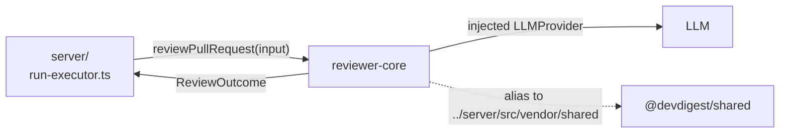

# reviewer-core — architecture

The pipeline diagram and public API are in the [package README](../README.md);
the system overview is in the [main README](../../README.md#architecture) and the cross-package rules in the
[repo architecture](../../docs/architecture.md). This
document covers the package boundary and how to extend the engine.

## Boundary

- Everything the engine knows arrives in the input: the diff, the agent's
  system prompt, optional context slots, and an `LLMProvider`. It reads no
  database, filesystem, environment or network other than through that provider.
- The server is the only consumer in the starter and imports the TypeScript
  source through an alias. A type error here fails the server's checks too.
- The only code shared with `server/` is the contracts in
  `server/src/vendor/shared`.

## Invariants

- Untrusted content (anything from a PR or repo) is fenced with
  `wrapUntrusted`, and `INJECTION_GUARD` is appended to every system prompt.
- Model output is parsed against the Zod contract, with a repair attempt.
- Every finding must cite a line present in the diff, or it is dropped.
- The score is recomputed from surviving findings; the model's is ignored.

## Extending the engine

- **New context for the model:** add an optional slot to the input and a
  section in `assemblePrompt`. When the slot is omitted the section must not
  appear. The server gathers the data and fills the slot.
- **New gate on findings:** add it after grounding in `review/run.ts`, as a
  pure function with its own tests.
- **Large diffs:** `review/reduce.ts` holds the map-reduce path; the strategy
  is chosen in `review/run.ts`. The starter runs single-pass.
- **New public symbol:** export it from `src/index.ts`.

Write the spec in [`../specs/`](../specs/README.md) first.
