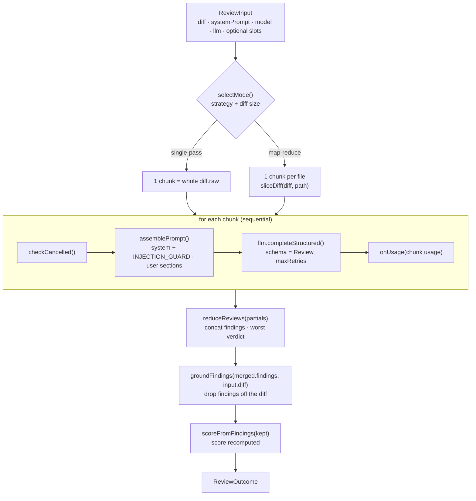

# Review pipeline — how `reviewPullRequest` works

How one review moves through the engine, step by step, with the exact code locations. The package
[README](../README.md) has the overview and the public API list; the contract (what callers can rely on)
is in [`../specs/review-engine.md`](../specs/review-engine.md).

## Flow

## Steps

### 1. Pick the mode
`src/review/run.ts:129 → selectMode`

| `strategy` | Result |
|---|---|
| `'single-pass'` | always single-pass |
| `'map-reduce'` | map-reduce only if the diff has more than 1 file, otherwise single-pass |
| `'auto'` (engine default) | map-reduce only if `additions + deletions > mapThresholdLines` (default 400, `DEFAULT_MAP_THRESHOLD_LINES`, `run.ts:30`) **and** more than 1 file |

The engine's default is `'auto'`, but the server always passes a strategy: `agent.strategy ?? REVIEW_STRATEGY`
(`server/src/modules/reviews/run-executor.ts:203`). Both the DB column default (`server/src/db/schema/agents.ts:20`)
and `REVIEW_STRATEGY` (`server/src/modules/reviews/constants.ts:12`) are `'single-pass'`. So in the studio,
map-reduce runs only for agents explicitly set to `map-reduce` or `auto`.

### 2. Build chunks
`src/review/run.ts:158 → chunks`

- Single-pass: one chunk `{ label: 'all files', diffText: diff.raw }`.
- Map-reduce: one chunk per `diff.files[i]`, with `diffText = sliceDiff(diff, f.path)` (`src/review/reduce.ts:58 → sliceDiff`).
  `sliceDiff` keeps the lines from each `diff --git` header whose text contains `b/<path>` or ` <path>`. If nothing
  matches, it falls back to a header-only stub with no hunks.
- Every chunk gets the **same** non-diff prompt parts (system, skills, memory, specs, callers, repo map, PR description,
  task). Only the diff is sliced, so in map-reduce the context tokens are paid once per file.

### 3. Assemble the prompt (per chunk)
`src/prompt.ts:85 → assemblePrompt`

- System message = `parts.system + "\n\n" + INJECTION_GUARD` (`prompt.ts:16`).
- User message sections, in this fixed order, each left out when empty:
  1. `task` (plain line)
  2. `## PR description`: `wrapUntrusted('pr-description', …)`, cut to `MAX_PR_DESCRIPTION_CHARS` = 4000 (`prompt.ts:37`)
  3. `## Skills / rules`: skill bodies joined by blank lines (**not** wrapped)
  4. `## Relevant memory`: `- item` bullets (**not** wrapped)
  5. `## Repo skeleton`: `wrapUntrusted('repo-map', …)`
  6. `## Project context`: each spec wrapped as `spec-<i>`
  7. `## Callers of changed symbols`: `wrapUntrusted('callers', …)`
  8. `## Diff to review`: `wrapUntrusted('diff', …)` (always present)
- `wrapUntrusted` (`prompt.ts:30`) escapes the literal `</untrusted>` inside content and wraps the content in
  `<untrusted source="label">…</untrusted>`.
- The returned `assembly` (a `PromptAssembly`) feeds the run trace. Single-pass stores the assembly that was actually
  sent. Map-reduce stores a **whole-diff** assembly built at `run.ts:156`, which was never sent as-is.

### 4. Call the LLM (per chunk)
`src/review/run.ts:188 → input.llm.completeStructured`

- Request: `{ model, schema: Review, schemaName: 'Review', messages, maxRetries, sessionId? }`.
  `maxRetries` defaults to `DEFAULT_REVIEW_MAX_RETRIES` = 2 (`run.ts:32`).
- Chunks run **sequentially**: a `for…of` loop with `await`, no parallelism.
- `checkCancelled()` runs before each chunk's call (`run.ts:178`). `onUsage` runs after each successful call
  (`run.ts:199`). Totals add up with null-propagating cost (`run.ts:198`): once any chunk reports `costUsd: null`, the
  total stays `null`.
- How retries and repair work inside the provider: see [providers-and-cost.md](providers-and-cost.md).

### 5. Reduce
`src/review/reduce.ts:43 → reduceReviews`

- 1 partial → returned unchanged.
- N partials → findings concatenated (no dedup), worst verdict wins (`request_changes` > `comment` > `approve`,
  `VERDICT_RANK` at `reduce.ts:33`), mean score, summaries joined with a space.

### 6. Ground
`src/grounding.ts:52 → groundFindings`

- The line index comes from `buildLineIndex` (`grounding.ts:24`): file → set of new-side line numbers from each hunk's
  `newLineNumbers`. If a hunk has no `newLineNumbers`, its declared range `newStart … newStart+max(newLines,1)-1` is used.
- A finding is dropped when its `file` is not in the diff. Otherwise:
  - `kind` in `FULL_FILE_KINDS` = {`secret_leak`, `lethal_trifecta`, `phantom`, `hook`} (`grounding.ts:16`) → kept
    (the file only needs to be present).
  - All other findings → kept only if `[start_line, end_line]` (order-insensitive) contains at least one indexed line.
- Grounding always checks the **whole** `input.diff`, even in map-reduce.
- What counts as a "diff line" depends on the caller's parser. The server's `parseUnifiedDiff`
  (`server/src/adapters/git/diff-parser.ts:14`) puts **context lines** into `newLineNumbers` as well as added lines.

### 7. Score and return
`src/review/run.ts:222` → `ReviewOutcome`

- `review = { ...merged, findings: kept, score: scoreFromFindings(kept) }`. `scoreFromFindings`
  (`reduce.ts:27`) = `100 − Σ penalty` clamped to 0–100, with penalties CRITICAL 35 / WARNING 12 / SUGGESTION 3
  (`SEVERITY_PENALTY`, `reduce.ts:13`). The model's `score` and the mean from reduce are both thrown away.
  The model's `verdict` and `summary` are **kept**.
- `grounding` = `"kept/total passed"` (`grounding.ts:87 → groundingSummary`). `raw` = raw outputs joined with `\n---\n`.

## Progress events (`onEvent`)

Each step emits a `ReviewEvent { kind, msg, data? }` where `kind` is one of `info | tool | result | error`:

| When | kind | msg (shape) |
|---|---|---|
| after mode selection | `info` | `Reviewing N changed file(s) in one pass` / `Large diff → map-reduce over N files` |
| before each LLM call | `tool` | `Reviewing all files in one pass` / `map: reviewing <path>` (data `{ file }`) |
| after each LLM call | `result` | `<label>: N candidate finding(s)` |
| after reduce | `result` | `Reduced to N finding(s); verdict=…, score=…` (the score here is the **pre-grounding** one) |
| per dropped finding | `info` | `grounding dropped "<title>": <reason>` |
| end | `result` | `Citation grounding: k/n passed` |

The engine never emits `error`. Failures surface as thrown exceptions, and the caller logs them (server:
`run-executor.ts:305`).

## Not part of `reviewPullRequest`

`src/output/to-review.ts:148 → toReviewPayload` turns an already-grounded `Review` into a GitHub review payload (used
by the CI path, L06). The GitHub event comes from severities plus `ci_fail_on` (`gateTriggered`, `to-review.ts:37`), not
from the model's verdict. Inline comments are anchored to the in-diff line closest to `end_line` (`resolveCommentLine`,
`to-review.ts:107`). The server uses only `countBlockers` (`to-review.ts:48`) from this file.
