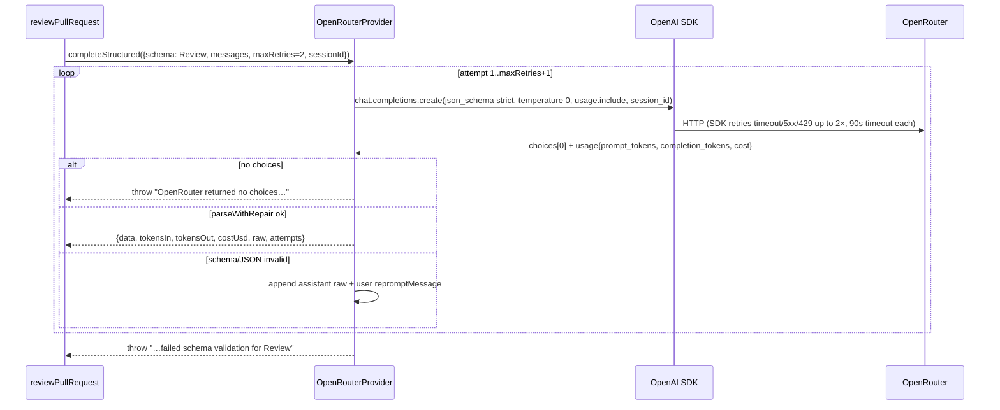
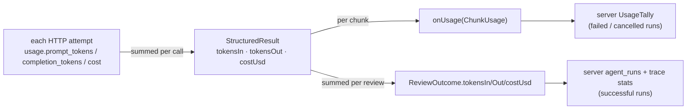

# LLM providers, structured output, retries, and cost

Which code makes the model call, how a schema-valid `Review` is obtained, and where token and USD numbers come from.
For the step order of a review see [pipeline.md](pipeline.md).

## Who implements `LLMProvider`

The engine depends only on the `LLMProvider` interface (`server/src/vendor/shared/adapters.ts:82`), passed in as
`ReviewInput.llm`. `reviewPullRequest` calls only `completeStructured`.

| Provider | Lives in | Structured-output mechanism | Cost source |
|---|---|---|---|
| `OpenRouterProvider` | `reviewer-core/src/llm/openrouter.ts:39` | OpenAI SDK at `https://openrouter.ai/api/v1`, `response_format: json_schema, strict: true` | OpenRouter `usage.cost` (real USD), else injected `estimateCost`, else `null` |
| `OpenAIProvider` | `server/src/adapters/llm/openai.ts:47` | `response_format` json_schema | static table `server/src/adapters/llm/pricing.ts:37 → estimateCost` |
| `AnthropicProvider` | `server/src/adapters/llm/anthropic.ts:41` | forced tool use (`tool_choice`, `anthropic.ts:115`) | same static table |
| `MockLLMProvider` | `server/src/adapters/mocks.ts:58` | returns a fixture, validated with `schema.safeParse` | fixed values |

Only `OpenRouterProvider` lives in the engine, because the CI runner needs it too (header comment at `openrouter.ts:14`).
The server builds it in `server/src/platform/container.ts:173 → buildLlm` and passes
`estimateCost: (m, i, o) => this.priceBook.estimate(m, i, o)`.

## `OpenRouterProvider.completeStructured`

`src/llm/openrouter.ts:59`

`reviewPullRequest` always passes `maxTokens` (default `DEFAULT_REVIEW_MAX_TOKENS` = 8000, override via `ReviewInput.maxTokens`); without it OpenRouter reserves the model maximum and returns 402 on low-limit keys. A reply cut off at the cap is retried once with a larger cap (up to `TRUNCATION_TOKEN_CEILING`).



- Two separate retry layers:
  - **Transport**: `new OpenAI({ timeout: 90_000, maxRetries: 2 })` (`openrouter.ts:54-55`).
  - **Schema repair**: up to `req.maxRetries + 1` attempts (`openrouter.ts:68`). Each failed attempt sends the bad output
    and a repair instruction back to the model (`openrouter.ts:113`). The conversation grows with every retry.
- `temperature` defaults to `0` (`openrouter.ts:72`).
- `session_id` (`openrouter.ts:80`) and `usage: { include: true }` (`openrouter.ts:83`) are sent only when
  `id === 'openrouter'`. The server builds `sessionId` as `owner/name#number:agentName`
  (`server/src/modules/reviews/run-executor.ts:213`), so all chunks of one run group together in the OpenRouter dashboard.
- An HTTP 200 with no `choices` (upstream error, moderation, free-tier limit) throws at `openrouter.ts:88`.
- Only `completeStructured` and `listModels` work. `complete` and `embed` throw `NOT_SUPPORTED`.

### Parse with repair
`src/llm/structured.ts:54 → parseWithRepair`

1. `JSON.parse(raw.trim())` first. Strict json_schema mode returns pure JSON.
2. Only if that fails: `extractJson` (`structured.ts:25`) strips ```` ```json ```` fences or takes the first balanced
   `{…}` / `[…]`. It is a fallback because braces or fences inside string values can fool it.
3. `schema.safeParse`. On failure, the Zod issues become the repair message
   (`- path: message` lines).

`toJsonSchema` (`structured.ts:19`) converts Zod to JSON Schema with OpenAI's `zodResponseFormat`. The server's OpenAI
and Anthropic providers reuse it through the re-export shim `server/src/platform/structured.ts`.

## Tokens and cost



- Per call: tokens are summed over all repair attempts. `costUsd = costFromApi ?? estimateCost(model, in, out) ?? null`
  (`openrouter.ts:107`).
- Per review: `ReviewOutcome.costUsd` adds up chunk costs but becomes `null` once any chunk reports `null`
  (`src/review/run.ts:198`). `null` means "unknown", never "free".
- `onUsage` (`run.ts:199`) fires once per **successful** chunk call. If a call throws (no choices, schema repair
  exhausted, transport failure after SDK retries), its tokens are never reported, even though the repair attempts were
  billed.
- Server side: `UsageTally` (`server/src/modules/reviews/usage.ts:7`) copies the null-propagation rule and returns
  `null` when no call completed. Success persists `outcome.costUsd` (`run-executor.ts:255`). Failure or cancel persists
  the tally (`run-executor.ts:312`). Full feature spec: [`../../server/specs/run-cost-badge.md`](../../server/specs/run-cost-badge.md).
- Server pricing for the OpenRouter path: `PriceBook.estimate` (`server/src/platform/price-book.ts:34`). It uses live
  OpenRouter prices when its cache is warm, otherwise the static table. It is synchronous, so the first call after a
  cold start uses the fallback while the cache refreshes.

## `listModels` pricing quirks

`src/llm/openrouter.ts:123` fetches `/models` directly with `fetch`, because the SDK's `models.list` drops `pricing`.
Per-token prices become USD per 1M tokens. Negative prices (OpenRouter's `-1` marker for router pseudo-models such as
`openrouter/auto`) become `pricing: null` (`openrouter.ts:142`). Results are sorted by cheapest completion price.
