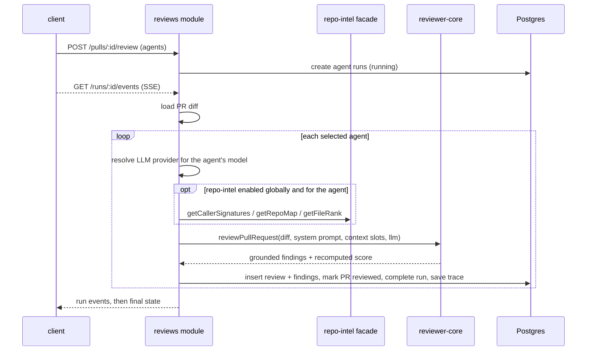

# server — architecture

The request and DI flow and the API map are in the
[package README](../README.md); the system overview is in the
[main README](../../README.md#architecture) and the cross-package rules in the
[repo architecture](../../docs/architecture.md). This document covers what those do
not: the server's dependencies on other packages and one review run in detail.

## Dependencies on other packages

The full dependency graph and its rules are in the
[repo architecture](../../docs/architecture.md#package-dependencies). What
matters when working in the server:

- `src/vendor/shared` is the copy of `@devdigest/shared` the API validates
  against. `reviewer-core` type-checks against it too; the client has its own
  copy that must be kept in step by hand.
- `reviewer-core` is consumed as source through an alias, so its dependencies
  must be installed (`npm ci` in `reviewer-core/`) or the API fails at boot
  with `ERR_MODULE_NOT_FOUND`.
- The client reaches the server over REST and SSE only.

## One review run

Triggered by `POST /pulls/:id/review`; orchestrated by
`src/modules/reviews/run-executor.ts`.

What to know when changing this flow:

- The server gathers context; `reviewer-core` formats it and calls the model.
  New context for the model is a new optional input slot on
  `reviewPullRequest`, filled in `run-executor.ts` from a port declared in
  `src/modules/reviews/ports.ts`.
- Agents run independently. A failed or cancelled run stores its status, error
  text and log so far and does not abort the others. If the diff cannot be
  loaded, every run in the request fails.
- Repo-intel context is best-effort: an unindexed repo yields empty results and
  the review continues on the diff alone.
- Only findings that survive grounding are persisted, with the recomputed score.
- Runs left in `running` by a crash are reaped on boot, before the server
  starts listening (`src/app.ts`).

## Adding a milestone module

Create `src/modules/<name>/` as a Fastify plugin, register it in
`src/modules/index.ts`, and use tables that already exist in `src/db/schema/`.
Write the spec in [`../specs/`](../specs/README.md) first. Lay the module out
inside-out (`domain.ts` → `ports.ts` → `service.ts` → `repository.ts` →
`routes.ts`) as the
[`onion-architecture` skill](../../.claude/skills/onion-architecture/SKILL.md)
describes, and run `pnpm deps:validate`.
