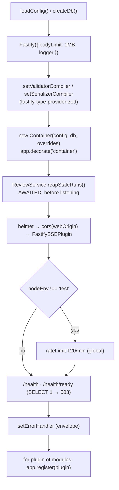
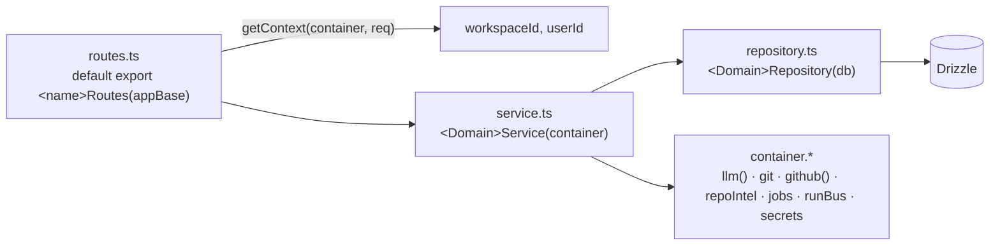

# Server architecture — boot, plugins, modules, DI

How the Fastify app is put together and how one request flows through it. The package [README](../README.md) has the
high-level request diagram, the API map, and the env table. This doc gives code locations and the ordering details
that matter when you add something.

## Boot order — `buildApp`
`src/app.ts:41 → buildApp`

| Step | Location | Why the order matters |
|---|---|---|
| Zod compilers | `src/app.ts:64-65` | Routes opt in per module with `app.withTypeProvider<ZodTypeProvider>()`. |
| Container | `src/app.ts:67-68` | Every module reads `app.container`. Tests pass `overrides` (`BuildAppOptions`, `app.ts:28`). |
| Stale-run reaper | `src/app.ts:80-85` | Marks every `running` `agent_runs` row `failed` (`modules/reviews/repository/run.repo.ts:105 → reapStaleRunningRuns`). Runs before any route exists, so a new run can't be reaped by mistake. Assumes one API instance per DB. |
| Plugins | `src/app.ts:89-97` | Registered before modules, so the encapsulated module plugins inherit them. |
| Error handler | `src/app.ts:116 → setErrorHandler` | Also registered before modules for the same reason. |
| Modules | `src/app.ts:168-170` | Static list from `src/modules/index.ts:24 → modules` (no autoload). |

`src/server.ts` calls `buildApp()`, listens on `0.0.0.0:apiPort`, and on SIGTERM/SIGINT runs `app.close()` (onClose closes the postgres pool).

## Error envelope
Every error leaves as `{ error: { code, message, details? } }` (`src/app.ts:116-164`):

| Thrown | Status | `code` |
|---|---|---|
| Route schema validation failure | 422 | `validation_error` |
| Response serialization failure | 500 | `internal_error` (details logged, never sent) |
| `ZodError` from a service `.parse` (matched by `instanceof` **or** by shape, since zod instances can differ) | 422 | `validation_error` |
| `AppError` subclass (`src/platform/errors.ts:7`) | `err.statusCode` | `err.code` |
| anything else | `err.statusCode ?? 500` | `internal_error` |

The client turns this envelope into `ApiError` (`client/src/lib/api.ts:44-58`).

## Module anatomy

- Example: `src/modules/reviews/routes.ts:19 → reviewsRoutes` creates `new ReviewService(container)` once per plugin
  registration. Each handler calls `getContext` first (`src/modules/_shared/context.ts:14`). In no-auth mode
  (`LocalNoAuthProvider`) that always resolves the seeded workspace and user.
- Shared route schemas: `src/modules/_shared/schemas.ts` (`IdParams`, …).
- Per-route config goes on the route options, e.g. `POST /pulls/:id/review` →
  `config: { rateLimit: { max: 10, timeWindow: '1 minute' } }` (`reviews/routes.ts:27-29`). SSE uses `rateLimit: false`.

## DI container
`src/platform/container.ts:56 → Container`

- Built once per `buildApp`: `config`, `db`, `secrets` (`LocalSecretsProvider`), `auth`, `jobs` (`new JobRunner(db)`), and
  `runBus`. `runBus` is the **module-level singleton** from `src/platform/sse.ts:103`, so every Container in the process
  shares it (`container.ts:85`).
- Lazy getters, cached on first use: `git`, `agentsRepo`, `reviewRepo`, `codeIndex`, `repoIntel`, `depgraph`,
  `tokenizer`, `priceBook`. Each checks `overrides` first.
- Async factories that need secrets: `github()` (throws `ConfigError` without `GITHUB_TOKEN`), `llm(id)`
  (`container.ts:163`, cached per provider id, built in `buildLlm` at `container.ts:173`), `embedder()`.
- `invalidateSecretCaches()` (`container.ts:214`) drops cached clients after keys change in Settings.

## Background work: two mechanisms

| Mechanism | Used by | Location | Persistence |
|---|---|---|---|
| `JobRunner` (p-queue, concurrency 3, timeout 120s, 2 retries) | clone (`CLONE_JOB_KIND`), repo-intel index/refresh/resync | `src/platform/jobs.ts:30`; handlers registered in `modules/repos/service.ts:46`, `modules/repo-intel/service.ts:173-179` | `jobs` table row per job |
| Fire-and-forget promise | review runs | `src/modules/reviews/service.ts:133 → void this.executor.executeRuns(...)` | `agent_runs` + `run_traces` |

Review runs are **not** jobs. Their live state is in the in-memory `RunBus`. See [review-pipeline.md](review-pipeline.md).

## Related
- Review execution end to end → [review-pipeline.md](review-pipeline.md)
- Tables, migrations, seed → [database.md](database.md)
- repo-intel internals → [`../src/modules/repo-intel/README.md`](../src/modules/repo-intel/README.md)
