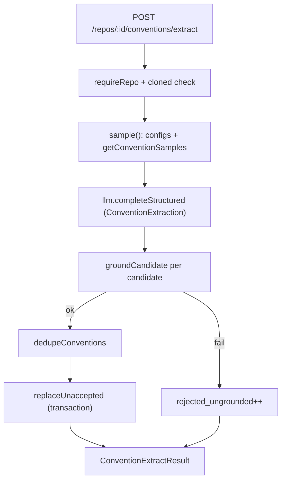
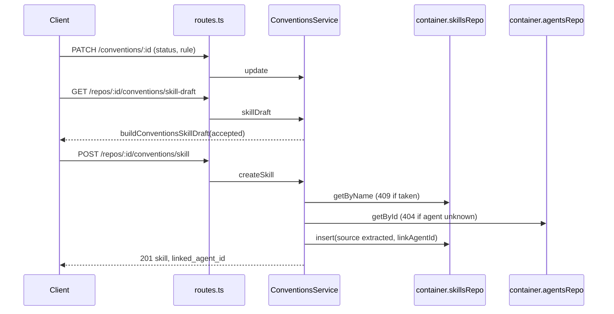

# Conventions extractor

The `conventions` module finds a repo's house rules, checks each one against the real code, and lets
the user turn the accepted rules into one `<repo>-conventions` skill. This doc explains how the code
works today. For the acceptance criteria, see [../specs/conventions.md](../specs/conventions.md). The
client half is in [../../client/specs/conventions.md](../../client/specs/conventions.md).

Code: `server/src/modules/conventions/` (`routes.ts` → `service.ts` → `repository.ts`, plus `domain.ts`,
`prompt.ts`, `constants.ts`, `ports.ts`).

## Design in one paragraph

The model proposes; code decides. Code samples the files, the model makes one call, and code verifies
every candidate. A candidate is kept only if its evidence file exists and its snippet is really in that
file. Line numbers and the stored snippet come from the file, never from the model.

## Extraction pipeline

1. **Sample** (`service.ts:104` → `ConventionsService.sample`). No model is involved.
   - `repoIntel.getConventionSamples(repo.id, 12)` returns the top files. If it throws, the list is
     empty and config files are still sampled (`service.ts:106-110`).
   - Config files (`CONFIG_FILE_NAMES`, `domain.ts:63`) are read from the repo root and from the
     top-level folder of every sampled file.
   - Caps (`constants.ts`): 12,000 characters per source file, 4,000 per config file, 90,000 in total.
     Empty files are skipped. A truncated file keeps its head and is flagged `truncated`.
   - `readRepoFile` skips unsafe paths and binary content (a NUL byte) and returns `null` on any read
     error (`service.ts:90`).
   - The full, untruncated content is kept in a map, so grounding checks the whole file.
   - No files at all → `ValidationError` (422).
2. **Model call** (`service.ts:157-166`). The model is the `feature_models.conventions` setting for the
   workspace (`repository.ts:113`), otherwise `DEFAULT_CONVENTIONS_MODEL` (`openai / gpt-4.1-mini`,
   `constants.ts:34`). The call sets `temperature: 0` and `maxTokens: 4000`. Without the cap the
   adapter reserves the model maximum, and OpenRouter rejects that with 402 on keys with a low
   credit limit (`constants.ts:18`). The schema `ConventionExtraction` allows at most 15 candidates.
3. **Ground** (`domain.ts:137` → `groundCandidate`). A candidate fails with one of
   `unsafe_path`, `file_not_found`, `snippet_too_short` (fewer than 12 characters after whitespace
   collapse) or `snippet_not_found`. `locateSnippet` matches line by line, in order, ignoring
   indentation, inner whitespace and blank lines, and handles CRLF. The stored snippet is the real
   file lines. Evidence files that were not sampled are read from the clone.
4. **De-duplicate** (`domain.ts:166` → `dedupeConventions`). `ruleKey` lowercases the rule and strips
   punctuation. A candidate is dropped if it matches another new candidate or an accepted rule.
5. **Store** (`repository.ts:65` → `replaceUnaccepted`). One transaction deletes every non-`accepted`
   convention of the repo and inserts the new ones as `pending`. A re-scan therefore keeps accepted
   rules and replaces everything else, including rejected ones.

## Prompt and untrusted input

`prompt.ts` builds the messages. Each file is a `<file path=… kind=…>` block. Quotes in the path are
escaped, and `neutralizeFileTags` breaks any `<file>` tag inside the content. The blocks are wrapped
with `wrapUntrusted('repository', …)` from `@devdigest/reviewer-core`. The system prompt tells the
model to treat file contents as data.

## Review and skill creation

- `skillDraft` and `createSkill` both call `acceptedFor`, which throws a 422 when no convention is
  accepted (`service.ts:211`).
- `buildConventionsSkillDraft` (`domain.ts:206`) writes `# <repo>-conventions` (name capped at 64
  characters), then one section per accepted rule with `path:lines` and a fenced snippet. The fence is
  longer than any fence inside the snippet. The skill type is `convention`.
- `createSkill` validates the name and body with `skillNameProblem` / `skillBodyProblem` from
  `modules/_shared/skill-name.ts`. The insert uses `source: 'extracted'` and `evidenceFiles` from the
  accepted rules.
- The agent link is part of the insert (`skillsRepo.insert({ linkAgentId })`,
  `skills/repository.ts:94`), so one transaction saves both and a failed link leaves no orphan skill.
  The skill is appended last in the agent's order.

## Routes

| Method | Path | Result |
| --- | --- | --- |
| GET | `/repos/:id/conventions` | `Convention[]`, highest confidence first, then oldest |
| POST | `/repos/:id/conventions/extract` | `{ candidates, sampled_files, rejected_ungrounded }` |
| POST | `/repos/:id/conventions/status` | sets the status of every candidate of the repo, returns the list |
| PATCH | `/conventions/:id` | `{ status?, rule? }` (at least one; rule max 500 characters) → `Convention` |
| GET | `/repos/:id/conventions/skill-draft` | `ConventionsSkillDraft` |
| POST | `/repos/:id/conventions/skill` | `{ name, description, type, body, enabled?, agent_id? }` → 201 `{ skill, linked_agent_id }` |

Errors: 404 for an unknown repo, convention or agent. 422 for a repo that is not cloned, nothing to
sample, no accepted convention, an invalid name or body, or an empty rule. 409 for a duplicate skill
name. Every query filters by `workspaceId` (`repository.ts`).

## Data model

`conventions` table: `id`, `workspace_id`, `repo_id` (cascade), `category`, `rule`, `evidence_path`,
`evidence_snippet`, `line_start`, `line_end`, `confidence`, `status`, `created_at`. Migrations:
`0011_conventions_extractor.sql` adds the new columns and backfills `status` from the old `accepted`
flag, `0012_conventions_drop_accepted.sql` drops the flag, and `0014_conventions_status_check.sql`
enforces the status enum. See [database.md](database.md) for the general schema rules.

## Safety

- `isSafeRelativePath` (`domain.ts:83`) rejects absolute paths, drive letters, `..` and any `.git`
  segment.
- `SimpleGitClient.readFile` (`adapters/git/simple-git.ts:135`) resolves the real path and refuses
  anything outside the clone or under `.git/`. A symlink shipped in the repo cannot leak files.
- The module imports nothing from other modules. It reaches them through `container.skillsRepo`,
  `agentsRepo`, `repoIntel`, `git` and `llm`.

## Decisions

### Module-local contracts and default model
- **Context**: `src/vendor/shared` is "do not touch", and the shared `FEATURE_MODELS` registry has no
  conventions entry.
- **Decision**: `Convention`, `ConventionStatus`, `ConventionExtractResult` and `ConventionsSkillDraft`
  live in `domain.ts`. The default model is `DEFAULT_CONVENTIONS_MODEL` in `constants.ts`.
- **Consequences**: the client mirrors the types in `client/src/lib/types.ts` and the model in
  `client/src/lib/feature-models.ts`. Change both sides together.

## Tests

`test/conventions-domain.test.ts` (grounding, de-duplication, draft), `test/conventions-service.test.ts`
(sampling, one model call, re-scan), `test/conventions-routes.it.test.ts` (end to end over Postgres).

## Related seed skills

The API Contract Reviewer seed skills (`breaking-change`, `response-schema`, `semver-discipline`) are
seeded from `src/db/seed-skills.ts`. `RETIRED_SEED_SKILLS` (`seed-skills.ts:213`) lists the two old
skills that re-seeding deletes (`seed.ts:268`).
