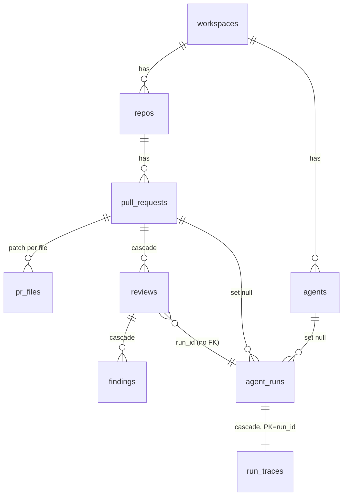
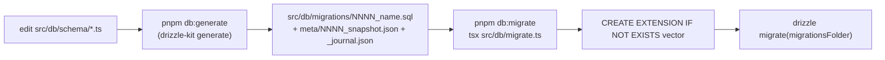

# Database — schema layout, review tables, migrations, seed

Postgres 16 + pgvector through Drizzle ORM. Naming rules (snake_case tables and columns, camelCase TS) are in
[`../CLAUDE.md`](../CLAUDE.md) § Naming conventions. Env vars and migrate/seed commands are in the [README](../README.md).

## Schema layout

`src/db/schema.ts` is the barrel. It re-exports 13 domain files from `src/db/schema/` and builds the `schema` object
used to type the Drizzle client. `src/db/schema/_shared.ts` (the `now()` → `created_at timestamptz default now()`
helper, `_shared.ts:9`) is **not** re-exported.

| File | Tables |
|---|---|
| `core.ts` | `users`, `workspaces`, `workspace_members`, `settings` |
| `repos.ts` | `repos` |
| `pulls.ts` | `pull_requests`, `pr_files`, `pr_commits` |
| `reviews.ts` | `reviews`, `findings`, `pr_intent`, `pr_brief` |
| `agents.ts` | `agents`, `agent_versions`, `agent_skills` |
| `skills.ts` | `skills`, `skill_versions` |
| `knowledge.ts` | `memory` (`vector(1536)`), `conventions` |
| `context.ts` | `code_chunks` (`vector(1536)`), `symbols`, `references`, `onboarding` |
| `eval.ts` | `eval_cases`, `eval_runs`, `conformance_checks`, `composed_reviews` |
| `ci.ts` | `ci_installations`, `ci_runs` |
| `runs.ts` | `agent_runs`, `run_traces`, `multi_agent_runs` |
| `ops.ts` | `jobs`, `installed_plugins`, `digests` |
| `repo-intel.ts` | `repo_index_state`, `file_edges`, `file_facts`, `file_rank`, `repo_map_cache` |

Every lesson's tables already exist. Tables a starter module doesn't use simply stay empty.

## The review path (tables a review touches)

- `reviews` (`src/db/schema/reviews.ts:9`): `workspace_id`, `pr_id` FK cascade. `agent_id` and `run_id` are plain uuids
  (**no FK**). `kind` ∈ `summary|review`.
- `findings` (`reviews.ts:28`): **no `workspace_id`**. Scope through the parent review/PR. `start_line`/`end_line`,
  `kind` default `'finding'`, `accepted_at`/`dismissed_at` timestamps for finding actions.
- `agent_runs` (`src/db/schema/runs.ts:8`): `status` is free text (`running|done|failed|cancelled` in practice),
  `cost_usd` double (null = unknown), `score`, `blockers`, `error`, `source` ∈ `local|ci`.
- `run_traces` (`runs.ts:36`): one jsonb `trace` document per run, PK = `run_id`.
- `agents` (`src/db/schema/agents.ts:8`): `provider` ∈ `openai|anthropic|openrouter`, `strategy` default `'single-pass'`
  (`:20`), `ci_fail_on` default `'critical'`, `repo_intel` default true, `version`.
- Row types for code outside the owning module: `src/db/rows.ts` (`AgentRow`, `FindingRow`, `PullRow`, `AgentRunRow`, …).

### Tenancy
No query guard exists. The barrel's header comment mentions a "base-repository guard" (`schema.ts:5`), but that guard
doesn't exist. Every repository function on a table with `workspace_id` filters by hand (e.g.
`modules/reviews/repository.ts:30 → getPull(workspaceId, prId)`). Child tables are scoped through a parent that was
already checked.

## Migrations workflow

- Config: `drizzle.config.ts` (schema `./src/db/schema.ts`, out `./src/db/migrations`, `strict: true`).
- `runMigrations(url)` (`src/db/migrate.ts:19`) creates the pgvector extension first. No `.sql` file does that, so
  `drizzle-kit migrate` alone fails on the `vector(1536)` columns. The testcontainers harness reuses the same
  function (`test/helpers/pg.ts`).
- CLI guard `import.meta.url === \`file://${process.argv[1]}\`` (`migrate.ts:37`). On Windows it never matches.
  See `../INSIGHTS.md` for the workaround.
- Current migrations: `0000_init` … `0010_polite_slapstick` (journal `src/db/migrations/meta/_journal.json`). Never
  edit an existing one. Generate a new one and keep the snapshot and journal it produces.
- Migrations are **not** applied on boot.

## Seed
`src/db/seed.ts:31 → seed(db)` (`pnpm db:seed`, idempotent: `onConflictDoNothing`, and agents inserted only if
missing, `seed.ts:220`):

- workspace + system user + membership + settings
- repo `acme/payments-api` (`seed.ts:80`), PR #482 "Add rate limiting to public API endpoints" (`seed.ts:101`),
  `pr_files` (`src/config.ts`, …), `pr_commits`
- one review with findings, including "Hardcoded Stripe secret key in commit" (`seed.ts:137-158`)
- agents **General Reviewer**, **Security Reviewer**, **Performance Reviewer** (`seed.ts:183-207`), all
  `openrouter` / `deepseek/deepseek-v4-flash` (`seed.ts:12-13`)

e2e flows and no-auth mode depend on these rows. See [`../../e2e/specs/README.md`](../../e2e/specs/README.md).
