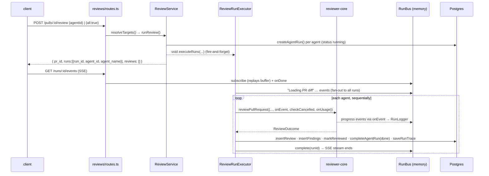

# Review pipeline — from `POST /pulls/:id/review` to persisted findings

What the server does around the engine. What happens *inside* `reviewPullRequest` (chunks, prompt, grounding,
score) is in [`../../reviewer-core/docs/pipeline.md`](../../reviewer-core/docs/pipeline.md). Prompt-context rules
are in the README § "Review context (non-obvious)".

## Sequence

## Steps with code locations

| # | Step | Location |
|---|---|---|
| 1 | Route: `RunRequest.parse(req.body ?? {})` (a manual parse here: an empty body is allowed), rate limit 10/min | `src/modules/reviews/routes.ts:27-44` |
| 2 | Targets: `all` → `agentsRepo.listEnabled`; `agentId` → one agent, else `NotFoundError`; neither → `AppError('invalid_run_request', 400)` | `src/modules/reviews/service.ts:46 → resolveTargets` |
| 3 | One `agent_runs` row per agent, created **before** returning, so the client gets run ids right away | `service.ts:119-129` |
| 4 | Background start, errors only logged | `service.ts:133` |
| 5 | Shared pre-work: one `RunLogger` fanned out to every run id, `loadDiff` | `src/modules/reviews/run-executor.ts:66-106` |
| 6 | Diff source: `git diff base...head` from the clone. If that throws or has 0 files, rebuild from `pr_files.patch` rows | `src/modules/reviews/diff-loader.ts:12 → loadDiff`, `:33 → diffFromPrFiles` |
| 7 | Diff failure → **every** queued run marked `failed` with the error and a trace from the bus buffer | `run-executor.ts:76 → failAll` |
| 8 | Agents run **one after another** (`for…of` + `await`). A failure is isolated to that agent | `run-executor.ts:108-135` |
| 9 | Provider: `container.llm(agent.provider)`. A missing key throws `ConfigError` and the run is persisted as failed | `run-executor.ts:164` |
| 10 | Context enrichment (best-effort, only when `agent.repoIntel !== false`): callers digest, repo map, rank note on the task line | `run-executor.ts:174-190`; helpers `buildCallersDigest` `:340`, `buildRepoMapDigest` `:377`, `buildRankNote` `:397` |
| 11 | Engine call: `strategy: agent.strategy ?? REVIEW_STRATEGY` (`'single-pass'`), `sessionId = owner/name#number:agent` | `run-executor.ts:196-219` |
| 12 | Persist: `reviews` row (verdict/summary/score from the outcome), `findings` rows (kept only), `pull_requests.last_reviewed_sha = headSha` | `run-executor.ts:225-241` |
| 13 | `blockers = countBlockers(kept, agent.ciFailOn)` (from reviewer-core) | `run-executor.ts:247` |
| 14 | `completeAgentRun(status 'done', tokens, costUsd, score, blockers, grounding)` + one `RunTrace` document | `run-executor.ts:250-295` |
| 15 | `runBus.complete(runId)` → SSE generator ends | `run-executor.ts:296` |

## Failure and cancel path
`run-executor.ts:299-326`

- `RunCancelledError` (`run-executor.ts:14`) → status `cancelled`, message `Cancelled by user`. Any other error →
  `failed` with `err.message`.
- Tokens and cost come from `UsageTally` (`src/modules/reviews/usage.ts:7`), filled by the engine's `onUsage`. This
  means partial spend from finished chunks is kept. Findings 0, grounding `0/0 passed`.
- The trace is `traceFromBuffer` (`run-executor.ts:421`): its log is the whole bus buffer, so the error is still visible
  after a reload.

### How cancel works
`POST /runs/:id/cancel` → `ReviewService.cancelRun` (`service.ts:85`):
1. publish `Cancellation requested — stopping…`
2. `runBus.cancel(runId)`: the executor's `checkCancelled` throws `RunCancelledError` at the engine's **next chunk
   checkpoint** (before each LLM call).
3. `cancelRunIfRunning` (`repository/run.repo.ts:94`) sets the row to `cancelled` right away. This also handles orphaned
   runs.
4. `runBus.complete(runId)`.

Single-pass has only one checkpoint, before its only LLM call. If the cancel arrives while that call is running, the
executor still finishes. `completeAgentRun` (`repository/run.repo.ts:142`) has no status guard, so it overwrites
`cancelled` with `done` and the review is persisted.

## Live events — `RunBus` + SSE
`src/platform/sse.ts:19 → RunBus`

- `publish` assigns a per-run `seq`, stamps `t` (HH:MM:SS), appends to an in-memory buffer, and emits.
- `subscribe` **replays the buffer first**, then streams live events. `onDone` fires right away (microtask) if the run
  already completed, so late subscribers replay and then the stream ends.
- `complete` deletes the emitter and the cancel flag. The buffer is **not** deleted, so it stays in memory for the life
  of the process.
- SSE route `GET /runs/:id/events` (`routes.ts:48-91`) turns the bus into an async generator. Each frame:
  `id: seq`, `event: kind`, `data: JSON(RunEvent)`. No rate limit.
- `RunLogger` (`src/platform/run-logger.ts:36`) wraps the bus for the executor. `forRun` narrows a fanned-out logger to
  one run. `step()` logs start/finish around an async call. `logFor(runId)` gives the persisted log lines.

## What gets persisted per run

| Table | Written by | Content |
|---|---|---|
| `agent_runs` | `createAgentRun` / `completeAgentRun` | status, provider/model, duration, tokens, `cost_usd`, findings_count, grounding, score, blockers, error |
| `reviews` | `insertReview` | verdict, summary, score, model, `run_id` link |
| `findings` | `insertFindings` (`repository/review.repo.ts:29`) | grounded findings only. The model's `id` and `evidence` are not stored |
| `run_traces` | `saveRunTrace` (upsert by `run_id`) | one jsonb `RunTrace`: config, stats, prompt_assembly, tool_calls (one per chunk), raw_output, log |

## Where the client reads it
`GET /pulls/:id/runs/active` (polling while non-empty), `GET /pulls/:id/runs`, `GET /pulls/:id/reviews`,
`GET /runs/:id/trace`, and SSE. See [`../../client/docs/data-fetching.md`](../../client/docs/data-fetching.md).
