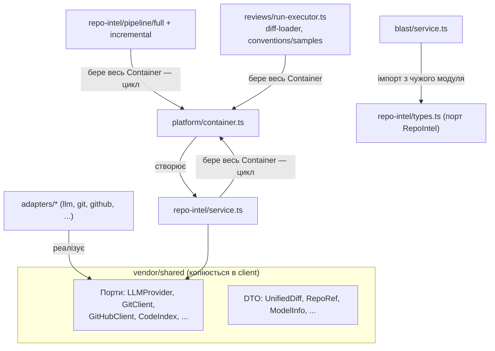
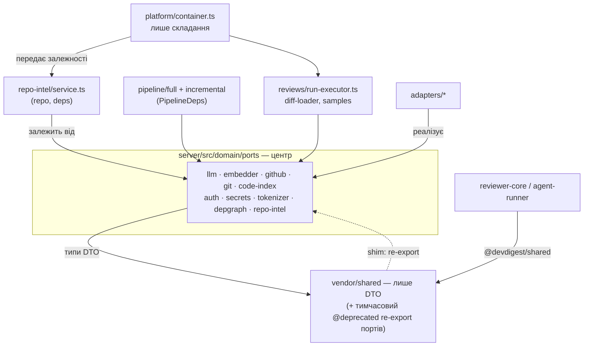

# Spec: Порти — всередину, контейнер — на край   |   Spec ID: SPEC-16   |   Status: draft

> Архітектурний рефакторинг `server/src` за [onion-architecture](../.claude/skills/onion-architecture/SKILL.md)
> (§3 «Ports Belong to the Inside», §4 «Constructor Injection, Never the Container»,
> §13, §15). Функціональна поведінка не змінюється. Рішення в цьому документі
> **ухвалені користувачем і остаточні**; spec фіксує їх точно, а не переобговорює.
>
> Примітка про формат: оскільки це архітектурна задача, «що» тут — це саме
> розташування коду й напрямок залежностей, тому шляхи файлів і імена типів
> з'являються в тексті свідомо. «Як» (послідовність правок усередині кожного
> файлу, технічні прийоми) — справа `implementation-planner`.

## Problem & Motivation

### Простими словами

Уявіть склад. Сервісу `RepoIntelService` для роботи треба 3–4 інструменти:
git, індекс коду, черга задач, токенайзер. А ми видаємо йому **ключ від усього
складу** — весь `Container`. Наслідки:

1. **Не видно, що сервісу насправді треба.** Щоб дізнатися, доводиться читати
   все тіло класу (`container.git.sync`, `container.jobs.register`,
   `container.config.repoIntelEnabled` ×9, `container.codeIndex.*`, `container.db`…).
2. **Помилки переїжджають із компіляції в рантайм.** Якщо в контейнері чогось
   бракує — дізнаємося падінням, а не червоним `tsc`.
3. **Стрілка дивиться не туди.** Контейнер — це «зовнішнє кільце», він сам
   створює сервіси. Сервіс, що імпортує контейнер, утворює цикл
   `service → container → service`. Таких циклів зараз 4.
4. **Тести брешуть типам.** Щоб протестувати сервіс, тести будують напівпорожній
   контейнер і кастять його `as unknown as Container` — будь-яке нове звернення до
   `container.X` ламає їх у рантаймі (див. `server/LEARNINGS.md`, 2026-08-04).

Друга половина проблеми — **де лежать порти** (інтерфейси інфраструктури:
`LLMProvider`, `GitClient`, `GitHubClient`, `CodeIndex`, `Embedder`,
`AuthProvider`, `SecretsProvider`). Зараз вони у `server/src/vendor/shared/adapters.ts` —
у теці, яка призначена для API-контрактів між client і server і яку
копіюють у клієнт. Клієнт жодним із цих портів не користується. Ще три порти
(`Tokenizer`, `DepGraph`, `RepoIntel`) лежать поруч зі своїми реалізаціями або в
модулі, через що `blast/service.ts` змушений імпортувати тип з іншого модуля.
Теки `server/src/domain/` не існує взагалі — правило `domain-depends-on-nothing`
у dependency-cruiser «проходить», бо перевіряти нічого.

Крім того, `vendor/` виключено з dependency-cruiser, тож `pnpm arch` цієї
проблеми просто не бачить.

### Факти (HEAD `fc35f3f`)

- Файли, що беруть увесь `Container`: `modules/repo-intel/service.ts` (+ сам
  створює `RepoIntelRepository(container.db)`), `modules/repo-intel/pipeline/full.ts`,
  `modules/repo-intel/pipeline/incremental.ts`, `modules/reviews/run-executor.ts`,
  `modules/reviews/diff-loader.ts`, `modules/conventions/samples.ts`.
  `modules/_shared/context.ts` — допустимий route-helper, лишається як є.
- Правило `no-container-in-services` ловить лише `^src/modules/.+/service\.ts$`,
  тому `run-executor`, `diff-loader`, `samples`, `pipeline/*` від нього вислизають.
- Точки складання: `platform/container.ts` (`new RepoIntelService(this)` у ліниво
  обчислюваному getter `repoIntel`), `modules/reviews/routes.ts`
  (`new ReviewRunExecutor(container, …)`).
- Обробники джобів repo-intel реєструються не в конструкторі, а в
  `registerIndexJobHandlers()`, який викликає `modules/repo-intel/routes.ts`
  через `this.container.jobs.register(...)`. `JobRunner` створюється в
  конструкторі `Container` негайно (не ліниво).
- `pipeline/*` імпортує напряму `adapters/astgrep` і `adapters/codeindex/extract`
  (не через порт) — це поза скоупом цього spec.

### Як є зараз

### Як хочемо

### Чи схеми відповідають тому, що треба зробити

Так. Друга схема — це рівно чотири кроки з розділу «Порядок комітів»: порти
переїжджають у `domain/ports`, сервіси й адаптери дивляться всередину, контейнер
лише складає залежності і більше ніким не імпортується з модулів.

Один нюанс, який видно на схемі пунктирною стрілкою: **`vendor/shared` ще якийсь
час re-export'ить порти** (compat-shim, позначений `@deprecated`), щоб
`reviewer-core` і `agent-runner` компілювалися без змін. Тож у перший день
картина — «джерело правди для портів — `domain/ports`, а `vendor/shared` на нього
посилається», а не «у `vendor/shared` портів більше немає». Повне видалення
shim — окрема наступна задача.

## Goals / Non-goals

### Goals

- G1. Створити `server/src/domain/ports/` — по одному файлу на порт — і зробити
  його єдиним джерелом правди для інтерфейсів інфраструктури сервера.
- G2. Прибрати `Container` з усіх файлів модулів, крім `routes.ts` і `_shared/`:
  `repo-intel/service.ts`, `repo-intel/pipeline/{full,incremental}.ts`,
  `reviews/run-executor.ts`, `reviews/diff-loader.ts`, `conventions/samples.ts`.
  Залежності — явно, через конструктор або параметри.
- G3. Винести чисті функції `buildTrace`, `renderCallersDigest`, `rankNote` з
  `run-executor.ts` в окремий файл модуля `reviews` з юніт-тестами; рядки на
  виході байт-у-байт ті самі.
- G4. Посилити enforcement: `no-container-in-services` покриває всі файли модулів
  (крім `routes.ts` і `_shared/`); `domain-depends-on-nothing` отримує реальні
  файли для перевірки; зняті з baseline порушення видалено з
  `.dependency-cruiser-known-violations.json`; каталог порушень у
  `.claude/skills/onion-architecture/README.md` оновлено.
- G5. Нуль функціональних змін; кожен крок — окремий коміт.

### Non-goals (follow-ups, лише згадка)

- Синхронізація клієнтської копії `client/src/vendor/shared` (видалення мертвих
  портів у клієнті) — у цьому spec клієнтську копію **не редагуємо**.
- Видалення compat-shim у `vendor/shared/adapters.ts` і міграція `reviewer-core`/
  `agent-runner` на нове джерело портів.
- `pulls` service/repository, `SettingsRepository`, транзакції, розщеплення
  `EvalService`/`CiService`.
- Цикл `agents/helpers.ts ↔ agents/repository.ts` та всі інші baseline-записи,
  не перелічені в AC-17.
- Пряме використання `adapters/astgrep` і `adapters/codeindex/extract` з
  `repo-intel/pipeline/*`.
- Цикл `pipeline/incremental.ts → pipeline/full.ts` (усередині модуля) —
  прибирається лише якщо це тривіально; інакше лишається.

## User stories

- **US-1 (розробник сервера).** Як розробник, я хочу бачити в сигнатурі
  конструктора `RepoIntelService` / `ReviewRunExecutor` рівно ті залежності, які
  він використовує, щоб не читати все тіло класу і отримувати помилку компіляції,
  а не рантайму, коли залежності бракує. → AC-5, AC-6, AC-7, AC-8, AC-9, AC-10, AC-11
- **US-2 (розробник сервера).** Як розробник, я хочу знаходити будь-який порт
  інфраструктури в одному місці — `domain/ports/` — а не шукати його у
  `vendor/shared`, поруч з адаптером чи в іншому модулі. → AC-1, AC-2, AC-3, AC-4
- **US-3 (автор тестів).** Як автор тестів, я хочу передавати сервісу фейки
  портів напряму, без `as unknown as Container`, щоб тест не ламався, коли
  сервіс почне читати ще одне поле контейнера. → AC-12, AC-13, AC-15
- **US-4 (автор тестів).** Як автор тестів, я хочу тестувати форматування trace /
  callers digest / rank note як чисті функції без запуску рану. → AC-14, AC-15
- **US-5 (AI-агент, що читає skill).** Як агент, що працює за
  `onion-architecture`, я хочу, щоб `pnpm arch` реально перевіряв правила для
  `domain/` і для всіх файлів модулів, а каталог порушень у README skill
  відповідав дійсності, щоб мої рішення спиралися на правду. → AC-16, AC-17,
  AC-18, AC-19
- **US-6 (споживач `@devdigest/shared`).** Як мейнтейнер `reviewer-core` /
  `agent-runner` / `client`, я хочу, щоб мої пакети компілювалися без жодних
  змін після цього рефакторингу. → AC-3, AC-20, AC-21, AC-22

## Acceptance criteria (EARS)

### Крок 1 — порти переїжджають у `domain/ports`

- **AC-1.** Система ПОВИННА містити теку `server/src/domain/ports/` з файлами
  `llm.ts` (`LLMProvider`, `ChatMessage`, `CompletionRequest`, `CompletionResult`,
  `StructuredRequest`, `StructuredResult`), `embedder.ts` (`Embedder`),
  `github.ts` (`GitHubClient` + типи, що є виключно його параметрами/результатами
  і не є DTO зі списку AC-2), `git.ts` (`GitClient`, `CloneOptions`, `BlameLine`,
  `GitCommit`), `code-index.ts` (`CodeIndex`), `auth.ts` (`AuthProvider`),
  `secrets.ts` (`SecretsProvider`, `SecretKey`), `tokenizer.ts` (`Tokenizer`),
  `depgraph.ts` (`DepGraph`), `repo-intel.ts` (фасад `RepoIntel` + його типи
  результатів). *Verify: `ls server/src/domain/ports`; grep `export interface` у кожному.*
- **AC-2.** `server/src/vendor/shared/adapters.ts` ПОВИНЕН і далі оголошувати
  DTO `ModelInfo`, `RepoRef`, `UnifiedDiff`, `DiffHunk`, `GitHubReviewPayload`,
  `CreateReviewCommentInput`, `OpenPrPayload`, `CommitFile`, `CommitFilesPayload`,
  `WorkflowRun`, `RunArtifact`, `CodeMatch`, `CodeSymbol`, `CodeReference`,
  `AuthUser`, `AuthWorkspace` — без зміни їхньої форми.
- **AC-3.** `server/src/vendor/shared/adapters.ts` ПОВИНЕН re-export'ити кожен
  перенесений порт (і супутні типи з AC-1, що раніше там оголошувались) з
  `../../domain/ports/*`, з коментарем `@deprecated`, який пояснює, що це
  compat-shim для `reviewer-core`/`agent-runner`, а джерело правди —
  `domain/ports`. Імена, що експортуються з `@devdigest/shared`, ПОВИННІ
  лишитися тими самими, що й до зміни.
  *Verify: diff множини експортованих імен `@devdigest/shared` до/після — порожній.*
- **AC-4.** Файли в `server/src/domain/` ПОВИННІ імпортувати лише `zod`, інші
  файли `src/domain/` та DTO-типи з `vendor/shared`; вони НЕ ПОВИННІ імпортувати
  нічого з `src/adapters/`, `src/platform/`, `src/db/`, `src/modules/`.
  *Verify: `pnpm arch` — `domain-depends-on-nothing` 0 порушень при непорожній `src/domain/`.*
- **AC-5.** Код у `server/src` поза `vendor/shared` ПОВИНЕН імпортувати порти з
  `domain/ports`, а не через `@devdigest/shared`; `Tokenizer`, `DepGraph` і
  `RepoIntel` ПОВИННІ оголошуватися лише в `domain/ports` (адаптери/модуль їх
  імпортують, `modules/repo-intel` може re-export'ити для власного вжитку).
  *Verify: grep імпортів `LLMProvider|GitClient|GitHubClient|CodeIndex|Embedder|AuthProvider|SecretsProvider`
  з `@devdigest/shared` у `server/src` поза `vendor/` — 0 збігів.*
- **AC-6.** `modules/blast/service.ts` НЕ ПОВИНЕН імпортувати нічого з
  `modules/repo-intel/`. *Verify: baseline-запис `no-cross-module` blast → repo-intel/types зник.*

### Крок 2 — ін'єкція через конструктор

- **AC-7.** `RepoIntelService` ПОВИНЕН приймати в конструкторі репозиторій
  `RepoIntelRepository` і об'єкт `RepoIntelDeps = { git; codeIndex; jobs;
  depgraph; tokenizer; repoIntelEnabled: boolean }` і НЕ ПОВИНЕН сам створювати
  репозиторій чи звертатися до `Container`.
- **AC-8.** `runFullIndex` і `runIncremental` ПОВИННІ приймати
  `PipelineDeps = Pick<RepoIntelDeps, 'git' | 'depgraph' | 'tokenizer'>` замість
  `Container`.
- **AC-9.** `ReviewRunExecutor` ПОВИНЕН отримувати залежності явно: репозиторій
  reviews, пошук агентів, резолвер LLM `(provider) => LLMProvider`, `runBus`,
  `tokenizer`, резолвер intent, резолвер project context, порт `RepoIntel`,
  `promptAssemblyDebugEnabled: boolean`. Типи резолверів intent і project context
  ПОВИННІ бути оголошені локально структурно (onion §13), без імпорту класів
  інших модулів.
- **AC-10.** `diff-loader` і `conventions/samples.ts` ПОВИННІ приймати `GitClient`
  (та інші реально використані залежності) замість `Container`.
- **AC-11.** `run-executor.ts` і `diff-loader.ts` НЕ ПОВИННІ імпортувати
  `db/schema` чи `db/rows`, а також НЕ ПОВИННІ імпортувати тип репо з
  `modules/repos/` (`RepoRow` там є, але це `typeof t.repos.$inferSelect` і
  імпорт reviews → repos — нове порушення `no-cross-module`). Тип репо й
  `AgentRow` ПОВИННІ бути замінені локальними структурними формами з лише
  використаними полями (onion §13).
- **AC-12.** КОЛИ сервер стартує, `platform/container.ts` і `modules/reviews/routes.ts`
  ПОВИННІ бути єдиними місцями, де ці класи складаються з конкретних залежностей;
  лінива ініціалізація getter `repoIntel` і перевага `ContainerOverrides.repoIntel`
  ПОВИННІ зберегтися.
- **AC-13.** КОЛИ викликається `registerIndexJobHandlers()`, `RepoIntelService`
  ПОВИНЕН реєструвати INDEX/REFRESH/RESYNC обробники на тому самому екземплярі
  `JobRunner`, що й контейнер (переданому через `deps.jobs`), а не шукати його
  повторно.

### Крок 3 — чисті функції з run-executor

- **AC-14.** Система ПОВИННА експортувати `buildTrace`, `renderCallersDigest`,
  `rankNote` як чисті функції з окремого файлу модуля `reviews` (напр.
  `run-trace-rules.ts`), і для однакових входів вони ПОВИННІ повертати рядки/
  об'єкти, ідентичні до поточної поведінки. *Verify: юніт-тести з
  snapshot/рядковими очікуваннями, зафіксованими до виносу.*
- **AC-15.** Тести `indexer-pipeline.test.ts`, `repo-intel-weighted-service.test.ts`,
  `repo-intel-facade-degraded.test.ts`, `conventions-samples.test.ts` НЕ ПОВИННІ
  містити `as unknown as Container`; вони ПОВИННІ передавати фейки портів
  напряму. Нові юніт-тести для функцій AC-14 ПОВИННІ не потребувати ні БД, ні
  контейнера.

### Крок 4 — enforcement і документація

- **AC-16.** Правило `no-container-in-services` ПОВИННЕ мати `from` =
  `^src/modules/(?!_shared/)(?!.*routes\.ts$)` (будь-який файл модуля, крім
  `routes.ts` і `_shared/`), severity `error`.
  *Verify: тимчасово додати `import type { Container }` у будь-який
  `modules/*/helpers.ts` → `pnpm arch` падає.*
- **AC-17.** `.dependency-cruiser-known-violations.json` НЕ ПОВИНЕН містити
  записів: `no-container-in-services` для `repo-intel/service.ts`; 4 записи
  `no-circular` циклу через `platform/container.ts` (`service → container`,
  `pipeline/full → container`, `pipeline/incremental → container`,
  `pipeline/incremental → pipeline/full`); 2 записи
  `db-only-in-repositories` для `reviews/run-executor.ts`; 1 для
  `reviews/diff-loader.ts`; 1 `no-cross-module` `blast/service.ts → repo-intel/types.ts`.
  Решта записів ПОВИННА лишитися без змін (і не повинно з'явитися нових).
  *Verify: `git diff` baseline — лише видалення, жодних додавань.*
- **AC-18.** ЯКЩО будь-який файл `src/modules/**` (крім `routes.ts`/`_shared/`)
  імпортує `platform/container.ts`, ТОДІ `pnpm arch` ПОВИНЕН завершитися з
  ненульовим кодом.
- **AC-19.** Каталог порушень у `.claude/skills/onion-architecture/README.md`
  ПОВИНЕН відображати нові лічильники (V1, V3/V4, V5 — «порти в
  `domain/ports`, shim лишається», V7, V8 — новий cross-module запис
  blast → repo-intel знятий) і фразу про `domain-depends-on-nothing` як «true
  zero без файлів» замінено на актуальну.

### Наскрізне

- **AC-20.** `cd reviewer-core && pnpm typecheck && pnpm test` ПОВИННІ проходити
  без змін у коді `reviewer-core`.
- **AC-21.** `cd agent-runner && pnpm typecheck` ПОВИНЕН проходити без змін у
  коді `agent-runner`.
- **AC-22.** `client/src/vendor/shared` НЕ ПОВИНЕН змінюватися, а `client pnpm typecheck`
  ПОВИНЕН проходити.
- **AC-23.** `cd server && pnpm typecheck && pnpm test && pnpm arch` ПОВИННІ
  проходити після **кожного** з чотирьох комітів, включно з
  `test/contracts.test.ts`, `reviews.it.test.ts`, `multi-agent.it.test.ts`.

## Edge cases

- **E1. Аліас reviewer-core / agent-runner.** Обидва пакети резолвлять
  `@devdigest/shared` у `server/src/vendor/shared/index.ts`, отже re-export
  з `../../domain/ports/*` потягне ці файли в їхній `tsc`. Файли `domain/ports`
  тому НЕ можуть використовувати серверні path-аліаси чи імпорти, що
  резолвляться лише в контексті `server/tsconfig.json`. `reviewer-core`
  мапить `zod` на власний `node_modules`, `agent-runner` — ні (резолвить від
  розташування файлу). Якщо порт посилається на zod-тип (`StructuredRequest`
  несе схему), можливий конфлікт двох копій zod у типах.
  [NEEDS CLARIFICATION: CL-1]
- **E2. Двонаправлене посилання `vendor/shared/adapters.ts ↔ domain/ports/*`.**
  Порти імпортують DTO з `vendor/shared`, а `vendor/shared` re-export'ить порти.
  Це свідомий однонаправлений виняток із правила «vendor/shared не знає про
  domain»: дозволено **лише** type-only re-export портів (жодних значень), щоб
  цикл існував тільки на рівні типів і зник з рантайму/бандла. Dependency-cruiser
  його не бачить, бо `vendor/` виключено.
- **E3. Клієнтська копія.** `client/src/vendor/shared/adapters.ts` лишається
  як є, з власними (мертвими) копіями портів; дрейф між копіями від цього
  збільшується — це прийнятно до follow-up.
- **E4. `pipeline/incremental.ts → pipeline/full.ts`.** Перевірено: `full.ts` не
  імпортує ні `incremental.ts`, ні `service.ts`, тож baseline-запис
  `no-circular incremental → full` — це лише ланка циклу
  `incremental → full → container → service → incremental`. Після кроку 2 він
  ПОВИНЕН зникнути разом з іншими; сам імпорт `incremental → full` лишається
  (це звичайна залежність, не цикл).
- **E5. `_shared/context.ts`.** Залишається route-helper'ом з доступом до
  `Container`; правило AC-16 явно його виключає.
- **E6. Лінивий getter `repoIntel`.** `RepoIntelService` створюється ліниво в
  `container.repoIntel`; залежності для нього (`git`, `codeIndex`, `depgraph`,
  `tokenizer`) самі є лінивими getter'ами. Передача їх у конструктор означає, що
  вони матеріалізуються в момент першого звернення до `repoIntel`, а не пізніше
  — порядок ініціалізації не повинен створити рекурсію getter'ів (напр.
  `codeIndex` залежить від `git`).
- **E7. `jobs`.** Обробники реєструються в `registerIndexJobHandlers()` (виклик
  з `repo-intel/routes.ts`), не в конструкторі. Через `deps.jobs` ПОВИНЕН
  прийти той самий `JobRunner`, що й `container.jobs`, — інакше джоби, які
  ставить у чергу `repos/service.ts`, не знайдуть обробника (AC-13).
- **E8. `ContainerOverrides`.** Тести, що підміняють `git`/`codeIndex`/
  `repoIntel` через overrides, повинні й далі бачити підміну — тобто контейнер
  передає в сервіс *перекриті* значення, а не дефолтні адаптери.
- **E9. `repoIntelEnabled` як boolean.** Сьогодні прапорець читається 9 разів
  з `container.config` у момент виклику. Після зміни він фіксується при створенні
  сервісу. Перевірено: ні `src`, ні `test` не мутують прапорець після створення
  (тести задають його лише при побудові фейкового контейнера), тож поведінка та
  сама; тести після кроку 2 передають його через `deps.repoIntelEnabled`.
- **E10. Baseline матчиться по точних from→to.** Звуження типу параметра може
  перетворити type-only імпорт `Container` на новий value-імпорт `db/*`
  (`server/LEARNINGS.md`, 2026-08-03) — новий запис у baseline заборонений
  (AC-17).

## Non-functional

- **Поведінка:** жодної функціональної зміни — ті самі HTTP-відповіді, ті самі
  рядки trace/prompt, ті самі джоби. Чисто архітектурні коміти, окремо від
  будь-яких поведінкових.
- **Тести:** загальний час `server pnpm test` не зростає помітно (нові юніт-тести
  чисті, без БД); тести з AC-15 стають швидшими або такими ж.
- **Гейти:** AC-20…AC-23 після кожного коміту.

## Cross-module interactions

| Модуль | Що перетинає межу | Зміна для модуля |
|---|---|---|
| `reviewer-core` | `LLMProvider`, `StructuredRequest`, `UnifiedDiff`, `DiffHunk`, `GitHubReviewPayload` через `@devdigest/shared` | немає — працює через shim (AC-3, AC-20) |
| `agent-runner` | `@devdigest/shared` + `@devdigest/reviewer-core` | немає (AC-21) |
| `client` | власна копія `vendor/shared`, з серверної бере лише `ModelInfo`-форму | немає (AC-22) |
| `mcp-server` | HTTP API сервера | немає — поведінка не змінюється |

## Inputs (provenance)

- Шляхи/рядки, перелічені в «Факти» — `[deterministic: git HEAD fc35f3f, читання коду]`.
- Baseline порушень — `[deterministic: server/.dependency-cruiser-known-violations.json]`.
- Нових LLM-викликів немає — `[new: 0 LLM calls]`.

## Untrusted inputs

Нових немає. Рефакторинг не додає читання тексту ззовні (PR body, коміти,
вміст файлів) і не змінює шляхів, якими існуючі недовірені дані потрапляють у
промпт.

## Що це дає (простими словами)

- **Видно, що кому треба.** Відкрив конструктор — бачиш повний список
  інструментів, без пошуку `container.` по файлу.
- **Помилки — на компіляції.** Забув передати залежність — червоний `tsc`, а не
  падіння на проді.
- **Мінус 4 цикли імпортів** і менше «магії» в порядку ініціалізації модулів.
- **Тести чесніші й простіші:** фейк порту замість напівпорожнього контейнера з
  кастом `as unknown as Container`.
- **Одне місце для портів** — `domain/ports`; `vendor/shared` повертається до
  своєї ролі (контракти client↔server).
- **Правила реально працюють:** `pnpm arch` починає перевіряти `domain/` і всі
  файли модулів, тож регресія не пройде непомітно.

## Порядок комітів

1. **`refactor(server): move ports to domain/ports`** — AC-1…AC-6, AC-20…AC-23.
   Створення `domain/ports`, shim у `vendor/shared`, міграція серверних імпортів,
   `RepoIntel` → domain (знімає cross-module blast → repo-intel).
2. **`refactor(server): inject deps instead of Container`** — AC-7…AC-13, AC-15
   (частина про контейнерні тести), AC-23. `RepoIntelService`, pipeline,
   `ReviewRunExecutor`, `diff-loader`, `samples`, row-типи; оновлення
   `container.ts` / `reviews/routes.ts`.
3. **`refactor(reviews): extract pure trace/digest rules`** — AC-14, AC-15
   (нові юніт-тести), AC-23.
4. **`chore(arch): widen no-container rule, shrink baseline, update catalogue`** —
   AC-16…AC-19, AC-23.

Кожен коміт окремо проходить гейти; жодних поведінкових змін у цих комітах.

## [NEEDS CLARIFICATION: …]

- ~~CL-1~~ (закрито: `vendor/shared/adapters.ts` уже сьогодні імпортує `zod`
  і резолвить його з `server/node_modules`, бо файл лежить у пакеті `server`.
  `domain/ports/*` лежатиме в тому самому пакеті, тож резолюція `zod` для
  `agent-runner` і `reviewer-core` не змінюється. Усі три пакети тримають
  `zod ^3.24.1`. Остаточне підтвердження — `pnpm typecheck` в `agent-runner`,
  який і так є гейтом AC-21).
- ~~CL-2~~ (закрито під час написання: `RepoRow` існує, але імпорт з `reviews` —
  cross-module, тому AC-11 вимагає локальну структурну форму).
- ~~CL-3~~ (закрито: прапорець `repoIntelEnabled` ніде не мутується після
  створення — див. E9).
- ~~CL-4~~ (закрито: у baseline рівно 4 записи `no-circular` цього циклу,
  включно з `incremental → full`; 5-й — `agents/`, поза скоупом — див. AC-17, E4).
