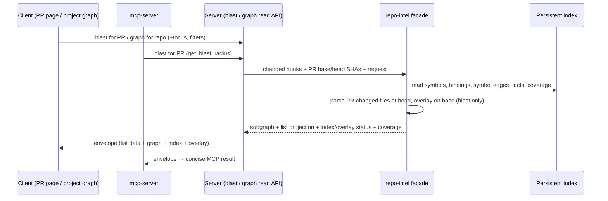

# Spec: Dependency graph, PR impact graph and project graph (Blast Radius v2)   |   Spec ID: SPEC-18   |   Status: draft
Supersedes: the "changed symbols", "caller resolution" and "2-hop reverse-import impact" decisions of [07-blast-radius.md](07-blast-radius.md). SPEC-07 stays as-is, as the history of v1; nothing in it is rewritten.

> Scope note: this spec is wide on purpose (index, blast radius, two views,
> MCP). It is one feature because every part reads the same graph, and a view
> built on top of the v1 index would only make the v1 errors more visible.
> `implementation-planner` should still plan it in phases. A sensible cut:
> index v3 + coverage metrics, then blast v2 + migrating existing consumers,
> then the PR impact graph, then the project graph. Each phase is shippable
> on its own.

## Problem & Motivation

The user's words: "I want to do the blast radius feature properly: build a
dependency graph and a graph of the project, because right now it works
so-so."

v1 (SPEC-07) shipped a list-style Blast Radius card, `GET /pulls/:id/blast`
and MCP `get_blast_radius`. All three read the `repo-intel` persistent index.
The index is built from two independent passes. One is a name-based reference
scan (`server/src/adapters/astgrep/index.ts`, `parseReferences`). The other is
a dependency-cruiser file graph (`server/src/adapters/depgraph/index.ts`).
They are joined by name in one SQL step (`repo-intel/repository.ts`,
`resolveReferences`). Blast radius then treats every symbol declared in a
changed file as "changed" (`repo-intel/service.ts`, `tryPersistentBlast`) and
adds a fixed 2-hop reverse file walk (`reverseImportImpact`, `BFS_DEPTH = 2`).

### Measured on this repository (evidence)

The current adapters were run in memory on this repo (861 tracked TS/JS
files, 2953 symbols), and the `resolveReferences` SQL was reproduced.
**Caveat:** this is one repo (n=1), and import bindings stand in for ground
truth. Treat the numbers as an order of magnitude, not a benchmark.

| # | Finding | Number | Root cause in v1 |
|---|---|---|---|
| M1 | Reported "changed symbols" whose line range intersects a diff hunk, over the last 10 commits | 228 / 1086 (21%); median per commit 34% | every symbol declared in a changed file counts as changed |
| M2 | In-repo **value** import bindings that produce any resolved reference | 943 / 2574 (37%) | name-join requires a direct edge to a file that itself declares the name |
| M3 | In-repo **type** import bindings that produce any resolved reference | 0 / 1239 (0%) | type usages are never recorded as references |
| M4 | Resolved references naming a symbol that is *not* an import binding of the referencing file | 445 / 2681 (17%) | member calls `x.get()` keep only the rightmost name, which collides with any imported file that exports `get` |
| M5 | In-repo import bindings where no directly imported file exports that name | 2670 / 3813 (70%) | barrels/re-exports, aliased and default imports, missing edges, non-indexed symbol kinds |
| M6 | Symbol kinds indexed | function, method, class, interface, type | exported consts/variables (zod schemas, config, constants) and enums are not symbols |
| M7 | File graph edges vs import sources | 1385 edges vs 1580 relative + 646 alias (`@/…`, `@devdigest/…`) sources; 57 alias-only files have zero edges; per-package tsconfig changed nothing (1376) | adapter looks only for a root `tsconfig.json` and turns every failure into an empty edge list |
| M8 | Shape of the result | file-level, untyped edges; depth fixed at 2; list card only; no project view; only `.ts/.tsx/.js/.jsx/.mjs/.cjs` | n/a |

The practical effect: the card over-reports what changed (M1) and
under-reports who depends on it (M2, M3, M5, M7). Of what it does report, a
noticeable share is wrong (M4). An empty or thin list can't be told apart from
an index that failed to resolve anything (M7, silent `[]`). There is no way to
see the shape of the impact or of the project at all (M8).

### Who else reads the same index (must not regress)

Verified by grepping `repoIntel.*` call sites in `server/src/modules`:

| Consumer | Facade read | What it shows |
|---|---|---|
| Blast Radius card + `GET /pulls/:id/blast` (`modules/blast`) | `getBlastRadius`, `getIndexState` | list of changed symbols → callers → endpoints/crons |
| MCP `get_blast_radius` (`mcp-server/src/tools/get-blast-radius.ts`) | via `GET /pulls/:id/blast` | same list, local `Raw…` mirror types, VERBATIM tool description |
| PR Brief facts (`modules/brief/facts.ts`, own local `RepoIntelBlastResult` port in `brief/ports.ts`) | `getBlastRadius` (raw `BlastResult`, not the HTTP shape; see `server/LEARNINGS.md` "brief reads `BlastResult` directly") | blast facts for the Why/Risk brief |
| Review prompt callers digest (`modules/reviews/run-executor.ts`) | `getCallerSignatures` | caller signatures section in the reviewer prompt |
| Phantom-API gate | `getUnresolvedReferences` (`references.decl_file IS NULL`) | unresolved-reference grounding |
| Onboarding tour (`modules/onboarding`) | `getCriticalPaths`, `getWeightedRankedFiles`, `getFileFacts` | reading path from the file graph + rank |
| Conventions samples, repo-map, review file rank | `getConventionSamples`, `getRepoMap`, `getFileRank` | rank-driven selection |

All of them depend on the edges, references or rank that this spec changes.

## Goals / Non-goals

**Goals**

1. Bindings resolve, names don't. A reference becomes an edge to a symbol
   only through an import binding of the referencing file, or a local
   declaration in that file. Name collisions can no longer produce edges.
2. One source of truth for dependencies. Imports and exports become
   first-class indexed facts. The file graph, the symbol graph and rank are
   all derived from them.
3. Blast radius v2. "Changed" means a symbol whose declaration range
   intersects a diff hunk. The PR's changed files are parsed at the PR head
   and overlaid on the base index, so declarations added or moved in the PR
   are visible. Impact is reverse reachability over typed symbol edges, and
   it stops at entry points (HTTP endpoints, crons, pages/routes, tests). The
   result is a subgraph that keeps compile-time (type-only) and runtime
   impact apart, and it lists the test files affected.
4. An interactive PR impact graph on the PR page, with the existing list kept
   as the non-visual equivalent.
5. A repo-level project graph on a new "Graph" repository tab: edges grouped
   by directory/module, with drill-down to file and symbol, hot/high-rank
   files and import cycles.
6. Index quality you can observe. Coverage metrics are stored with the index
   state, shown as a confidence/partial banner, and guarded by a fixture-based
   regression check.
7. Every existing consumer (table above) keeps working, or is moved over
   explicitly.

**Non-goals (explicitly out)**

- Languages other than JS/TS. The existing `SUPPORTED_EXT` set stays.
- Full type-checker-based resolution: no type inference, no installed
  `node_modules`, no `tsc` program build. Only module resolution against
  tsconfig is in scope.
- An LLM summary of impact. This path stays at zero LLM calls (same as
  SPEC-07).
- Persisting per-PR blast results. They are still computed on read; the
  `pr_brief` reservation is unchanged.
- A full per-PR index. Only the PR's changed files are parsed at head, per
  request, and that overlay is never persisted (AC-25a).
- Per-repo configuration of entry-point detection. v1 of this feature ships
  fixed built-in rules (AC-27a).
- Resolving members through values whose type is not visible from an import
  binding (e.g. `deps.repo.get()` where `deps` is an untyped parameter). These
  stay unresolved, by design (Design direction §6).
- Cross-repo dependency graphs.

## User stories

- **US-1** As a reviewer, I want "changed symbols" to be only the
  declarations the diff actually touches, including declarations the PR adds
  or moves, so that the impact list isn't padded with untouched neighbours
  from the same file and doesn't miss new code.
- **US-2** As a reviewer, I want every caller and dependent shown to be a
  real dependency, reached through an actual import or local declaration, so
  that I can trust each entry without checking it by hand.
- **US-3** As a reviewer, I want to see impact through re-exports, barrels,
  path aliases, default and renamed imports, type usages and exported
  constants, so that a thin result means low impact, not low coverage.
- **US-4** As a reviewer, I want blast radius to follow the dependency chain
  up to entry points (endpoints, crons, pages, tests), and to tell runtime
  impact apart from type-only impact, so that I know which user-facing
  surfaces and tests are at risk.
- **US-5** As a reviewer, I want an interactive graph of a PR's impact on the
  PR page, so that I can see how the change propagates instead of reading a
  flat list.
- **US-6** As a developer new to a repo, I want a project graph page grouped
  by directory/module, with drill-down, hot files and cycles, so that I can
  understand the architecture and spot structural problems.
- **US-7** As any user of these views, I want an explicit confidence/partial
  indicator with coverage numbers, so that I can tell "no impact" from "the
  index couldn't resolve this".
- **US-8** As a keyboard or screen-reader user, I want a non-visual
  equivalent of both graphs, so that the information isn't locked inside a
  canvas.
- **US-9** As an MCP client (e.g. Claude Code) and as the PR Brief and review
  pipeline, I want the existing blast-radius consumers to keep working on the
  better data, so that the improvement reaches every surface without breaking
  any of them.
- **US-10** As a maintainer, I want index-format changes to trigger a
  controlled re-index and a regression check on coverage numbers, so that
  index quality can't silently decay.

## Acceptance criteria (EARS)

### Index: imports, exports, symbols (US-2, US-3, US-10)

- **AC-1** The system shall index, for every import in a supported file:
  the local binding name, the imported name (including `default` and
  namespace `*`), the module specifier, and whether the import is type-only
  (declaration-level or per-specifier `type`). *Verify: index the fixture;
  import facts for a file with `import type`, `import { type X }`,
  `import X from`, `import * as ns`, `import { a as b }` match the expected
  table exactly.*
- **AC-2** The system shall index, for every file, its exports: local
  declarations exported by name or default, `export { a as b }`,
  `export { x } from '…'` and `export * from '…'` (re-export facts keep their
  specifier).
- **AC-3** The system shall index exported `const`/`let`/`var` declarations
  and `enum` declarations as symbols, in addition to the v1 kinds (function,
  method, class, interface, type).
- **AC-4** WHEN a specifier is resolved, the system shall use the module
  resolution rules of the nearest applicable tsconfig for that file
  (including `baseUrl`, `paths` and `extends` chains inside the clone). Where
  no tsconfig applies, it shall use default Node/TS resolution rules. It
  shall not require `node_modules` to be installed in the clone and shall not
  type-check. *Verify: on the fixture, alias imports resolve in a package
  whose tsconfig is not at the repo root.*
- **AC-5** IF a specifier cannot be resolved to an in-repo file and is not a
  recognised external package or Node built-in, THEN the system shall record
  it as an unresolved specifier (file, specifier, reason) and count it in the
  coverage metrics. It shall never turn the failure into "this file has no
  dependencies". *Verify: a fixture import of a missing relative file appears
  in the unresolved list; the importing file's other edges are still
  present.*
- **AC-6** IF tsconfig loading fails for a package (malformed JSON, broken
  `extends`), THEN the system shall record that failure in the index state,
  fall back to default resolution for that package's files, and mark the
  index `partial`. The rest of the repo shall not be affected.
- **AC-7** The system shall derive the file-level import graph only from the
  indexed, resolved imports (AC-1, AC-4). No second, independent graph
  computation shall feed edges, rank or blast radius.
- **AC-8** WHEN an import binding refers to a name re-exported through one or
  more `export … from` / `export *` hops, the system shall resolve the
  binding to the declaring symbol by following the chain. It shall stop
  without error on cycles and record the binding as unresolved (reason:
  cycle) if no declaration is reached.

### Index: symbol edges (US-2, US-3)

- **AC-9** The system shall record symbol→symbol edges with a kind drawn from
  the closed set {`call`, `type`, `value`, `extends`, `implements`,
  `re-export`} and a confidence drawn from {`exact`, `inferred`}.
- **AC-10** The system shall attribute each edge to the source symbol whose
  declaration line range most tightly encloses the reference. A reference
  outside any declaration shall be attributed to a file-level (module scope)
  pseudo-symbol of that file, not dropped.
- **AC-11** The system shall create an `exact` edge only when the reference
  name is a local import binding of the referencing file (resolved via AC-8)
  or a declaration in the same file. A name that is neither shall produce no
  edge.
- **AC-12** WHEN a reference is a member call or member access `x.m` and `m`
  is a method of exactly one class or interface whose binding is imported
  into (or declared in) that file, the system shall create an `inferred`
  edge to that method. IF zero or more than one such method exists, THEN the
  system shall leave the reference unresolved.
- **AC-13** The system shall record type-position references (annotations,
  generics, `satisfies`, `implements`/`extends` clauses, type-only imports) as
  `type`/`extends`/`implements` edges, kept apart from runtime
  (`call`/`value`) edges.

### Index: lifecycle and quality (US-7, US-10)

- **AC-14** The system shall store with each repo's index state: the indexer
  version, the coverage metrics (at least: share of in-repo import bindings
  resolved to a declaring symbol, split value/type; unresolved specifier
  count; tsconfig failures count; share of symbol edges that are `inferred`),
  and the indexed commit SHA. *Verify: `GET` on the index state returns these
  fields after an index run.*
- **AC-15** WHEN the indexer version shipped by this feature differs from a
  repo's stored indexer version, the system shall schedule a full re-index of
  that repo. (The version must be bumped from the current `INDEXER_VERSION =
  2`.)
- **AC-16** WHILE a repo's stored index predates the current indexer version
  or a re-index is queued or running, every graph and blast response for
  that repo shall carry a `reindexing` state (a separate field, AC-16a)
  together with re-index progress (files processed / files total, where
  known). It shall return no graph or blast data built from the old-format
  index: old-format data has no symbol edges and shall not be served, even
  marked as stale. The existing degraded "no index" fallback of v1 is not
  used while `reindexing` either. *Verify: with a stored indexer version of
  2, the blast and graph reads return `reindexing` with progress and contain
  no nodes, edges, changed symbols or callers.*
- **AC-16a** The system shall expose the reindexing state with its progress,
  the low-confidence flag (AC-32), the stale-overlay flag (AC-25b) and the
  overlay-degraded flag (AC-25f) as separate fields. It shall not add new
  values to the existing v1 `IndexStatus` or `DegradedReason` sets, so that
  every existing `getIndexState` reader keeps its behaviour.
- **AC-17** WHILE indexing, the system shall stay inside the existing repo-intel
  budgets (`MAX_INDEXED_FILES` 5000, `MAX_FILE_SIZE` 400 KB,
  `MAX_PARSE_MS_PER_FILE` 2000 ms, `INDEX_SOFT_BUDGET_MS` 110 s under the
  JobRunner's 120 s hard limit). IF a budget is exceeded, THEN it shall finish
  as `partial` with the reason recorded, the same way v1 does.
- **AC-18** WHEN incremental re-indexing processes changed files, the system
  shall also re-resolve the bindings and edges of files whose resolution
  depends on them (importers of a changed file's exports, including through
  re-export chains). A file rename or deletion shall leave no edge pointing at
  a path that no longer exists.

### Measurable quality gates on the fixture (US-1, US-2, US-3, US-10)

The fixture is a committed, versioned, synthetic test repository containing
every construct named in AC-1…AC-13. The thresholds in AC-19…AC-23 are
normative and gate the test run (AC-24). The v1 baseline from M1–M7 is shown
for contrast. The live repository changes with every commit, so it cannot be
a stable threshold. It is measured by the non-gating report of AC-24a.

- **AC-19** The system shall resolve ≥ 95% of the fixture's in-repo **value**
  import bindings to a declaring symbol (v1 proxy: 37%, M2).
- **AC-20** The system shall resolve ≥ 95% of the fixture's in-repo **type**
  import bindings to a declaring symbol and record ≥ 1 `type` edge for each
  binding that is used (v1: 0%, M3).
- **AC-21** The system shall produce 0 `exact` edges whose target name is
  neither an import binding nor a local declaration of the source file (v1:
  17% of resolved references, M4).
- **AC-22** The system shall produce at least one file edge for every fixture
  file that imports an in-repo module only through a path alias (v1: 57 such
  files on this repo had zero edges, M7).
- **AC-23** WHEN blast radius is computed for each scripted fixture diff,
  ≥ 95% of the reported changed symbols shall have a declaration range that
  intersects a diff hunk (v1 proxy: 21%, M1), and 100% of the expected
  impacted symbols listed for that diff shall be reported.
- **AC-24** IF any of AC-19…AC-23 regresses below its threshold, THEN the
  regression check shall fail the module's test run. *Verify: a deliberately
  broken resolver variant makes the check fail.*
- **AC-24a** The repository shall contain a report script that reproduces the
  M1, M2, M3, M4 and M7 measurements on this repository and prints them next
  to their v1 values. The report is non-gating: it fails no test run and no
  CI job (user decision, 2026-11-18).

### Blast radius v2 (US-1, US-4, US-7)

- **AC-25** WHEN blast radius is requested for a PR, the system shall treat as
  changed exactly those symbols whose declaration line range intersects a
  diff hunk of that PR: head-side hunks against the declarations of the PR's
  changed files parsed at the PR head SHA (AC-25a), and base-side hunks of
  removed lines against the declarations of those files in the persistent
  index.
- **AC-25a** The persistent index is built on the repo's default branch. WHEN
  blast radius is requested for a PR, the system shall parse the PR's
  changed supported files at the PR head SHA and overlay them on the
  persistent index for that request only: their symbols, bindings and edges
  replace those files' indexed entries, and the overlay is never written to
  the persistent index. Files are read from git objects at the head SHA,
  without changing the clone's working tree.
- **AC-25b** The system shall include in every blast response the indexed
  (base) SHA and the PR head SHA used for the overlay. WHERE the indexed SHA
  differs from the PR's base SHA, the response shall set a `staleOverlay`
  flag, so the client can tell that unchanged files were read from a
  different commit.
- **AC-25c** WHEN a symbol is declared in the PR head but not in the
  persistent index (added, or moved from another file or location), the
  system shall report it as a changed symbol. *Verify: a fixture diff that
  adds a new exported function reports that function as changed.*
- **AC-25d** The system shall compute every edge that originates in a
  PR-changed file from that file's head content. Its bindings shall resolve
  against the overlay for other PR-changed files and against the persistent
  index for unchanged files.
- **AC-25e** WHEN a PR deletes a file or a symbol, the system shall report
  each deleted symbol as a changed node marked `deleted` (from the persistent
  index), report its dependents in the persistent index as impacted, and keep
  no head-side edge that targets a deleted symbol or path.
- **AC-25f** The overlay shall apply the same per-file limits as indexing
  (`MAX_FILE_SIZE` 400 KB, `MAX_PARSE_MS_PER_FILE` 2000 ms). IF a changed
  file exceeds a limit, cannot be read at the head SHA, or cannot be parsed,
  THEN the system shall use only the persistent-index facts for that file
  (base-only), list the file in the response, and set an `overlayDegraded`
  flag. The request shall not fail because of it.
- **AC-26** WHEN a changed file has hunks that intersect no declaration (e.g.
  module-scope statements, imports), the system shall treat that file's
  module-scope pseudo-symbol as changed. A changed file shall never yield
  zero changed nodes.
- **AC-27** The system shall compute impact as reverse reachability over
  symbol edges from the changed symbols. It shall stop expanding a path at
  an entry point (AC-27a) or after 6 symbol hops. A depth requested by the
  caller shall be clamped to 1…6; with no requested depth, the limit is 6.
- **AC-27a** The system shall recognise entry points by these fixed built-in
  rules, with no per-repo configuration: (a) files carrying an existing HTTP
  endpoint or cron fact; (b) Next.js app-router `page`, `route` and `layout`
  files (`app/**/page.*`, `app/**/route.*`, `app/**/layout.*`, any supported
  extension); (c) test files (`*.test.*`, `*.spec.*`, and files under a
  `__tests__/` directory).
- **AC-28** The system shall return the blast result as a subgraph: nodes
  (symbol, file, kind, role ∈ {changed, impacted, entry-point}, depth) and
  edges (source, target, edge kind, confidence), plus the list of affected
  test files and affected entry points.
- **AC-29** The system shall mark each impacted node as `runtime` when it is
  reached through at least one path made only of runtime edges, and as
  `type-only` otherwise.
- **AC-30** WHERE type-only impact is disabled by the request, the system
  shall exclude nodes reached only through `type`/`extends`/`implements`
  edges from the result. Type-only impact shall be included by default for
  the HTTP read and the UI, where it is shown as secondary (AC-41, AC-46). It
  shall be excluded by default in MCP `get_blast_radius`, where the caller
  can opt in.
- **AC-31** IF the reachable subgraph exceeds the node or edge cap, THEN the
  system shall return a truncated subgraph that keeps all changed nodes and
  all reached entry points first, and shall set an explicit `truncated`
  flag with the untruncated counts.
- **AC-32** The system shall include in every blast response the index status,
  indexer version, indexed SHA and the coverage metrics from AC-14. WHERE the
  share of in-repo value import bindings resolved to a declaring symbol is
  below 80%, the response shall set a `lowConfidence` flag (AC-16a). 80% is
  the default cut-off; the plan may tune it with evidence.
- **AC-33** The system shall compute blast radius from the persistent index
  plus the head overlay of AC-25a only. On the request path it shall parse
  nothing but the PR's changed supported files, within the existing per-file
  budgets (`MAX_FILE_SIZE`, `MAX_PARSE_MS_PER_FILE`, see AC-25f). The existing
  documented "no index at all" degraded fallback stays as the only other
  exception.

### Existing consumers (US-9)

- **AC-34** WHEN `GET /pulls/:id/blast` is called by an existing client, the
  response shall still validate against the current `BlastRadius` contract
  (`changed_symbols`, `downstream[]` with `callers`, `endpoints_affected`,
  `crons_affected`) inside the existing status envelope. New data shall be
  additive (new optional fields, or a new endpoint).
- **AC-35** The system shall make the same contract change in both
  `vendor/shared` copies (server and client). A contract-drift check between
  them shall pass for every type this spec touches.
- **AC-36** WHEN MCP `get_blast_radius` is called, it shall return the
  existing fields, filled from v2 data, plus the affected entry points and
  test files. It shall exclude type-only impact unless the caller explicitly
  asks for it (AC-30). Any change to its VERBATIM description shall be a
  single deliberate edit that is called out in review.
- **AC-37** WHEN the PR Brief builds its blast facts, it shall receive v2
  changed symbols and callers through its existing local port shape. The
  brief's grounding of blast citations shall keep passing.
- **AC-38** WHEN the review run builds the callers digest, it shall use v2
  edges (caller signatures of symbols actually changed per AC-25), and stay
  within its existing row limit and token budget.
- **AC-39** The system shall keep `getUnresolvedReferences` (phantom gate),
  `getCriticalPaths`, `getWeightedRankedFiles`, `getFileRank`, `getRepoMap`
  and `getConventionSamples` working on the v3 index. Their existing tests
  shall pass, with only fixture expectations updated where the better graph
  legitimately changes the answer (each such change listed in the plan).

### PR impact graph view (US-5, US-7, US-8)

- **AC-40** WHEN a user opens a PR whose repo has a usable index, the PR page
  shall offer an interactive impact graph of the AC-28 subgraph next to the
  existing Blast Radius list, with changed, impacted and entry-point nodes
  visually distinct.
- **AC-41** The impact graph shall draw `inferred` edges differently from
  `exact` edges, and shall draw `type-only` nodes and edges as visually
  secondary to `runtime` ones. It shall show a legend explaining every visual
  encoding used.
- **AC-42** WHEN a user selects a node, the view shall show its symbol, file,
  kind, role and depth. It shall offer a link to the exact `file:line` at the
  PR head on GitHub (same link pattern as the v1 card) and highlight the
  paths connecting it to the changed symbols.
- **AC-43** The impact graph shall support pan, zoom, fit-to-view, a filter
  for type-only impact (AC-30) and a filter that hides `inferred` edges.
- **AC-44** WHILE the blast response is loading, the view shall show a loading
  state. WHILE the response carries the `reindexing` state (AC-16), the view
  shall show a re-indexing state with the reported progress and no graph. IF
  the request fails, THEN the view shall show an error state with retry. IF
  the subgraph has no impacted nodes, THEN it shall show an empty state that
  says whether coverage was full or low-confidence.
- **AC-45** WHERE the response is `truncated`, `partial`, `staleOverlay`,
  `overlayDegraded` or `lowConfidence`, the view shall show a non-blocking
  banner naming each condition and the coverage numbers.
- **AC-46** The system shall keep the list form of the same data (the Blast
  Radius card, extended with entry points, tests and the runtime/type-only
  distinction) available and keyboard-operable as the non-visual equivalent
  of the impact graph.

### Project graph view (US-6, US-7, US-8)

- **AC-46a** The project graph shall live in a new repo tab named "Graph",
  next to the existing repo tabs. It shall not depend on the onboarding tour.
- **AC-47** WHEN a user opens a repo's project graph page, the system shall
  show the file graph grouped by directory at the top level, with each
  aggregate edge weighted by the number of underlying file edges.
- **AC-48** WHEN a user expands a directory node, the view shall replace it
  with its child directories and files. WHEN a user opens a file, it shall
  show that file's symbols and their in/out symbol edges.
- **AC-49** The project graph shall show hot/high-rank files (rank and,
  where available, change hotness) distinctly, and shall list import cycles
  (strongly connected components of size > 1 at file level) with their member
  files.
- **AC-50** The project graph page shall show the index status, indexed SHA
  and coverage metrics of AC-14, including the unresolved-specifier list
  (paged).
- **AC-51** The project graph page shall provide a non-visual equivalent: a
  navigable directory/file table with in/out edge counts, rank and cycle
  membership, reachable by keyboard.
- **AC-52** WHILE the repo has no usable index, the page shall show an empty
  state that explains why (never indexed, re-indexing with progress per
  AC-16, failed) instead of an empty canvas.

### Graph read API bounds (US-5, US-6)

- **AC-53** Every graph read response shall be bounded by a node cap and an
  edge cap, and shall support level-of-detail (directory aggregation) and/or
  pagination, so that a repo at `MAX_INDEXED_FILES` never produces an
  unbounded payload.
- **AC-54** IF a request names a directory, file or symbol that is not in the
  repo's index, THEN the system shall respond with a not-found error, not an
  empty graph.

## Edge cases

| Case | Handled means |
|---|---|
| PR deletes a file / symbol | Deleted declarations are changed nodes marked `deleted`; their dependents are impacted (AC-25e). |
| PR adds a file / symbol | Parsed at head via the overlay; new symbols are changed (AC-25a, AC-25c). |
| PR moves a symbol to another file | Head-side declaration is changed (AC-25c); the old declaration is deleted (AC-25e); importers of the old location are impacted. |
| Changed file too large, unparseable or unreadable at head | Base-only facts for that file, file listed, `overlayDegraded` set (AC-25f). |
| Requested depth 0, negative or above 6 | Clamped to 1…6 (AC-27). |
| PR renames/moves a file | Treated as delete + add; importers of the old path are impacted. |
| PR only touches non-code files (md, json, lockfile) | Empty impact with an explicit "no supported files changed" reason, not a failure. |
| Changed lines are only imports / module-scope code | Module-scope pseudo-symbol is changed (AC-26). |
| Barrel `index.ts` with `export *` from many files | Bindings resolve through the chain (AC-8); a name exported by two `export *` sources is ambiguous → unresolved, counted. |
| Re-export cycle (`a` re-exports `b` re-exports `a`) | Terminates, unresolved with reason `cycle` (AC-8). |
| Import cycle between files | Reverse reachability terminates (visited set). The cycle shows in the project graph (AC-49). |
| Namespace import `ns.fn()` | Resolves `fn` among `ns`'s target exports. That is an `exact` edge, not a member-call inference. |
| Dynamic `import('…')` / `require('…')` with a literal specifier | Indexed as an import (runtime). Non-literal specifier: unresolved, counted. |
| Default export of an anonymous function/class | Symbol named after the file's default export; importers' local names bind to it. |
| Declaration merging / overloads (same name twice in a file) | One logical symbol; edges target it once. |
| Monorepo: several packages, each with its own tsconfig, no root tsconfig | Nearest tsconfig per file (AC-4), the M7 case. |
| tsconfig `extends` an npm package not installed / outside the clone | Record failure, default resolution for that package, `partial` (AC-6). Never read outside the clone. |
| Symlink inside the clone pointing outside it | Not followed. The target is treated as unresolved. |
| `.d.ts` files | Type-only declarations: `type` edges only. |
| Very hot symbol (thousands of dependents) | Truncation keeps changed nodes and entry points (AC-31), `truncated` flag set. |
| Index at a different commit than the PR base | Changed files come from the head overlay (AC-25a). The response reports both SHAs and the base mismatch (AC-25b). |
| PR head commit not present in the clone | Fetch it before the overlay. If it still cannot be read, every changed file degrades to base-only facts and `overlayDegraded` is set (AC-25f). |
| Re-index queued/running, or index predates the indexer version | `reindexing` state with progress, no data (AC-16). The views show the re-indexing state (AC-44, AC-52). |
| Index `failed` | Blast falls back to the existing degraded path. The graph views show the failed empty state (AC-52). |
| Two tabs / repeated requests | Reads are side-effect free and idempotent. |

## Non-functional

- **Indexing cost:** a full index of a repo at the fixture size and of this
  repository (≈860 files) completes within `INDEX_SOFT_BUDGET_MS` (110 s) on
  the dev machine. Beyond that it ends `partial` (AC-17), never failing the
  job.
- **Read latency:** P95 of a blast or graph read for a repo of this
  repository's size stays under 1 s for a project graph read and under 2 s
  for a blast read of a PR with up to 50 changed files (the head overlay of
  AC-25a included). Measured on the dev machine with a warm database. These
  are defaults; the plan may tune them with evidence.
- **Payload bounds:** no graph response exceeds the node/edge caps (AC-53).
  Cap values belong to the plan, but must be stated there as numbers.
- **Security / path containment:** every path accepted by a graph endpoint
  (directory, file, symbol id) is checked to be repo-relative and normalised,
  with no absolute paths, no `..` segments and no NUL bytes, and to exist in
  the index (AC-54). Module resolution and tsconfig `extends` never read a
  file outside the repo's clone directory, and symlinks are not followed out
  of it. Overlay paths come from the PR's changed-file list and get the same
  containment check.
- **Security / rendering:** symbol names, file paths, specifiers and tsconfig
  values are rendered in both views and the MCP output as plain text. They
  are never HTML, markdown that gets executed, or URL schemes other than the
  GitHub blob link built by the existing helper.
- **Accessibility:** both graphs have a keyboard-operable non-visual
  equivalent (AC-46, AC-51). Visual encodings (changed/impacted/entry,
  exact/inferred, runtime/type-only) are not conveyed by colour alone. State
  changes (loading → loaded, banner) are announced via a live region.
- **Cost:** zero LLM calls on every path in this spec.

## Inputs (provenance)

| Input | Provenance |
|---|---|
| Repository file contents at the indexed SHA | `[deterministic: git clone under server/clones, via existing repo-intel walk]` |
| tsconfig files (per package, incl. `extends` chains inside the clone) | `[deterministic: clone contents]` |
| Imports / exports / symbols / symbol edges | `[deterministic: AST parse at index time, new indexed facts]` |
| File graph, rank, cycles | `[deterministic: derived from indexed imports]` (replaces the dependency-cruiser pass) |
| Endpoint / cron facts | `[reused: L04 repo-intel file facts]` |
| Hotness (change frequency) | `[reused: L04 repo-intel hotness window]` |
| PR changed files and diff hunks | `[deterministic: PR diff already fetched for the PR page / smart diff]` |
| Contents of the PR's changed files at the PR head SHA (overlay) | `[deterministic: git objects at the head SHA, parsed per request, not persisted]` |
| PR base and head SHAs (overlay, stale check, GitHub links) | `[reused: existing PR metadata]` |
| Index state + coverage metrics | `[deterministic: computed at index time]` |
| Impact summary text | none: `[new: 0 LLM calls]` |

## Untrusted inputs

- **Repository contents** (source files, tsconfig files, file and directory
  names, symbol names, import specifiers) are attacker-controllable for any
  imported repo. They are treated as data. They are never executed, never
  `require`d or evaluated (tsconfig is parsed, not loaded as code), never
  interpolated into a shell command, and never followed outside the clone
  (path containment above).
- **PR head contents** read for the overlay (AC-25a) may come from a fork and
  are equally untrusted. They are parsed as data under the same rules and
  per-file limits (AC-25f), and never written into the persistent index.
- **Request parameters** of the graph/blast endpoints (repo id, PR id,
  directory/file/symbol identifiers, depth, filters) are validated by schema
  before use. Depth is clamped to 1…6 (AC-27).
- **Labels** derived from the above are rendered as text in the client and the
  MCP output (Non-functional → rendering).
- **Caller signatures in the review prompt** (AC-38) are repository text that
  reaches an LLM. They stay inside the existing prompt section governed by
  the shared injection guard, as data and never as instructions. This spec
  adds no new path from repository text into a prompt.

## Contract shape (cross-module, what crosses the boundary)

Non-normative shape. Field names are for the plan to finalise. Both
`vendor/shared` copies carry it. `IndexStatus` and `DegradedReason` are not
extended (AC-16a).

- **Blast v2 (server → client, server → mcp-server):** the existing envelope
  `{ status, degradedReason?, data: BlastRadius }`, extended additively with
  `reindexing?: { state, processed?, total? }`,
  `index: { indexerVersion, indexedSha, coverage{…}, lowConfidence }`,
  `overlay: { baseSha, headSha, staleOverlay, overlayDegraded, degradedFiles[] }`
  and `graph: { nodes[], edges[], entryPoints[], tests[], truncated?, totals? }`.
  `data` keeps validating against the current `BlastRadius` (AC-34). When
  `reindexing` is present, no data is returned (AC-16).
- **Project graph (server → client):** a level-of-detail read keyed by
  repo + optional directory/file/symbol focus, returning
  `{ level, nodes[], edges[], cycles[], index{…}, reindexing?, truncated?, page? }`.
- **Index state (server → client):** existing index-state read gains the
  coverage metrics (AC-14) and the separate reindexing fields (AC-16a).

## Design direction (non-normative, for implementation-planner)

These are settled directions the user already chose. They are recorded here
so the plan does not re-litigate them. They are not acceptance criteria, and
the plan owns every concrete choice.

1. Principle: names are not resolved, bindings are.
2. Specifier resolution uses TypeScript's module-resolution API only (no
   program/type-check), per file with the nearest tsconfig, working without
   `node_modules`.
3. The file graph derives from indexed imports. The separate
   dependency-cruiser pass in the indexer is removed. (Whether the
   `DepGraph` port/adapter is deleted or reimplemented is for the plan.)
4. Exports are followed to the declaring symbol through re-export chains,
   cycle-safe.
5. Symbol edges carry kind + confidence. The source symbol is the enclosing
   declaration by line range. Exported const/variable/enum become symbols.
6. Member calls `x.method()` resolve only among methods of classes/interfaces
   imported into that file, marked `inferred`, because this codebase calls
   repositories through injected instances. Otherwise they stay unresolved.
7. Blast = reverse reachability from hunk-intersecting symbols, stopping at
   entry points; subgraph output; runtime vs type-only.
8. Project graph = the same edges aggregated by directory, with drill-down.
9. Coverage metrics stored with index state, plus a fixture regression check.
10. Index-format change ⇒ `INDEXER_VERSION` bump + re-index. Schema changes go
    in new migrations only. Mind the migration-journal `when` ordering hazard
    in [plans/17-hardening.md](../plans/17-hardening.md) (R2 / H5): a new
    migration whose journal `when` is earlier than an already-applied one is
    silently skipped.
11. Graph rendering: React Flow (`@xyflow/react`) with `elkjs` layout, chosen
    by the user. The plan checks current versions and licences. The ACs stay
    library-neutral and state only the interaction requirements
    (AC-40…AC-51).
12. Suggestion (not a decision): draw `inferred` edges dashed and type-only
    edges in a lighter weight, and place the impact graph as a toggle
    ("List | Graph") inside the existing Blast Radius card rather than as a
    new tab, to keep SPEC-07's Overview layout.
13. Node/edge caps are numbers the plan must state (AC-31, AC-53).
14. Overlay (AC-25a…AC-25f): the astgrep adapter already exports
    `parseChangedFiles`, a natural starting point for parsing the PR's
    changed files at head.

## Decisions (resolved clarifications, 2026-11-18)

| # | Question | Decision | Where |
|---|---|---|---|
| 1 | Traversal depth | Stop at entry points; hard max 6 symbol hops; request depth clamped 1…6 | AC-27 |
| 2 | Type-only impact default | On in HTTP/UI (secondary), off in MCP (opt-in) | AC-30 |
| 3 | Behaviour during re-index | `reindexing` + progress, no old-format data | AC-16 |
| 4 | Index SHA vs PR SHAs | Overlay: base index on default branch; PR changed files parsed at head and overlaid per request; both SHAs returned; base-only with `overlayDegraded` when a changed file can't be parsed | AC-25, AC-25a…AC-25f, AC-33 |
| 5 | Entry-point rules | Built-in: endpoint/cron facts; app-router page/route/layout; `*.test.*`/`*.spec.*`/`__tests__`. Not configurable per repo (non-goal) | AC-27a |
| 6 | Fixture thresholds | 95% / 0 / 100% on the synthetic fixture (gating); M1–M7 on this repo as a non-gating report script | AC-19…AC-24a |
| 7 | Low-confidence cut-off | Value-binding resolution < 80% (default; plan may tune with evidence) | AC-32 |
| 8 | Caps and latency | Caps: numbers stated in the plan. Latency: P95 < 1 s graph, < 2 s blast (≤ 50 changed files); defaults, plan may tune with evidence | Non-functional, Design direction §13 |
| 9 | Project graph navigation | New repo tab "Graph" | AC-46a |
| 10 | `IndexStatus`/`DegradedReason` | Separate fields for reindexing / low-confidence / stale-overlay / overlay-degraded; v1 sets unchanged | AC-16a |
| 11 | Visualisation library | React Flow (`@xyflow/react`) + `elkjs` | Design direction §11 |

Decisions 1, 2 (MCP part), 5, 6 and 7 are defaults the user accepted without
objecting rather than choices they confirmed explicitly; they are cheap to
change in the plan.

## [NEEDS CLARIFICATION: …]

None open. Every item raised in the first draft is resolved in the Decisions
table above.

Note for the plan (not blocking): the DevDigest MCP read tools (conventions, blast
radius, findings) were unreachable while this spec was written because the
local API was not running. House conventions and prior findings were
cross-checked only through `server/LEARNINGS.md` and the code. Re-check
through MCP once the stack is up.
